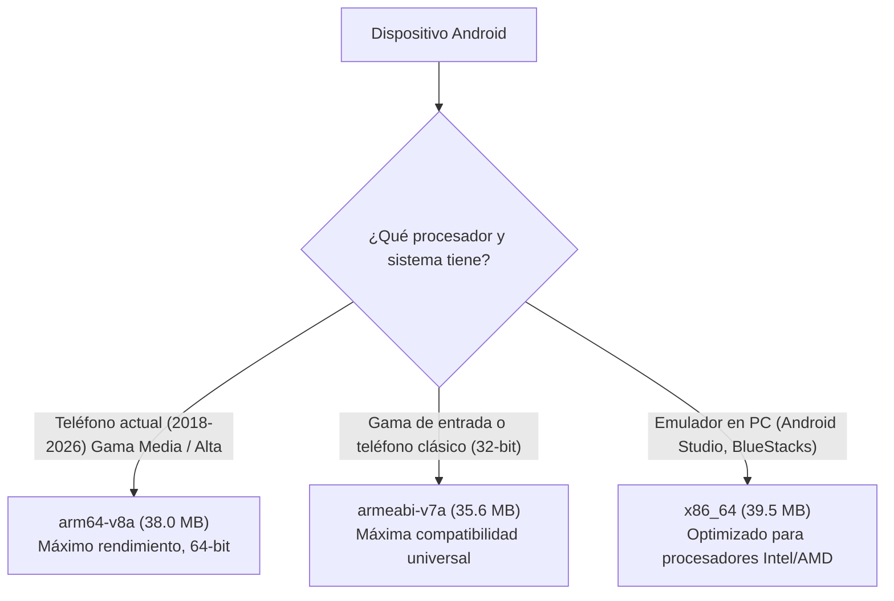

# 📱 Guía de Arquitecturas Móviles y Compatibilidad de APKs: Berea Interlineal

Esta guía técnica explica qué versión de APK instalar en cada teléfono, con énfasis en el **Samsung Galaxy A33** y el **Honor X6c**, junto a un catálogo de modelos y métodos de comprobación.

---

## 🎯 Respuesta Rápida: Tus Dispositivos

| Dispositivo | Procesador | Arquitectura | APK Recomendado (Release v1.3.1) | Alternativa Compatible |
|---|---|---|---|---|
| **Samsung Galaxy A33 5G** | Exynos 1280 (64-bit) | `arm64-v8a` | **`berea_interlineal_1.3.1_arm64-v8a.apk`** (38.7 MB) | `berea_interlineal_1.3.1_armeabi-v7a.apk` |
| **Honor X6c / X6 / X6a** | MediaTek Helio G36 / G25 | `arm64-v8a` / `armeabi-v7a`* | **`berea_interlineal_1.3.1_arm64-v8a.apk`** (38.7 MB) | **`berea_interlineal_1.3.1_armeabi-v7a.apk`** (36.3 MB) |

> [!TIP]
> **Detalle sobre el Honor X6c:**  
> El procesador del Honor X6c (MediaTek) es físicamente de 64 bits. Sin embargo, algunos fabricantes configuran los teléfonos de gama de entrada con un sistema operativo de 32 bits para ahorrar memoria RAM.  
> - Si al intentar instalar `app-arm64-v8a-release.apk` el sistema dice *"La app no es compatible con tu teléfono"*, instala directamente **`app-armeabi-v7a-release.apk`**.  
> - **`app-armeabi-v7a-release.apk` es universal** y corre en ambos casos.

---

## 🏗️ Desglose de Arquitecturas ABI



### 1. `arm64-v8a` (AArch64 - 64 bits) — **El Estándar Moderno**
* **Uso**: El 90% de los teléfonos inteligentes vendidos entre 2018 y hoy.
* **Ventajas**: Ejecuta código nativo a 64 bits, aprovecha todas las instrucciones del procesador, consume menos batería y rinde mejor en búsquedas léxicas pesadas de SQLite.
* **Ruta de archivo**: `build/app/outputs/flutter-apk/app-arm64-v8a-release.apk` (38.0 MB).

### 2. `armeabi-v7a` (ARMv7 - 32 bits) — **Compatibilidad Universal**
* **Uso**: Teléfonos de gama de entrada con 2 GB o 3 GB de RAM, teléfonos antiguos (anteriores a 2018) y sistemas con Android Go.
* **Ventajas**: Funciona en casi el **99.9%** de los teléfonos Android que existen, incluidos los que tienen procesador de 64 bits (los chips de 64 bits soportan ejecutar 32 bits en modo compatibilidad).
* **Ruta de archivo**: `build/app/outputs/flutter-apk/app-armeabi-v7a-release.apk` (35.6 MB).

### 3. `x86_64` (Intel / AMD 64-bit) — **Emuladores y PC**
* **Uso**: Emulador de Android Studio en Windows/Mac/Linux, BlueStacks, LDPlayer, tablets con procesadores Intel y computadoras con ChromeOS.
* **Ruta de archivo**: `build/app/outputs/flutter-apk/app-x86_64-release.apk` (39.5 MB).

---

## 📋 Catálogo de Modelos Compatibles por Marca

### Samsung
| Modelo / Serie | Arquitectura | APK Recomendado |
|---|---|---|
| **Galaxy A33 5G**, A34, A35, A53, A54, A55 | `arm64-v8a` | `app-arm64-v8a-release.apk` |
| **Galaxy S Series** (S20, S21, S22, S23, S24, Ultra) | `arm64-v8a` | `app-arm64-v8a-release.apk` |
| **Galaxy Note Series** (Note 10, Note 20) | `arm64-v8a` | `app-arm64-v8a-release.apk` |
| **Galaxy Z Series** (Z Flip, Z Fold) | `arm64-v8a` | `app-arm64-v8a-release.apk` |
| **Galaxy M Series** (M23, M33, M53, M54) | `arm64-v8a` | `app-arm64-v8a-release.apk` |
| **Galaxy A03 Core, A01, A10** (Modelos Android Go) | `armeabi-v7a` | `app-armeabi-v7a-release.apk` |

### Honor / Huawei
| Modelo / Serie | Arquitectura | APK Recomendado |
|---|---|---|
| **Honor X6c**, X6, X6a, X5 Plus | `arm64-v8a` / `armeabi-v7a`* | `app-arm64-v8a-release.apk` (o `armeabi-v7a`) |
| **Honor Magic Series** (Magic 4, 5, 6, Lite/Pro) | `arm64-v8a` | `app-arm64-v8a-release.apk` |
| **Honor 50, 70, 90, 200** | `arm64-v8a` | `app-arm64-v8a-release.apk` |
| **Honor X7, X8, X9 (4G / 5G)** | `arm64-v8a` | `app-arm64-v8a-release.apk` |
| **Huawei P30, P40, P50, Mate Series** | `arm64-v8a` | `app-arm64-v8a-release.apk` |
| **Huawei Y5, Y6 antiguos** | `armeabi-v7a` | `app-armeabi-v7a-release.apk` |

### Xiaomi / Redmi / POCO
| Modelo / Serie | Arquitectura | APK Recomendado |
|---|---|---|
| **Redmi Note Series** (Note 9, 10, 11, 12, 13) | `arm64-v8a` | `app-arm64-v8a-release.apk` |
| **POCO Series** (X3, X4, X5, X6, F3, F4, F5, F6) | `arm64-v8a` | `app-arm64-v8a-release.apk` |
| **Xiaomi Flagships** (Mi 11, 12, 13, 14) | `arm64-v8a` | `app-arm64-v8a-release.apk` |
| **Redmi A1, A2, A3** (Edición Go) | `armeabi-v7a` | `app-armeabi-v7a-release.apk` |

### Motorola
| Modelo / Serie | Arquitectura | APK Recomendado |
|---|---|---|
| **Moto Edge Series** (Edge 20, 30, 40, 50) | `arm64-v8a` | `app-arm64-v8a-release.apk` |
| **Moto G Series** (G52, G53, G54, G72, G84) | `arm64-v8a` | `app-arm64-v8a-release.apk` |
| **Moto E Series** (E20, E22, E32) | `armeabi-v7a` / `arm64-v8a` | `app-armeabi-v7a-release.apk` |

---

## 🔍 ¿Cómo Saber la Arquitectura Exacta de tu Teléfono?

### Método 1: Con el comando ADB (Desde la PC con el teléfono conectado)
Conecta tu teléfono con Depuración USB habilitada y ejecuta en la terminal:
```bash
adb shell getprop ro.product.cpu.abi
```
* Si devuelve `arm64-v8a` ➔ Instala `app-arm64-v8a-release.apk`.
* Si devuelve `armeabi-v7a` ➔ Instala `app-armeabi-v7a-release.apk`.

### Método 2: Con una Aplicación Gratuita
Instala desde Google Play cualquiera de estas aplicaciones:
* **AIDA64**: Menú *CPU* ➔ campo *Conjunto de instrucciones* (*64-bit ARMv8-A* o *32-bit ARMv7*).
* **CPU-Z**: Pestaña *SOC* o *System* ➔ campo *Kernel Architecture* o *Supported ABIs*.

### Método 3: La Regla Práctica de los 10 Segundos
1. Copia **`app-arm64-v8a-release.apk`** a tu teléfono e instálalo.
2. Si se instala y abre correctamente: ¡listo! Tienes el máximo rendimiento nativo de 64 bits.
3. Si el instalador de Android muestra *"No se puede instalar la aplicación porque no es compatible con tu procesador"*, simplemente instala **`app-armeabi-v7a-release.apk`**.

---

## 🚀 Cómo Instalar el APK en tu Dispositivo

### Opción A: Por Cable USB mediante ADB (Instalación Directa)
```bash
# 1. Verificar que el teléfono está reconocido
adb devices

# 2. Instalar el APK de 64 bits (Galaxy A33 o Honor X6c si es de 64 bits)
adb install -r "build/app/outputs/flutter-apk/app-arm64-v8a-release.apk"

# O para dispositivos de 32 bits:
adb install -r "build/app/outputs/flutter-apk/app-armeabi-v7a-release.apk"
```

### Opción B: Pasando el APK al Teléfono
1. Conecta el teléfono a la PC mediante cable USB en modo **Transferencia de archivos (MTP)** o envíatelo por **Telegram / Google Drive / WhatsApp**.
2. Copia el archivo `app-arm64-v8a-release.apk` (o `app-armeabi-v7a-release.apk`) a la carpeta *Descargas* del teléfono.
3. Abre el explorador de archivos del teléfono y toca el APK.
4. Si el sistema te lo pide, marca la casilla *"Permitir instalar aplicaciones de esta fuente"*.
5. Presiona **Instalar** y ¡listo! Disfruta de **Berea Interlineal** 100% offline y ultraligero.
