# 📋 Plan de Implementación: Corrección de Integridad Bíblica, Limpieza de UI y Despliegue Secuencial (v1.3.5, v1.3.7 y v1.4.0)

> **Documento de Especificación Técnica Oficial**: `PLAN_CORRECCION_BIBLIA_Y_LIMPIEZA_UI_V135_V137_V140.md`  
> **Alcance del Documento**: 
> 1. **Corrección Cuidadosa y Preservación de Código**: Subsanar y parchar el 100% de capítulos y versículos faltantes en `assets/data/logos_k_logos.db` (incorporando **Hageo 2**, **Salmos 104 y 105**, y los 18 capítulos truncados en **Nehemías, Mateo, Marcos, Lucas, Juan, Hechos y Romanos**), cuidando minuciosamente de **no romper ni degradar** ninguna funcionalidad existente en ninguna de las versiones.
> 2. **Limpieza Visual**: Eliminación de los botones inferiores redundantes de navegación entre capítulos (`[ ← Cap. Anterior ]` y `[ Cap. Siguiente → ]`) en la lectura continua de la Biblia.
> 3. **Política Estricta de Notas de Lanzamiento**:
>    * En la **versión 1.3.5**, se documentará de forma detallada y pública lo que se corrigió y añadió para que los usuarios comprendan con exactitud las mejoras al descargarla.
>    * En la **versión 1.3.7**, **NO se colocarán esas notas de corrección bíblica**, enfocándose exclusivamente en sus propias novedades (similitudes y árbol léxico).
> 4. **Protocolo Secuencial de Instalación y Validación por Fases (Gatekeepers)**:
>    * Probar e instalar la **v1.3.5** en el emulador. Si todo funciona bien ➔ proceder con la **v1.3.7**.
>    * Probar e instalar la **v1.3.7** en el emulador. Si todo está bien ➔ proceder con la **v1.4.0**.
>    * Probar e instalar la **v1.4.0** en el emulador. Si todo está bien ➔ proceder a compilar y publicar los releases en GitHub marcados como **BORRADORES (`draft: true`)**.

---

## 🧭 1. Hoja de Ruta Progresiva y Acumulativa

La integridad del texto sagrado y la limpieza visual son la base fundamental de Berea Interlineal. Ambos ajustes son transversales y se incorporan de forma acumulativa y quirúrgica en las tres versiones que saldrán al público:

```mermaid
flowchart TD
    AUDIT["🔍 Diagnóstico: Integridad Bíblica y Limpieza
    • 1 Capítulo faltante: Hageo 2
    • 2 Capítulos con huecos: Salmos 104 y 105
    • 18 Capítulos truncados (Neh, Mt, Mr, Lc, Jn, Hch, Ro)
    • UI: Botones redundantes al final del capítulo"]
    
    AUDIT --> G1["🛡️ FASE 1: Versión 1.3.5 (Edición Léxica)
    • Base de datos 100% íntegra (1.189 caps / 31.102 versos)
    • Eliminación de botones 'Cap. Anterior / Siguiente' en UI
    • Derivaciones Strong al 100% (Hebreo y Griego) y STEPBible
    • Notas de versión: Detalle completo de lo corregido y añadido
    • INSTALAR Y PROBAR EN EMULADOR"]
    
    G1 -- "SI TODO FUNCIONA BIEN" --> G2["🛡️ FASE 2: Versión 1.3.7 (Edición Exegética)
    • Acumula todo lo de v1.3.5 sin alterar nada
    • Módulo de Similitudes Doctrinales y Sinónimos
    • Familia de Palabras Derivadas (Árbol Léxico)
    • Notas de versión: Solo novedades exegéticas (SIN notas de la BD)
    • INSTALAR Y PROBAR EN EMULADOR"]
    
    G2 -- "SI TODO ESTÁ BIEN" --> G3["🛡️ FASE 3: Versión 1.4.0 (Edición Enciclopedia)
    • Acumula todo lo de v1.3.5 y v1.3.7
    • Menú Lateral Persiana (BereaDrawer ☰)
    • Barra Inferior de 3 Botones (Enfoque B: Biblia, Diccionario, Estudio)
    • Resumen Bíblico de 66 Libros y Biografías de Escritores
    • Guía de Uso Interactiva de 8 Pasos
    • INSTALAR Y PROBAR EN EMULADOR"]
    
    G3 -- "SI TODO ESTÁ BIEN" --> RELEASE["🚀 FASE 4: Compilación y Releases en GitHub
    • Compilar APKs por ABI + Universal para v1.3.5, v1.3.7 y v1.4.0
    • Crear Releases en GitHub estrictamente como BORRADOR (draft: true)"]
```



---

## 🛡️ 2. Mandato de Preservación y No Regresión

> [!CAUTION]
> **Regla de Oro para el Desarrollador**: Cada versión debe modificarse de manera minuciosa, aislada y cuidadosa a fin de **no romper ni dañar lo que ya tiene cada una**:
> * **Persistencia de Usuario**: No alterar las tablas nativas SQLite (`user_notes`, `user_bookmarks`, `user_highlights`, `user_history`).
> * **Experiencia de Lectura**: Preservar el scroll continuo, el resaltado de versículos, las fuentes offline académicas (SIL) y la estética del pergamino alejandrino.
> * **Aislamiento Funcional**: Asegurar que cada módulo nuevo se integre sin acoplamiento destructivo sobre el código base existente.

---

## 🔍 3. Diagnóstico Técnico de la Base de Datos

### 3.1. Estado Actual Auditado (`assets/data/logos_k_logos.db`)
* **Libros Canónicos**: 66 de 66 registrados (39 AT, 27 NT).
* **Capítulos Totales**: **1.188 de 1.189** presentes en la tabla `verses`.
* **Capítulo Omitido**: **Hageo capítulo 2 (`Ha 2`)** — 23 versículos faltantes.
  * *Causa Raíz*: En el script crawler [tools/crawl_logosklogos.py](file:///d:/user/Desktop/SMART%20FILES/OCHOA%20MORA/TRABAJOS%20EN%20PHYTON/LogosKLogos/V0/tools/crawl_logosklogos.py#L51), la constante de capítulos tenía la errata `"Ha": 1` en lugar de `"Ha": 2`. El scraper se detuvo al terminar el capítulo 1 y nunca solicitó el capítulo 2.
* **Huecos Internos en Capítulos Existentes**:
  * **Salmos 104**: Faltan los versículos **22, 23 y 24** (salto de v. 21 a v. 25).
  * **Salmos 105**: Faltan los versículos **3, 4 y 5** (salto de v. 2 a v. 6).
* **Capítulos Truncados Prematuramente**:
  El crawler interpretaba respuestas con micro-cortes o variantes de estructura como fin de capítulo (`completed = True; break`), dejando incompletos los versículos finales en 18 capítulos:
  1. **Nehemías (Neh 7)**: vv. 68 al 73 (faltan 6 versículos).
  2. **Mateo (Mt)**:
     * Cap. 17: vv. 21 al 27 (faltan 7 versículos).
     * Cap. 18: vv. 11 al 35 (faltan 25 versículos).
     * Cap. 21: vv. 44 al 46 (faltan 3 versículos).
     * Cap. 23: vv. 14 al 39 (faltan 26 versículos).
  3. **Marcos (Mr)**:
     * Cap. 7: vv. 16 al 37 (faltan 22 versículos).
     * Cap. 9: vv. 44 al 50 (faltan 7 versículos).
     * Cap. 11: vv. 26 al 33 (faltan 8 versículos).
     * Cap. 15: vv. 28 al 47 (faltan 20 versículos).
  4. **Lucas (Lc)**:
     * Cap. 17: vv. 36 al 37 (faltan 2 versículos).
     * Cap. 23: vv. 17 al 56 (faltan 40 versículos).
     * Cap. 24: vv. 12 al 53 (faltan 42 versículos).
  5. **Juan (Jn)**:
     * Cap. 5: vv. 4 al 47 (faltan 44 versículos).
  6. **Hechos (Hch)**:
     * Cap. 8: vv. 37 al 40 (faltan 4 versículos).
     * Cap. 15: vv. 34 al 41 (faltan 8 versículos).
     * Cap. 24: vv. 7 al 27 (faltan 21 versículos).
     * Cap. 28: vv. 29 al 31 (faltan 3 versículos).
  7. **Romanos (Ro)**:
     * Cap. 16: vv. 24 al 27 (faltan 4 versículos).

* **Balance General de Versículos**:
  * Versículos presentes en BD: **30.779**.
  * Versículos estándar RV1960: **31.102**.
  * Total de versículos a parchar: **323 versículos** con su desglose interlineal completo de palabras (`words`).

---

## 🎨 4. Diagnóstico y Limpieza de UI: Botones Redundantes al Final del Capítulo

### 4.1. Problema Identificado en la Interfaz
Al leer cualquier capítulo bíblico hasta el final en la vista de lectura continua, aparecen dos botones expansivos:


```text
┌─────────────────────────────────────────────────────────────────┐
│ [ ← Cap. Anterior ]              [ Cap. Siguiente → ]           │
└─────────────────────────────────────────────────────────────────┘
```

### 4.2. Justificación Técnica de la Eliminación (Por qué son Redundantes)
1. **Saturación Visual Innecesaria**: Rompen la estética solemne del pergamino alejandrino al pie del texto bíblico y generan saltos de lectura incómodos.
2. **Multi-redundancia de Navegación**: El usuario ya cuenta con cuatro (4) mecanismos más fluidos y directos para cambiar de capítulo:
   * **Selector Superior (AppBar)**: Toque en el título (ej. *«Mateo 1»*) que abre el selector instantáneo de libro, capítulo y versículo.
   * **Controles Rápidos de Cabecera / Barra Inferior**: Botones de flecha anterior y siguiente en el entorno de navegación.
   * **Gesto Táctil de Deslizamiento (Swipe Horizontal)**: Deslizar hacia la izquierda o derecha en cualquier parte de la pantalla avanza o retrocede el capítulo con animación natural.
   * **Atajos de Teclado y Scroll**: Compatibilidad con teclas de volumen o cursores.

### 4.3. Ubicación Exacta del Código a Remover
En el archivo [lib/features/bible/bible_screen.dart](file:///d:/user/Desktop/SMART%20FILES/OCHOA%20MORA/TRABAJOS%20EN%20PHYTON/LogosKLogos/V0/lib/features/bible/bible_screen.dart#L884-L907):

```dart
// ❌ CÓDIGO A ELIMINAR (Líneas 884-906):
const SizedBox(height: 18),

// Botones inferiores de navegación rápida entre capítulos
Row(
  children: [
    Expanded(
      child: OutlinedButton.icon(
        onPressed: _hasPrevChapter ? _prevChapter : null,
        icon: const Icon(Icons.arrow_back_rounded, size: 18),
        label: const Text('Cap. Anterior'),
      ),
    ),
    const SizedBox(width: 12),
    Expanded(
      child: FilledButton.tonalIcon(
        onPressed: _hasNextChapter ? _nextChapter : null,
        icon: const Icon(Icons.arrow_forward_rounded, size: 18),
        iconAlignment: IconAlignment.end,
        label: const Text('Cap. Siguiente'),
      ),
    ),
  ],
),
```

> **Reemplazo Estético**:
> En lugar de los botones, se dejará un espaciador inferior elegante para que el último versículo no quede pegado al borde de la pantalla:
> ```dart
> // ✅ REEMPLAZO LIMPIO:
> const SizedBox(height: 48), // Espacio de aire inferior para lectura relajada
> ```

---

## 🛠️ 5. Plan de Acción Técnico para la Base de Datos

### 5.1. Herramienta de Reparación Focalizada: `tools/patch_bible_completeness.py`
Se creará un script Python automatizado y determinista que completará exclusivamente los 323 versículos faltantes sin alterar ni sobreescribir los 30.779 versículos ya existentes y validados.

#### Tareas del Script:
1. **Corrección de Configuración**: Modificar `tools/crawl_logosklogos.py` línea 51 asegurando `"Ha": 2`.
2. **Descarga Focalizada**:
   * Descargar `AT/Ha/2/1` hasta `AT/Ha/2/23`.
   * Descargar `AT/Sal/104/22..24` y `AT/Sal/105/3..5`.
   * Descargar `AT/Neh/7/68..73`.
   * Descargar los segmentos finales del NT para Mt, Mr, Lc, Jn, Hch y Ro.
3. **Mapeo e Inserción Transaccional en SQLite**:
   * **Tabla `verses`**:
     ```sql
     INSERT OR REPLACE INTO verses (id, book_id, chapter, verse, translation, language)
     VALUES (?, ?, ?, ?, ?, ?);
     ```
   * **Tabla `words`**:
     ```sql
     INSERT OR REPLACE INTO words (verse_id, position, surface, lemma, strong_code, parsing, translation)
     VALUES (?, ?, ?, ?, ?, ?, ?);
     ```
4. **Actualización de Estadísticas en `books`**:
   * Confirmar que `Ha` refleje 2 capítulos y que el total de versículos sume 31.102.
5. **Regeneración de Ocurrencias (`occurrences`)**:
   * Asegurar que el recuento de apariciones de palabras Strong incluya los nuevos versículos incorporados.

### 5.2. Script de Verificación Automática: `tools/verify_bible_integrity.py`
Un script de validación que se ejecuta antes de cualquier compilación y que devuelve código de salida `0` solo si:
* Existen exactamente 66 libros.
* Existen exactamente 1.189 capítulos (929 en AT, 260 en NT).
* Hay cero huecos en versículos (cada capítulo empieza en 1 y es estrictamente continuo).
* Hay exactamente 31.102 versículos con traducción e interlineal poblados.

---

## 📦 6. Especificación por Versión y Política Estricta de Notas de Lanzamiento

### 6.1. Versión 1.3.5: Edición Léxica e Integridad Bíblica
* **Enfoque Principal**: Reparación estructural de la Biblia + Limpieza de UI + Enriquecimiento Léxico Strong.
* **Cambios Técnicos**:
  1. Base de datos `logos_k_logos.db` reparada al 100% (Hageo 2 + 323 versículos completados).
  2. Eliminación de los botones inferiores redundantes `[ ← Cap. Anterior ]` y `[ Cap. Siguiente → ]`.
  3. Poblado de 14.197 derivaciones y raíces en `derivation` (Hebreo y Griego).
  4. Poblado de acepciones académicas en `stepbible` (Tyndale House).
  5. Supresión de guiones secos `—` en `strong_detail_screen.dart`.
  6. Enlaces interactivos entre números Strong dentro de las derivaciones.
* **Notas de la Versión 1.3.5 (Obligatorias en `RELEASE_NOTES.md` y GitHub)**:
  > **Contenido obligatorio que debe colocarse para los usuarios**:
  > * **Restauración Canónica de la Biblia**: Se incorpora el capítulo completo de **Hageo 2** (23 versículos) y se restablecen los 323 versículos omitidos en Salmos 104, Salmos 105, Nehemías 7, y los Evangelios y Epístolas (Mateo, Marcos, Lucas, Juan, Hechos y Romanos), completando el 100% de los 1.189 capítulos y 31.102 versículos de las Sagradas Escrituras.
  > * **Lectura Despejada e Inmersiva**: Se eliminaron los botones redundantes de cambio de capítulo al pie del texto, permitiendo una lectura más limpia y fluida sobre el pergamino alejandrino (la navegación continúa ágil mediante el selector superior, controles de cabecera y deslizamiento horizontal táctil).
  > * **Diccionario Strong Enriquecido**: Se completaron todas las derivaciones y raíces etimológicas en hebreo y griego, junto con el léxico académico STEPBible / Tyndale House, eliminando los campos vacíos con guiones y habilitando hipervínculos táctiles entre palabras relacionadas.
* **Empaque y Publicación**:
  * Directorio local: `release_builds/v1.3.5/` (4 APKs por ABI + Universal + `checksums.txt`).
  * Tag GitHub: `v1.3.5`.
  * Título: `📜 Berea Interlineal v1.3.5 [BORRADOR] - Edición Léxica e Integridad Bíblica`.
  * Estado: **`draft: true`** (Oculto al OTA de producción).

---

### 6.2. Versión 1.3.7: Edición Exegética y Relaciones Strong
* **Enfoque Principal**: Todo lo de v1.3.5 + Conexiones Doctrinales y Familias Semánticas.
* **Cambios Técnicos**:
  1. Todo el paquete de v1.3.5 acumulado (Biblia íntegra, sin botones redundantes, derivaciones completas).
  2. Nueva tabla relacional SQLite `strong_relations` (código origen, código destino, tipo de relación, ponderación semántica).
  3. Bloque visual en ficha Strong: **«Similitudes y Sinónimos Teológicos»** (términos hebreos y griegos afines).
  4. Bloque visual en ficha Strong: **«Familia de Palabras Derivadas»** (árbol léxico de vocablos emparentados por raíz común).
  5. Navegación cruzada bidireccional entre términos afines.
* **Regla Estricta de Notas de la Versión 1.3.7**:
  > [!IMPORTANT]
  > **En las notas de la versión 1.3.7 NO se incluirá la nota de la corrección bíblica**. Las notas de la 1.3.7 se enfocarán de forma limpia y exclusiva en sus aportes propios:
  > * Incorporación del bloque de Similitudes Doctrinales y Sinónimos Teológicos.
  > * Incorporación del Árbol de Familias de Palabras Derivadas.
  > * Navegación relacional entre conceptos bíblicos.
* **Empaque y Publicación**:
  * Directorio local: `release_builds/v1.3.7/` (4 APKs por ABI + Universal + `checksums.txt`).
  * Tag GitHub: `v1.3.7`.
  * Título: `⚖️ Berea Interlineal v1.3.7 [BORRADOR] - Edición Exegética y Relaciones Strong`.
  * Estado: **`draft: true`**.

---

### 6.3. Versión 1.4.0: Edición Enciclopedia y Persiana (Enfoque B)
* **Enfoque Principal**: Todo lo de v1.3.5 y v1.3.7 + Nueva Arquitectura de Navegación y Enciclopedia Teológica.
* **Cambios Técnicos**:
  1. Todo lo acumulado en v1.3.5 y v1.3.7 (Biblia completa de 1.189 capítulos, sin botones redundantes, derivaciones, relaciones semánticas).
  2. **Menú Lateral Persiana (`BereaDrawer` ☰)** con estilo Pergamino Alejandrino:
     * Acceso a Resumen Bíblico y Escritores.
     * Acceso a Guía Interactiva, Búsqueda Global y Ajustes.
  3. **Barra Inferior Rápida de 3 Pestañas (Enfoque B)**:
     * `[ 📖 Biblia ]` (con lectura continua limpia y swipe fluido).
     * `[ 📚 Diccionario ]` (Strong enriquecido con derivaciones y similitudes).
     * `[ ✍️ Mi Estudio ]` (Notas personales, Marcadores teológicos e Historial unificado).
  4. **Módulo de Resumen Bíblico de los 66 Libros y Escritores Sagrados**:
     * Fichas canónicas completas (autor, fecha, destinatarios, propósito, bosquejo temático y aplicación práctica).
  5. **Guía de Uso Interactiva Integral de 8 Pasos**:
     * Recorrido guiado visual para educar al usuario sobre las novedades de la aplicación.
* **Empaque y Publicación**:
  * Directorio local: `release_builds/v1.4.0/` (4 APKs por ABI + Universal + `checksums.txt`).
  * Tag GitHub: `v1.4.0`.
  * Título: `🏛️ Berea Interlineal v1.4.0 [BORRADOR] - Edición Enciclopedia y Persiana`.
  * Estado: **`draft: true`**.

---

## 🚦 7. Protocolo Secuencial de Instalación y Validación por Fases (Gatekeepers)

Para garantizar la máxima estabilidad y evitar cualquier daño a las funciones ya operativas, el desarrollador **debe seguir obligatoriamente este flujo secuencial paso a paso**:

```text
┌────────────────────────────────────────────────────────────────────────────────┐
│  PASO 1: APLICAR Y PROBAR VERSIÓN 1.3.5                                       │
│  - Reparar base de datos y retirar botones redundantes en UI.                  │
│  - Instalar APK de v1.3.5 en el emulador Android.                              │
│  - Verificar: Hageo 2, Salmos, lectura limpia, notas, marcadores, derivación.  │
└──────────────────────────────────────┬─────────────────────────────────────────┘
                                       │
                         ¿TODO FUNCIONA BIEN? 
                                       │
                      SI ──────────────┴────────────── NO ──> CORREGIR v1.3.5
                      │
┌─────────────────────▼──────────────────────────────────────────────────────────┐
│  PASO 2: APLICAR Y PROBAR VERSIÓN 1.3.7                                       │
│  - Incorporar módulo de similitudes y árbol de derivadas.                      │
│  - Instalar APK de v1.3.7 en el emulador Android.                              │
│  - Verificar: Similitudes, árbol léxico y preservación intacta de v1.3.5.      │
└──────────────────────────────────────┬─────────────────────────────────────────┘
                                       │
                         ¿TODO ESTÁ BIEN?
                                       │
                      SI ──────────────┴────────────── NO ──> CORREGIR v1.3.7
                      │
┌─────────────────────▼──────────────────────────────────────────────────────────┐
│  PASO 3: APLICAR Y PROBAR VERSIÓN 1.4.0                                       │
│  - Integrar BereaDrawer (☰), barra de 3 botones, resumen bíblico y guía.       │
│  - Instalar APK de v1.4.0 en el emulador Android.                              │
│  - Verificar: Persiana, navegación Enfoque B, resumen de 66 libros y guía.     │
└──────────────────────────────────────┬─────────────────────────────────────────┘
                                       │
                         ¿TODO ESTÁ BIEN?
                                       │
                      SI ──────────────┴────────────── NO ──> CORREGIR v1.4.0
                      │
┌─────────────────────▼──────────────────────────────────────────────────────────┐
│  PASO 4: COMPILACIÓN FINAL Y PUBLICACIÓN DE RELEASES                          │
│  - Compilar los 4 APKs definitivos para v1.3.5, v1.3.7 y v1.4.0.               │
│  - Generar checksums.txt y notas de release (nota detallada solo en 1.3.5).    │
│  - Publicar releases en GitHub con estado estricto: BORRADOR (draft: true).   │
└────────────────────────────────────────────────────────────────────────────────┘
```

### 7.1. Detalle de Pruebas en Emulador por Fase

> [!IMPORTANT]
> **Instrucción Obligatoria de Arranque Inicial (Instalación Limpia desde Cero)**:  
> Como las versiones se instalarán desde cero en el emulador (instalación limpia con base de datos y preferencias nuevas), al abrir la aplicación por primera vez **se activará automáticamente la Guía de Uso Interactiva** (`InteractiveTourOverlay`).  
> **El desarrollador debe pulsar inmediatamente en el botón «Omitir»** (situado en la esquina superior derecha del diálogo del tour interactivo). Esto cerrará la guía y le permitirá acceder de forma directa y expedita a la pantalla principal de la Biblia para comenzar de inmediato con las pruebas técnicas de cada versión sin interferencias.

#### Fase 1: Pruebas de v1.3.5 en Emulador
```powershell
flutter install -d emulator-5554
```
* **Acción Inicial**: Al abrir la app tras la instalación limpia, pulsar **«Omitir»** en la Guía de Uso Interactiva para ir directo al texto bíblico.
* **Verificación Bíblica**:
  1. Abrir **Hageo 1** y avanzar al **capítulo 2** (comprobar que cargan los 23 versículos con texto original e interlineal).
  2. Abrir **Salmos 104** y comprobar la lectura fluida en los versículos 21, 22, 23, 24 y 25.
  3. Abrir **Salmos 105** y comprobar los versículos 2, 3, 4, 5 y 6.
  4. Abrir **Mateo 18** (llegar al v. 35) y **Juan 5** (llegar al v. 47).
* **Verificación de Limpieza de UI**:
  5. Deslizarse hasta el final de cualquier capítulo bíblico y constatar que **ya no aparecen los botones `Cap. Anterior` y `Cap. Siguiente`**.
  6. Constatar que la navegación por deslizamiento lateral (Swipe) y el selector superior funcionan con total agilidad.
* **Verificación Strong**:
  7. Abrir `#H776 (érets)` y `#G3056 (logos)` y verificar que la derivación y el léxico STEPBible se muestran completos y sin guiones `—`.

#### Fase 2: Pruebas de v1.3.7 en Emulador
* **Acción Inicial**: Al iniciar la app tras instalar desde cero, pulsar **«Omitir»** en la guía de uso interactiva para proceder de inmediato a las pruebas.
* Probar que el bloque de **«Similitudes y Sinónimos Teológicos»** despliega los términos correctos y permite navegar entre ellos con un toque.
* Probar que el **«Árbol de Familias de Palabras Derivadas»** lista los vocablos afines.
* Constatar que toda la funcionalidad de la v1.3.5 sigue intacta al 100%.

#### Fase 3: Pruebas de v1.4.0 en Emulador
* **Acción Inicial**: Al arrancar desde cero, pulsar **«Omitir»** en la guía para validar primero de forma ágil la navegación general (Persiana, Biblia de 3 botones y Resumen); posteriormente, la guía puede reabrirse y probarse a fondo desde el menú lateral (`BereaDrawer` > «Guía de Uso»).
* Probar la apertura suave del **Menú Lateral Persiana (`BereaDrawer` ☰)**.
* Probar el intercambio rápido entre las 3 pestañas inferiores: **`[ 📖 Biblia ]`**, **`[ 📚 Diccionario ]`**, **`[ ✍️ Mi Estudio ]`**.
* Probar la consulta de las fichas de los 66 libros y perfiles de escritores en el **Resumen Bíblico**.
* Ejecutar la **Guía Interactiva de 8 Pasos** y validar que acompaña al usuario por todas las novedades.

#### Fase 4: Compilación Final y Publicación en GitHub
Solo tras haber superado las tres fases anteriores con éxito absoluto:
```powershell
# Publicación de v1.3.5 (Con nota de correcciones de la BD y UI)
gh release create v1.3.5 ./release_builds/v1.3.5/*.apk --title "📜 Berea Interlineal v1.3.5 [BORRADOR] - Edición Léxica e Integridad Bíblica" --notes-file ./release_builds/v1.3.5/RELEASE_NOTES.md --draft

# Publicación de v1.3.7 (SOLO novedades exegéticas, SIN notas de la BD)
gh release create v1.3.7 ./release_builds/v1.3.7/*.apk --title "⚖️ Berea Interlineal v1.3.7 [BORRADOR] - Edición Exegética y Relaciones Strong" --notes-file ./release_builds/v1.3.7/RELEASE_NOTES.md --draft

# Publicación de v1.4.0 (Novedades de la Persiana, Barra de 3 botones y Enciclopedia)
gh release create v1.4.0 ./release_builds/v1.4.0/*.apk --title "🏛️ Berea Interlineal v1.4.0 [BORRADOR] - Edición Enciclopedia y Persiana" --notes-file ./release_builds/v1.4.0/RELEASE_NOTES.md --draft
```

---

## 🔒 8. Compromiso Final de Seguridad y Preservación

1. **La versión 1.3.2 en producción permanece congelada**: No se alteran sus binarios ni su release oficial en GitHub.
2. **Protección absoluta contra auto-actualización indeseada**: Los releases v1.3.5, v1.3.7 y v1.4.0 quedan con la etiqueta `draft: true`. El sistema OTA Updater instalado en los teléfonos de los usuarios no recibirá avisos prematuros.
3. **Cuidado riguroso del código**: La ejecución se hace con cambios no destructivos, conservando el pergamino alejandrino, las tipografías académicas offline (SIL) y los contrastes WCAG AAA.
