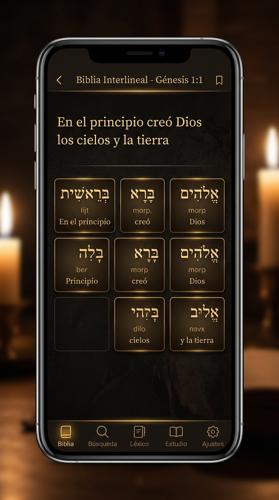
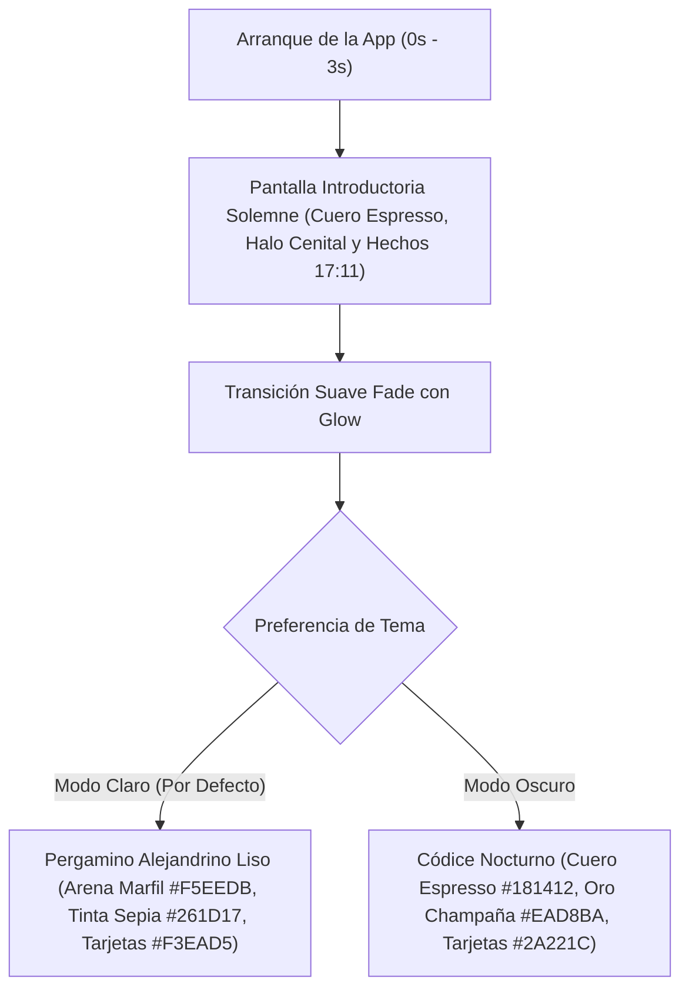

# 📜 Plan de Implementación: Despliegue de Interfaz Pergamino Alejandrino y Nueva Pantalla Introductoria

> **Documento de Especificación Técnica Oficial**: `PLAN_DESPLIEGUE_PERGAMINO_E_INTRODUCCION.md`  
> **Versiones de Aplicación**: Se incorpora como gran novedad en **v1.3.1**, se consolida como estándar visual nativo en **v1.3.2** y permanece como identidad base en **versiones futuras**.  
> **Regla de Documentación de Novedades**: Este cambio visual se documenta formalmente como **Novedad en la v1.3.1** (visible para usuarios que actualizan desde la v1.3.0). En la v1.3.2 y posteriores ya forma parte de la identidad base.  
> **Estilo Oficial Seleccionado**: **Opción 1: Pergamino Alejandrino (Vitela y Papiro Liso Clásico)** en Modo Claro y **Códice a la Luz de la Vela (Cuero Espresso y Oro Luminoso)** en Modo Oscuro.

---

## 📸 MUESTRAS VISUALES APROBADAS (REFERENCIA OBLIGATORIA)

Toda implementación en código Flutter DEBE ajustarse estrictamente a estas tres maquetas aprobadas. Cualquier resultado que altere esta armonía (como líneas de cuaderno escolar o viñetas sucias) queda terminantemente prohibido.

### 1. Pantalla de Bienvenida e Introducción Solemne (`SplashScreen`)
Atmósfera de cuero profundo, iluminación cenital dorada, isotipo squircle con orla ámbar, tipografía institucional nítida y lema bíblico oficial de Berea (*Hechos 17:11*).


### 2. Lectura Bíblica Interlineal: Modo Claro (Pergamino Alejandrino)
Fondo liso de papiro/vitela marfil cálido (`#F5EEDB`), sin cuadrículas ni renglones, tarjetas interlineales flotantes en papiro suave (`#F3EAD5`) con sombra difusa y texto en tinta sepia carbón (`#261D17`).


### 3. Lectura Bíblica Interlineal: Modo Oscuro (Códice a la Luz de la Vela)
Fondo en cuero espresso profundo (`#181412`), tarjetas en cuero tostado suave (`#2A221C`) con acentos ámbar y texto en oro champaña luminoso (`#EAD8BA`).



---

## ⚠️ ERRORES CRÍTICOS A EVITAR (ANTI-PATRONES DETECTADOS EN PRUEBAS)

> [!CAUTION]
> **LECCIÓN APRENDIDA DE LA IMPLEMENTACIÓN FALLIDA EN EMULADOR**:
> En una prueba previa, un desarrollador intentó implementar el pergamino agregando un `CustomPainter` programático con bucles de líneas (`canvas.drawLine`) cada 7px y 22px, combinado con gradientes radiales oscuros en los bordes. El resultado en el emulador fue desastroso: parecía un **cuaderno escolar de matemáticas (papel milimetrado/cuadriculado)** con los bordes manchados o quemados, destruyendo por completo la elegancia de la Biblia.

### 🚫 Lo que está TOTALMENTE PROHIBIDO:
1. **PROHIBIDO dibujar líneas horizontales, verticales o tramas (`canvas.drawLine` cada 7px, 22px o 42px)**:
   - La pantalla NO debe tener renglones ni cuadrículas.
   - La aplicación es una Biblia Interlineal académica de estudio, **no un cuaderno de matemáticas ni una libreta de notas escolar**.
   - Las palabras hebreas, griegas y los textos en español jamás deben aparecer tachados ni atravesados por líneas de fondo.
2. **PROHIBIDO viñetas oscuras agresivas y manchas en los bordes (`RadialGradient` con alpha `0.52` a `0.82`)**:
   - Viñetas perimetrales oscuras hacen que la pantalla parezca sucia, reducen el área útil de lectura y generan un choque desagradable con la barra de navegación y el AppBar.
   - El fondo del pergamino debe ser limpio, homogéneo y luminoso en toda la extensión del Scaffold.
3. **PROHIBIDO texturas rasterizadas ruidosas o de baja resolución**:
   - Texturas ruidosas compiten visualmente con los signos diacríticos (nikud hebreo y acentos/espíritus griegos), provocando fatiga visual inmediata.
4. **PROHIBIDO contenedores rectangulares planos y sin contraste armónico**:
   - Las tarjetas de palabras y versículos deben tener bordes redondeados (`BorderRadius.circular(10)` a `12`) y una sutil elevación cálida que las separe orgánicamente del fondo.

### ✅ Lo que SÍ DEBE HACERSE (Estándar Editorial de Alta Gama):
1. **Fondo liso y uniforme de tono arena/marfil cálido (`#F5EEDB`)**:
   - Emula una hoja auténtica de papiro egipcio o vitela antigua lisa de alta gama (similar al modo pergamino/sepia de aplicaciones de lectura de referencia como Kindle, Apple Books o Moon+ Reader).
2. **Tarjetas interlineales flotantes y acolchadas**:
   - Fondo: `#F3EAD5` (ligeramente más claro/luminoso que el fondo general).
   - Borde: `#DFCFAF` con grosor de 1.0 px.
   - Sombra sutil: `BoxShadow(color: Color(0x12000000), blurRadius: 4, offset: Offset(0, 2))`.
   - Radio de esquinas: `BorderRadius.circular(10)`.
3. **Tinta Sepia Carbón (`#261D17`) para máxima legibilidad**:
   - Ratio de contraste óptimo superior a 12:1 contra el fondo `#F5EEDB`.
   - Cero deslumbramiento, reduciendo drásticamente el cansancio ocular en sesiones prolongadas de estudio.
4. **Modo Oscuro Códice Nocturno (`#181412`) con texto en Oro Champaña (`#EAD8BA`)**:
   - Sustituye los fondos negros fríos o azulados por una atmósfera cálida de biblioteca antigua iluminada por velas.

---

## 🧭 1. Resumen de Flujo de Usuario



---

## 🎨 2. Especificación Técnica de la Pantalla Introductoria (`SplashScreen`)

**Archivo de implementación**: `lib/features/splash/splash_screen.dart` y `android/app/src/main/res/drawable/launch_background.xml`.


### 2.1. Fondo y Atmósfera Celestial
* **Gradiente de Fondo del Scaffold**:
  ```dart
  BoxDecoration(
    gradient: RadialGradient(
      center: const Alignment(0.0, -0.25), // Centrado detrás del logotipo
      radius: 1.15,
      colors: [
        const Color(0xFF241C16), // Núcleo cálido
        const Color(0xFF14110E), // Cuero espresso profundo
        const Color(0xFF0D0B09), // Penumbra exterior suave
      ],
      stops: const [0.0, 0.65, 1.0],
    ),
  )
  ```
* **Halo Dorado Cenital (*Celestial Glow*)**:
  ```dart
  Container(
    width: 220,
    height: 220,
    decoration: BoxDecoration(
      shape: BoxShape.circle,
      gradient: RadialGradient(
        colors: [
          const Color(0xFFFBBF24).withOpacity(0.22),
          Colors.transparent,
        ],
      ),
    ),
  )
  ```

### 2.2. Logotipo Central Berea Interlineal
* **Asset oficial**: `assets/images/berea_interlineal_icon.jpg`
* **Contenedor Squircle**:
  ```dart
  Container(
    width: 120,
    height: 120,
    decoration: BoxDecoration(
      borderRadius: BorderRadius.circular(28),
      border: Border.all(
        color: const Color(0xFFFBBF24).withOpacity(0.55),
        width: 1.8,
      ),
      boxShadow: [
        BoxShadow(
          color: const Color(0xFFF59E0B).withOpacity(0.35),
          blurRadius: 26,
          spreadRadius: 2,
        ),
      ],
    ),
    child: ClipRRect(
      borderRadius: BorderRadius.circular(26),
      child: Image.asset(
        'assets/images/berea_interlineal_icon.jpg',
        fit: BoxFit.cover,
      ),
    ),
  )
  ```

### 2.3. Jerarquía Tipográfica y Lema Bíblico
* **Título Principal**:
  ```dart
  Text(
    'BEREA INTERLINEAL',
    textAlign: TextAlign.center,
    style: TextStyle(
      fontSize: 28,
      fontWeight: FontWeight.w900,
      letterSpacing: 3.5,
      color: const Color(0xFFFDFBF7),
      shadows: [
        Shadow(
          color: const Color(0xFFD97706).withOpacity(0.6),
          blurRadius: 14,
        ),
      ],
    ),
  )
  ```
* **Pastilla Dorada**:
  ```dart
  Container(
    padding: const EdgeInsets.symmetric(horizontal: 14, vertical: 5),
    decoration: BoxDecoration(
      color: const Color(0xFFF59E0B).withOpacity(0.18),
      borderRadius: BorderRadius.circular(20),
      border: Border.all(
        color: const Color(0xFFFBBF24).withOpacity(0.7),
        width: 1.2,
      ),
    ),
    child: const Text(
      'BIBLIA INTERLINEAL DE ESTUDIO',
      style: TextStyle(
        fontSize: 11.5,
        fontWeight: FontWeight.w800,
        letterSpacing: 1.6,
        color: Color(0xFFFCD34D),
      ),
    ),
  )
  ```
* **Lema Oficial de Berea (Hechos 17:11)**:
  ```dart
  const Text(
    '«...escudriñando cada día las Escrituras» (Hechos 17:11)',
    textAlign: TextAlign.center,
    style: TextStyle(
      fontSize: 13.5,
      fontStyle: FontStyle.italic,
      fontWeight: FontWeight.w500,
      letterSpacing: 0.4,
      color: Color(0xFFE2C48E),
    ),
  )
  ```
* **Fuentes Originales**:
  ```dart
  const Text(
    'Hebreo BHS • Griego Tischendorf • Reina-Valera 1960\nDiccionarios Strong y Análisis Morfológico',
    textAlign: TextAlign.center,
    style: TextStyle(
      fontSize: 12,
      height: 1.45,
      color: Color(0xFFA89884),
    ),
  )
  ```

### 2.4. Barra de Carga Ámbar Líquido
* **Barra de Progreso**:
  ```dart
  LinearProgressIndicator(
    value: progressValue,
    minHeight: 4.5,
    backgroundColor: Colors.white.withOpacity(0.12),
    valueColor: const AlwaysStoppedAnimation<Color>(Color(0xFFF59E0B)),
  )
  ```
* **Mensajes Dinámicos de Inicio**:
  - `p < 0.35` ➔ *«Abriendo manuscritos hebreos y griegos...»*
  - `p < 0.70` ➔ *«Sincronizando léxicos Strong y morfología...»*
  - `p >= 0.70` ➔ *«Listo para escudriñar la Palabra.»*

---

## 🏺 3. Especificación Técnica del Tema "Pergamino Alejandrino" (`core/theme.dart`)

**Archivo de implementación**: `lib/core/theme.dart`.

> [!IMPORTANT]
> **REGLA DE CONSTRUCCIÓN DEL TEMA**:
> El tema debe ser puramente cromático, limpio y sin `CustomPainters` de tramas o cuadrículas. Se aplican colores sólidos cálidos bien orquestados a nivel de `ThemeData`, permitiendo que todos los `Scaffold`, `Card`, `AppBar` y `BottomNavigationBar` hereden el estilo automáticamente de forma rápida, eficiente y sin consumo extra de CPU/GPU.

### 3.1. Paleta de Modo Claro (`lightTheme`)
* **`scaffoldBackgroundColor`**: `const Color(0xFFF5EEDB)` (Arena marfil cálido de papiro/vitela lisa).
* **`colorScheme.surface`**: `const Color(0xFFFAF5EA)` (Papiro limpio para tarjetas de versículos, diálogos y menús desplegables).
* **`cardColor`**: `const Color(0xFFFAF5EA)`.
* **Bordes generales de tarjetas y selectores**: `Border.all(color: const Color(0xFFDFCFAF), width: 1.0)`.
* **`colorScheme.onSurface` (Tinta de lectura)**: `const Color(0xFF261D17)` (Tinta sepia / carbón vegetal con excelente contraste).
* **`colorScheme.onSurfaceVariant` (Subtítulos y glosas)**: `const Color(0xFF6B5A4B)` (Tono nuez oscuro).
* **`colorScheme.primary`**: `const Color(0xFFB45309)` (Bronce antiguo cálido).
* **`colorScheme.secondary`**: `const Color(0xFFD97706)` (Ámbar dorado).
* **`appBarTheme`**:
  * `backgroundColor`: `const Color(0xFFEFE6D2)`
  * `elevation`: 0.5
  * `iconTheme`: `IconThemeData(color: const Color(0xFF261D17))`
  * `titleTextStyle`: `TextStyle(color: const Color(0xFF261D17), fontSize: 20, fontWeight: FontWeight.bold)`
* **`bottomNavigationBarTheme`**:
  * `backgroundColor`: `const Color(0xFFEDE4CE)`
  * `selectedItemColor`: `const Color(0xFFB45309)`
  * `unselectedItemColor`: `const Color(0xFF8C7B6B)`
* **Tarjetas interlineales (Palabras individuales Hebreas / Griegas)**:
  * Contenedor:
    ```dart
    Container(
      padding: const EdgeInsets.symmetric(horizontal: 10, vertical: 8),
      decoration: BoxDecoration(
        color: const Color(0xFFF3EAD5), // Papiro suave
        borderRadius: BorderRadius.circular(10),
        border: Border.all(
          color: const Color(0xFFDFCFAF),
          width: 1.0,
        ),
        boxShadow: const [
          BoxShadow(
            color: Color(0x12000000),
            blurRadius: 4,
            offset: Offset(0, 2),
          ),
        ],
      ),
      child: ...
    )
    ```

### 3.2. Paleta de Modo Oscuro (`darkTheme` — Códice a la Luz de la Vela)
* **`scaffoldBackgroundColor`**: `const Color(0xFF181412)` (Cuero espresso profundo y papiro en penumbra).
* **`colorScheme.surface`**: `const Color(0xFF221C18)` (Cuero tostado oscuro).
* **`cardColor`**: `const Color(0xFF221C18)`.
* **Bordes generales**: `Border.all(color: const Color(0xFF4A3E34), width: 1.0)`.
* **`colorScheme.onSurface` (Texto luminoso)**: `const Color(0xFFEAD8BA)` (Oro champaña y marfil cálido, de lectura ultra-descansada).
* **`colorScheme.onSurfaceVariant`**: `const Color(0xFFA89884)` (Bronce suave).
* **`colorScheme.primary`**: `const Color(0xFFF59E0B)` (Ámbar cálido).
* **`colorScheme.secondary`**: `const Color(0xFFFBBF24)`.
* **`appBarTheme`**:
  * `backgroundColor`: `const Color(0xFF1F1915)`
  * `elevation`: 0.5
  * `iconTheme`: `IconThemeData(color: const Color(0xFFEAD8BA))`
  * `titleTextStyle`: `TextStyle(color: const Color(0xFFEAD8BA), fontSize: 20, fontWeight: FontWeight.bold)`
* **`bottomNavigationBarTheme`**:
  * `backgroundColor`: `const Color(0xFF1B1613)`
  * `selectedItemColor`: `const Color(0xFFF59E0B)`
  * `unselectedItemColor`: `const Color(0xFF786A5E)`
* **Tarjetas interlineales (Palabras individuales Hebreas / Griegas)**:
  * Contenedor:
    ```dart
    Container(
      padding: const EdgeInsets.symmetric(horizontal: 10, vertical: 8),
      decoration: BoxDecoration(
        color: const Color(0xFF2A221C),
        borderRadius: BorderRadius.circular(10),
        border: Border.all(
          color: const Color(0xFF4D3B2C),
          width: 1.0,
        ),
        boxShadow: const [
          BoxShadow(
            color: Color(0x24000000),
            blurRadius: 5,
            offset: Offset(0, 2),
          ),
        ],
      ),
      child: ...
    )
    ```

---

## 📢 4. Protocolo de Notas de Actualización: v1.3.0 ➔ v1.3.1

> [!IMPORTANT]
> **REGLA DE DOCUMENTACIÓN**:
> Esta innovación visual se presenta como **novedad principal en las notas de la versión 1.3.1**, para que todos los usuarios que vienen de la versión 1.3.0 experimenten y comprendan el cambio de inmediato al recibir la actualización OTA.

### 4.1. Tarjeta de Novedades en Ajustes de la v1.3.1 (`SettingsScreen`)
En `lib/features/settings/settings_screen.dart`, la tarjeta de la versión 1.3.1 debe estructurarse con estos elementos:

```dart
// Novedades en Versión 1.3.1
Column(
  crossAxisAlignment: CrossAxisAlignment.start,
  children: [
    Text(
      'Novedades en Versión 1.3.1:',
      style: theme.textTheme.titleSmall?.copyWith(
        fontWeight: FontWeight.bold,
        color: theme.colorScheme.onSurface,
      ),
    ),
    const SizedBox(height: 10),
    _featureRow(
      icon: Icons.auto_stories_rounded,
      title: 'Entorno Visual Pergamino Alejandrino',
      desc: 'Nuevo diseño cálido inspirado en los manuscritos antiguos de papiro y vitela. Reduce el cansancio visual y brinda una experiencia de lectura bíblica inmersiva tanto en Modo Claro como en Modo Oscuro.',
      theme: theme,
    ),
    _featureRow(
      icon: Icons.movie_filter_rounded,
      title: 'Nueva Introducción y Lema de Berea',
      desc: 'Pantalla de bienvenida solemne con fondo de cuero antiguo, iluminación celestial, barra de progreso en oro ámbar y el lema bíblico oficial: «...escudriñando cada día las Escrituras» (Hechos 17:11).',
      theme: theme,
    ),
    _featureRow(
      icon: Icons.storage_rounded,
      title: 'Persistencia permanente en SQLite',
      desc: 'Marcadores, notas e historial ahora se resguardan de forma atómica en logos_user_data.db, garantizando que nunca se borren al cerrar o reiniciar la app.',
      theme: theme,
    ),
    _featureRow(
      icon: Icons.system_update_rounded,
      title: 'Actualizador In-App OTA Multi-Procesador',
      desc: 'Detección automática de procesador (arm64, armv7, x86_64, universal) y descarga directa con barra de progreso desde GitHub Releases.',
      theme: theme,
    ),
    _featureRow(
      icon: Icons.link_rounded,
      title: 'Hipervínculos en códigos Strong derivados',
      desc: 'Toca las referencias derivadas entre paréntesis dentro de las definiciones para abrir ese Strong directamente sin perder el contexto.',
      theme: theme,
    ),
    _featureRow(
      icon: Icons.format_list_bulleted_rounded,
      title: 'Dónde aparece desplegable',
      desc: 'Acordeón por libro con todas las apariciones de cada palabra y resaltado de marcador que conserva el color de fuente original.',
      theme: theme,
    ),
  ],
)
```

### 4.2. Registro en el Release de GitHub (Tag `1.3.1`)
El cuerpo del Release en GitHub para la versión 1.3.1 debe mantener este encabezado editorial:
```markdown
# 📜 Berea Interlineal v1.3.1: Edición Manuscrito Alejandrino

### 🎨 Nueva Experiencia Visual y Didáctica
* **Fondo de Pergamino Alejandrino**: Reemplazo del blanco digital por un tono cálido de papiro y arena marfil (`#F5EEDB`) en Modo Claro, y códice en penumbra (`#181412`) en Modo Oscuro. Cero líneas de libreta, cero distracciones.
* **Pantalla de Bienvenida Solemne**: Presentación majestuosa con atmósfera de cuero antiguo, resplandor dorado, barra de carga en oro ámbar y el lema oficial de **Hechos 17:11**.

### 💾 Persistencia y Rendimiento
* **Persistencia Real en SQLite**: Base de datos dedicada permanente (`logos_user_data.db`) para marcadores, notas e historial.
* **Actualizador In-App OTA**: Descarga optimizada según la arquitectura de procesador del teléfono.
* **Navegación Léxica Mejorada**: Hipervínculos entre códigos Strong derivados y acordeón de ocurrencias por libro.
```

---

## 🚀 5. Aplicación en Versiones Posteriores (v1.3.2 y v1.4.0+)

* **En la versión 1.3.2**:
  * El fondo de Pergamino Alejandrino y la nueva pantalla introductoria **se mantienen activos al 100% como la interfaz natural del sistema**.
  * Las notas de actualización de la v1.3.2 no repiten el cambio de pergamino, sino que se concentran en las funciones avanzadas de su fase:
    - *Lectura por capítulo continuo y gestos swipe*.
    - *Expansión interlineal en línea al toque*.
    - *Tipografías académicas SIL OFL (Ezra SIL, Cardo, Frank Ruhl Libre)*.
    - *5 Resaltadores teológicos (Promesas, Mandamientos, Atributos de Dios, Advertencias, Profecía)*.
    - *Avisos en el Centro de Notificaciones de Android*.
* **En versiones futuras (v1.4.0+)**:
  * El estilo de pergamino alejandrino continúa siendo la identidad canónica del producto.

---

## 🗓️ 6. Checklist de Implementación y Control de Calidad para el Desarrollador

* [x] **Eliminación de anti-patrones**: Verificar que NO existan clases `CustomPainter` dibujando líneas horizontales ni verticales en ningún archivo de la app.
* [x] **Verificación de Fondo Liso**: Comprobar en emulador o dispositivo real que el fondo en Modo Claro sea un color uniforme `#F5EEDB` sin cuadrículas ni manchas oscuras en los bordes.
* [x] **Modificar `lib/core/theme.dart`**: Implementar las paletas puras de **Pergamino Alejandrino** (Claro) y **Códice a la Luz de la Vela** (Oscuro).
* [x] **Actualizar `lib/features/splash/splash_screen.dart`**: Implementar fondo de cuero, resplandor dorado, lema de Hechos 17:11 y barra de progreso ámbar exactamente como en la maqueta `assets/propuesta_intro_splash.jpg`.
* [x] **Actualizar `android/app/src/main/res/drawable/launch_background.xml`**: Colocar `#14110E` como color nativo de arranque en frío.
* [x] **Tarjetas Interlineales en `bible_screen.dart`**: Configurar el contenedor de cada palabra con fondo `#F3EAD5`, bordes redondeados `10px`, borde `#DFCFAF` y sombra difusa suave.
* [x] **Ajustar `settings_screen.dart`**: Confirmar que la tarjeta de novedades de la versión 1.3.1 destaque el nuevo entorno visual.
* [x] **Inspección Visual Final**: Comparar las pantallas del APK instalado contra las maquetas oficiales contenidas en `Archivos_md/assets/`. Deben coincidir con fidelidad total.
* [x] **Compilación con Firma Oficial**: Compilar con `berea-release.jks`.
* [x] **Despliegue**: Subir APKs con sus `checksums.txt` a los Releases correspondientes en GitHub.
