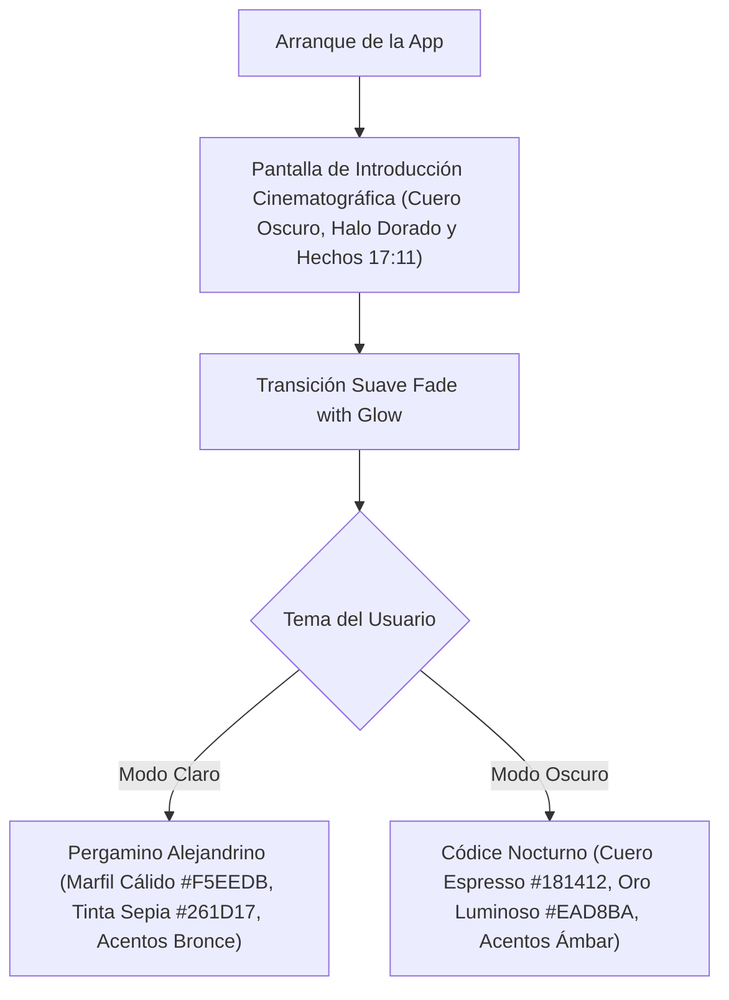
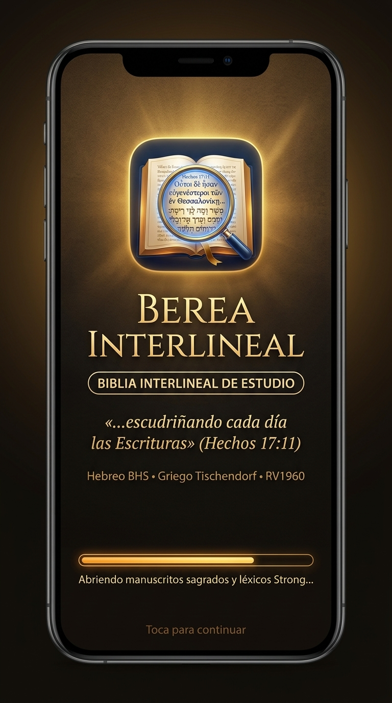
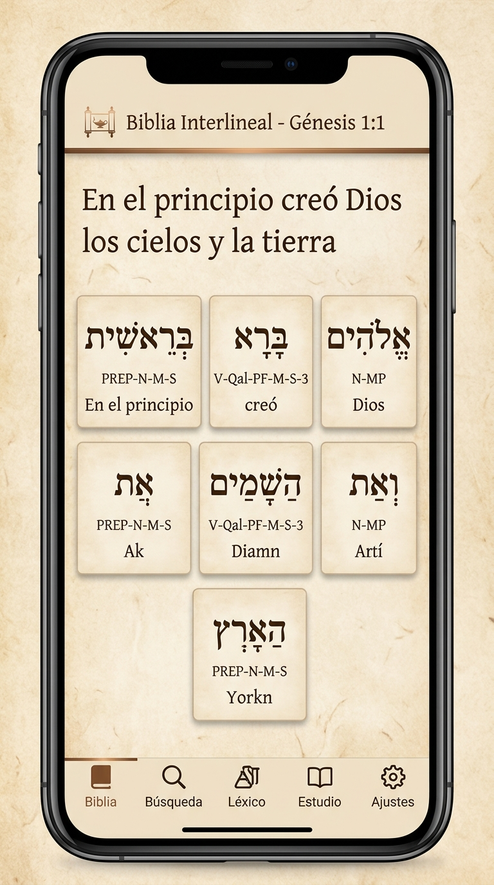

# 📜 Plan de Implementación: Despliegue de Interfaz Pergamino Alejandrino y Nueva Pantalla Introductoria

> **Documento de Especificación para Desarrollador**: `PLAN_DESPLIEGUE_PERGAMINO_E_INTRODUCCION.md`  
> **Versiones de Aplicación**: Se incorpora en **v1.3.1**, se consolida en **v1.3.2** y permanece como estándar base en **versiones futuras**.  
> **Regla de Documentación de Novedades**: Este cambio visual se documenta formalmente como **Novedad en la v1.3.1** (visible para usuarios que actualizan desde la v1.3.0). En la v1.3.2 y posteriores ya forma parte de la identidad base.  
> **Estilo Seleccionado**: **Opción 1: Pergamino Alejandrino** (Día) / **Códice a la Luz de la Vela** (Noche).  

---

## 🧭 1. Resumen Ejecutivo del Cambio Visual



### Objetivos:
1. **Eliminar la frialdad digital**: Sustituir el fondo blanco/gris estéril y el azul plano por una atmósfera cálida, orgánica y didáctica que emula la lectura sobre papiro bíblico y vitela auténtica.
2. **Eliminar pantallas de carga vacías**: Reemplazar el cuadro donde el logo flotaba solo en medio de un fondo negro/azul vacío por una pantalla introductoria completa, majestuosa y rica en atmósfera desde el milisegundo cero.
3. **Identidad bíblica explícita**: Incorporar el lema oficial de la comunidad de Berea: *«...escudriñando cada día las Escrituras» (Hechos 17:11)*.
4. **Armonía cromática total**: La introducción, la barra de progreso dorada, el logotipo y la pantalla de lectura comparten la misma paleta cálida basada en oro, bronce, papiro y tinta antigua.

---

## 🎨 2. Especificación Técnica de la Nueva Pantalla Introductoria (`SplashScreen`)

**Archivo de implementación**: `lib/features/splash/splash_screen.dart` y `android/app/src/main/res/drawable/launch_background.xml`.



### 2.1. Fondo y Atmósfera Celestial
* **Gradiente de Fondo**:
  ```dart
  BoxDecoration(
    gradient: RadialGradient(
      center: const Alignment(0.0, -0.25), // Centrado detrás del logo
      radius: 1.15,
      colors: [
        const Color(0xFF241C16), // Núcleo cálido de penumbra
        const Color(0xFF14110E), // Cuero espresso oscuro en los bordes
        const Color(0xFF0D0B09), // Viñeta profunda
      ],
      stops: const [0.0, 0.65, 1.0],
    ),
  )
  ```
* **Halo Dorado Central (*Celestial Glow*)**:
  Detrás del squircle del logo se sitúa un contenedor con `BoxShape.circle` y `RadialGradient` difuminado:
  ```dart
  Container(
    width: 220,
    height: 220,
    decoration: BoxDecoration(
      shape: BoxShape.circle,
      gradient: RadialGradient(
        colors: [
          const Color(0xFFFBBF24).withOpacity(0.22), // Resplandor dorado suave
          Colors.transparent,
        ],
      ),
    ),
  )
  ```

### 2.2. Logotipo Central Berea Interlineal
* **Asset oficial**: `assets/images/berea_interlineal_icon.jpg`
* **Contenedor Squircle**:
  ```dart
  Container(
    width: 120,
    height: 120,
    decoration: BoxDecoration(
      borderRadius: BorderRadius.circular(28),
      border: Border.all(
        color: const Color(0xFFFBBF24).withOpacity(0.55),
        width: 1.8,
      ),
      boxShadow: [
        BoxShadow(
          color: const Color(0xFFF59E0B).withOpacity(0.35),
          blurRadius: 26,
          spreadRadius: 2,
        ),
      ],
    ),
    child: ClipRRect(
      borderRadius: BorderRadius.circular(26),
      child: Image.asset(
        'assets/images/berea_interlineal_icon.jpg',
        fit: BoxFit.cover,
      ),
    ),
  )
  ```

### 2.3. Jerarquía Tipográfica y Lema Bíblico
* **Título Principal**:
  ```dart
  Text(
    'BEREA INTERLINEAL',
    textAlign: TextAlign.center,
    style: TextStyle(
      fontSize: 28,
      fontWeight: FontWeight.w900,
      letterSpacing: 3.5,
      color: const Color(0xFFFDFBF7),
      shadows: [
        Shadow(
          color: const Color(0xFFD97706).withOpacity(0.6),
          blurRadius: 14,
        ),
      ],
    ),
  )
  ```
* **Tagline en Pastilla Dorada**:
  ```dart
  Container(
    padding: const EdgeInsets.symmetric(horizontal: 14, vertical: 5),
    decoration: BoxDecoration(
      color: const Color(0xFFF59E0B).withOpacity(0.18),
      borderRadius: BorderRadius.circular(20),
      border: Border.all(
        color: const Color(0xFFFBBF24).withOpacity(0.7),
        width: 1.2,
      ),
    ),
    child: const Text(
      'BIBLIA INTERLINEAL DE ESTUDIO',
      style: TextStyle(
        fontSize: 11.5,
        fontWeight: FontWeight.w800,
        letterSpacing: 1.6,
        color: Color(0xFFFCD34D),
      ),
    ),
  )
  ```
* **Lema Bíblico (Nuevo)**:
  ```dart
  const Text(
    '«...escudriñando cada día las Escrituras» (Hechos 17:11)',
    textAlign: TextAlign.center,
    style: TextStyle(
      fontSize: 13.5,
      fontStyle: FontStyle.italic,
      fontWeight: FontWeight.w500,
      letterSpacing: 0.4,
      color: Color(0xFFE2C48E),
    ),
  )
  ```
* **Fuentes Originales**:
  ```dart
  const Text(
    'Hebreo BHS • Griego Tischendorf • Reina-Valera 1960\nDiccionarios Strong y Análisis Morfológico',
    textAlign: TextAlign.center,
    style: TextStyle(
      fontSize: 12,
      height: 1.45,
      color: Color(0xFFA89884),
    ),
  )
  ```

### 2.4. Barra de Progreso Ámbar y Mensajes Didácticos
* **Barra estilizada**:
  ```dart
  LinearProgressIndicator(
    value: progressValue,
    minHeight: 4.5,
    backgroundColor: Colors.white.withOpacity(0.12),
    valueColor: const AlwaysStoppedAnimation<Color>(Color(0xFFF59E0B)), // Ámbar líquido
  )
  ```
* **Textos dinámicos de fase de carga**:
  1. `$p < 0.35` ➔ `«Abriendo manuscritos hebreos y griegos...»`
  2. `$p < 0.70` ➔ `«Sincronizando léxicos Strong y morfología...»`
  3. `$p >= 0.70` ➔ `«Listo para escudriñar la Palabra.»`

---

## 🏺 3. Especificación Técnica del Tema "Pergamino Alejandrino" (`core/theme.dart`)

**Archivo de implementación**: `lib/core/theme.dart` y selectores de lectura en `lib/features/bible/`.



### 3.1. Paleta de Modo Claro (`lightTheme`)
* **`scaffoldBackgroundColor`**: `const Color(0xFFF5EEDB)` (Arena marfil cálido de papiro auténtico).
* **`colorScheme.surface`**: `const Color(0xFFFAF5EA)` (Papiro limpio para tarjetas de versículos y diálogos).
* **`cardColor`**: `const Color(0xFFFAF5EA)`.
* **Bordes de tarjetas**: `Border.all(color: const Color(0xFFE2D6C0), width: 1.0)`.
* **`colorScheme.onSurface` (Tinta de texto)**: `const Color(0xFF261D17)` (Tinta sepia / carbón vegetal con ratio 12:1 contra el fondo).
* **`colorScheme.primary`**: `const Color(0xFFB45309)` (Bronce antiguo cálido).
* **`colorScheme.secondary`**: `const Color(0xFFD97706)` (Ámbar dorado).
* **`appBarTheme`**:
  * Color de fondo: `const Color(0xFFEFE6D2)`
  * Iconos y títulos: `const Color(0xFF261D17)`
* **`bottomNavigationBarTheme`**:
  * Fondo: `const Color(0xFFEDE4CE)`
  * Icono seleccionado: `const Color(0xFFB45309)`
* **Tarjetas interlineales (Palabras Hebreas / Griegas)**:
  * Fondo de tarjeta: `const Color(0xFFF3EAD5)`
  * Borde: `Border.all(color: const Color(0xFFDFCFAF), width: 1.0)`
  * Sombra: `BoxShadow(color: const Color(0x18000000), blurRadius: 4, offset: Offset(0, 2))`

### 3.2. Paleta de Modo Oscuro (`darkTheme` — Códice a la Luz de la Vela)
* **`scaffoldBackgroundColor`**: `const Color(0xFF181412)` (Cuero espresso profundo y papiro en penumbra).
* **`colorScheme.surface`**: `const Color(0xFF221C18)` (Cuero tostado oscuro).
* **`cardColor`**: `const Color(0xFF221C18)`.
* **Bordes de tarjetas**: `Border.all(color: const Color(0xFF4A3E34), width: 1.0)`.
* **`colorScheme.onSurface` (Texto)**: `const Color(0xFFEAD8BA)` (Oro champaña y marfil luminoso, de lectura ultra-descansada).
* **`colorScheme.primary`**: `const Color(0xFFF59E0B)` (Ámbar cálido).
* **`colorScheme.secondary`**: `const Color(0xFFFBBF24)`.
* **`appBarTheme`**: Fondo `const Color(0xFF1F1915)` con iconos dorados.
* **`bottomNavigationBarTheme`**: Fondo `const Color(0xFF1B1613)` con iconos activos en ámbar dorado.
* **Tarjetas interlineales**:
  * Fondo: `const Color(0xFF2A221C)`
  * Borde: `Border.all(color: const Color(0xFF785B3F).withOpacity(0.55), width: 1.0)`
  * Resplandor sutil: `BoxShadow(color: const Color(0xFFF59E0B).withOpacity(0.08), blurRadius: 6)`

---

## 📢 4. Protocolo de Notas de Actualización: v1.3.0 ➔ v1.3.1

> [!IMPORTANT]
> **REGLA DE DOCUMENTACIÓN**:
> Esta innovación visual se presenta como **novedad principal en las notas de la versión 1.3.1**, para que todos los usuarios que vienen de la versión 1.3.0 experimenten y comprendan el cambio de inmediato al recibir la actualización OTA.

### 4.1. Tarjeta de Novedades en Ajustes de la v1.3.1 (`SettingsScreen`)
En `lib/features/settings/settings_screen.dart`, la tarjeta de la versión 1.3.1 debe estructurarse así:

```dart
// Novedades en Versión 1.3.1
Column(
  crossAxisAlignment: CrossAxisAlignment.start,
  children: [
    Text(
      'Novedades en Versión 1.3.1:',
      style: theme.textTheme.titleSmall?.copyWith(
        fontWeight: FontWeight.bold,
        color: theme.colorScheme.onSurface,
      ),
    ),
    const SizedBox(height: 10),
    _featureRow(
      icon: Icons.auto_stories_rounded,
      title: 'Entorno Visual Pergamino Alejandrino',
      desc: 'Nuevo diseño cálido inspirado en los manuscritos antiguos de papiro y vitela. Reduce el cansancio visual y brinda una experiencia de lectura bíblica inmersiva tanto en Modo Claro como en Modo Oscuro.',
      theme: theme,
    ),
    _featureRow(
      icon: Icons.movie_filter_rounded,
      title: 'Nueva Introducción y Lema de Berea',
      desc: 'Pantalla de bienvenida solemne con fondo de cuero antiguo, iluminación celestial, barra de progreso en oro ámbar y el lema bíblico oficial: «...escudriñando cada día las Escrituras» (Hechos 17:11).',
      theme: theme,
    ),
    _featureRow(
      icon: Icons.storage_rounded,
      title: 'Persistencia permanente en SQLite',
      desc: 'Marcadores, notas e historial ahora se resguardan de forma atómica en logos_user_data.db, garantizando que nunca se borren al cerrar o reiniciar la app.',
      theme: theme,
    ),
    _featureRow(
      icon: Icons.system_update_rounded,
      title: 'Actualizador In-App OTA Multi-Procesador',
      desc: 'Detección automática de procesador (arm64, armv7, x86_64, universal) y descarga directa con barra de progreso desde GitHub Releases.',
      theme: theme,
    ),
    _featureRow(
      icon: Icons.link_rounded,
      title: 'Hipervínculos en códigos Strong derivados',
      desc: 'Toca las referencias derivadas entre paréntesis dentro de las definiciones para abrir ese Strong directamente sin perder el contexto.',
      theme: theme,
    ),
    _featureRow(
      icon: Icons.format_list_bulleted_rounded,
      title: 'Dónde aparece desplegable',
      desc: 'Acordeón por libro con todas las apariciones de cada palabra y resaltado de marcador que conserva el color de fuente original.',
      theme: theme,
    ),
  ],
)
```

### 4.2. Registro en el Release de GitHub (Tag `1.3.1`)
El mensaje del Release en GitHub para la versión 1.3.1 debe actualizarse con el siguiente encabezado:
```markdown
# 📜 Berea Interlineal v1.3.1: Edición Manuscrito Alejandrino

### 🎨 Nueva Experiencia Visual y Didáctica
* **Fondo de Pergamino Alejandrino**: Reemplazo del blanco digital por un tono cálido de papiro y arena marfil (`#F5EEDB`) en Modo Claro, y códice en penumbra (`#181412`) en Modo Oscuro.
* **Pantalla de Bienvenida Solemne**: Presentación majestuosa con atmósfera de cuero antiguo, resplandor dorado, barra de carga en oro ámbar y el lema oficial de **Hechos 17:11**.

### 💾 Persistencia y Rendimiento
* **Persistencia Real en SQLite**: Base de datos dedicada permanente (`logos_user_data.db`) para marcadores, notas e historial.
* **Actualizador In-App OTA**: Descarga optimizada según la arquitectura de procesador del teléfono.
* **Navegación Léxica Mejorada**: Hipervínculos entre códigos Strong derivados y acordeón de ocurrencias por libro.
```

---

## 🚀 5. Aplicación en Versiones Posteriores (v1.3.2 y v1.4.0+)

* **En la versión 1.3.2**:
  * El fondo de Pergamino Alejandrino y la nueva pantalla introductoria **se mantienen activos al 100% como la interfaz natural del sistema**.
  * Las notas de actualización de la v1.3.2 no repiten el cambio de pergamino, sino que se enfocan en las novedades propias de su fase:
    - *Lectura por capítulo continuo y gestos swipe*.
    - *Expansión interlineal en línea al toque*.
    - *Tipografías académicas SIL OFL (Ezra SIL, Cardo, Frank Ruhl Libre)*.
    - *5 Resaltadores teológicos (Promesas, Mandamientos, Atributos de Dios, Advertencias, Profecía)*.
    - *Avisos en el Centro de Notificaciones de Android*.
* **En versiones futuras (v1.4.0+)**:
  * Continúa como el estándar visual oficial del producto.

---

## 🗓️ 6. Checklist de Implementación para el Desarrollador

* [x] Modificar `lib/core/theme.dart` con las paletas de color de **Pergamino Alejandrino** (Claro y Oscuro).
* [x] Actualizar `lib/features/splash/splash_screen.dart` con el fondo de cuero, resplandor dorado, lema de Hechos 17:11 y barra ámbar.
* [x] Actualizar `android/app/src/main/res/drawable/launch_background.xml` con el color de fondo cálido `#14110E`.
* [x] Integrar las tarjetas de papiro suave para los bloques de palabras interlineales en `bible_screen.dart`.
* [x] Ajustar la tarjeta de novedades de la versión 1.3.1 en `settings_screen.dart` para destacar el nuevo entorno visual.
* [x] Recompilar los APKs de la versión 1.3.1 y 1.3.2 con la clave oficial de producción (`berea-release.jks`).
* [x] Almacenar los binarios en `release_builds/v1.3.1/` y `release_builds/v1.3.2/` con sus `checksums.txt`.
* [x] Ejecutar el script de despliegue para sustituir los binarios en GitHub Releases.
