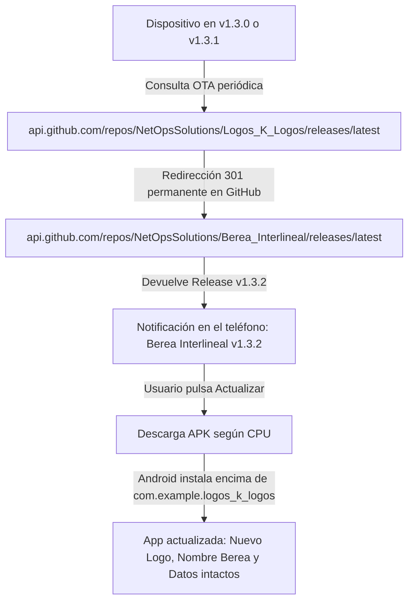
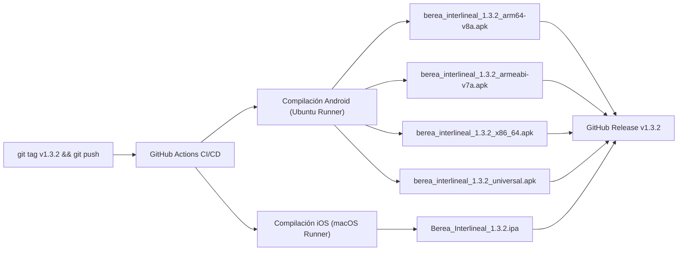

# Plan de Implementación y Despliegue v1.3.2: Transición a "Berea Interlineal"

> **Versión del Plan**: 1.0  
> **Fecha de creación**: 26 de Octubre de 2026  
> **Nuevo Nombre Oficial**: **Berea Interlineal**  
> **Repositorio Destino**: `https://github.com/NetOpsSolutions/Berea_Interlineal.git`  
> **Versión Objetivo**: `1.3.2`  

---

## 1. Identidad Visual Oficial (Nuevo Logotipo)

El nuevo logotipo oficial para la versión 1.3.2 fusiona la reverencia por el texto sagrado con el rigor del estudio exegético diario de **Hechos 17:11**:


### Especificaciones de Diseño
* **Elemento Central**: Biblia sagrada abierta con páginas iluminadas en oro cálido y cinta marcapáginas dorada.
* **Lente de Aumento Exegética**: Lupa óptica de cristal y bronce/oro pulido posada diagonalmente sobre el texto, magnificando e iluminando con destello azul zafiro el pasaje de Hechos 17:11 en griego e interlineal.
* **Badge / Contenedor**: Squircle moderno para iOS/Android sobre fondo azul noche profundo (`#0B132B`).
* **Ubicación del recurso en el proyecto**: `assets/images/berea_interlineal_icon.jpg`.

---

## 2. Estrategia de Migración del Repositorio en GitHub

Para que los dispositivos actualmente en **v1.3.0** y **v1.3.1** se actualicen de manera completamente automática sin intervención manual ni pérdida de datos:



### Pasos en GitHub (Panel Web)
1. Iniciar sesión en GitHub y abrir `https://github.com/NetOpsSolutions/Logos_K_Logos`.
2. Ir a la pestaña **Settings** (Configuración) ➔ Sección **General**.
3. En el campo **Repository name**, reemplazar `Logos_K_Logos` por `Berea_Interlineal`.
4. Hacer clic en **Rename**.
   * *Efecto*: GitHub mantiene vivos todos los enlaces viejos y los redirige automáticamente (HTTP 301). Los releases 1.3.0 y 1.3.1 siguen existiendo dentro del mismo historial.

### Pasos en la Terminal Local (Git)
Actualizar la URL del origen remoto en el proyecto local para apuntar al nuevo nombre:
```bash
git remote set-url origin https://github.com/NetOpsSolutions/Berea_Interlineal.git
git remote -v
```

---

## 3. Preservación de Datos y Compatibilidad en Android

Para que la actualización se instale **encima** de la aplicación vieja y no cree una app duplicada ni borre la base de datos de los usuarios:

| Parámetro | Valor v1.3.0 / v1.3.1 | Valor v1.3.2 (Berea Interlineal) | Impacto |
| :--- | :--- | :--- | :--- |
| **`applicationId`** | `com.example.logos_k_logos` | **`com.example.logos_k_logos`** | **Obligatorio mantenerlo igual**. Garantiza que Android reconozca que es la misma app y conserve SQLite, notas y favoritos. |
| **Firma Digital (Keystore)** | Misma clave de firmado | **Misma clave de firmado** | Obligatorio para permitir actualización in-place. |
| **Nombre Visible (`android:label`)** | `Logos K Logos` | **`Berea Interlineal`** | El texto debajo del icono en el launcher cambiará automáticamente. |
| **Icono de la App (`ic_launcher`)** | Icono genérico Flutter | **Nuevo Logo Berea Interlineal** | Se actualiza automáticamente en el launcher. |

---

## 4. Plan de Modificaciones en el Código (Fase de Ejecución)

### Paso 4.1: Generación de Iconos Multi-resolución
Configurar y ejecutar la generación de iconos adaptativos en Android e iOS a partir del nuevo arte `assets/images/berea_interlineal_icon.jpg`:
* **Android**:
  - `android/app/src/main/res/mipmap-mdpi/ic_launcher.png` (48x48)
  - `android/app/src/main/res/mipmap-hdpi/ic_launcher.png` (72x72)
  - `android/app/src/main/res/mipmap-xhdpi/ic_launcher.png` (96x96)
  - `android/app/src/main/res/mipmap-xxhdpi/ic_launcher.png` (144x144)
  - `android/app/src/main/res/mipmap-xxxhdpi/ic_launcher.png` (192x192)
* **iOS**:
  - `ios/Runner/Assets.xcassets/AppIcon.appiconset` (Icono maestro 1024x1024 y variantes)

### Paso 4.2: Actualización de Metadatos de la App
* **`pubspec.yaml`**:
  ```yaml
  name: berea_interlineal
  description: "Berea Interlineal - Estudio bíblico interlineal Hebreo-Griego-Español (Hechos 17:11)"
  version: 1.3.2+7
  ```
* **`android/app/src/main/AndroidManifest.xml`**:
  ```xml
  <application
      android:label="Berea Interlineal"
      android:icon="@mipmap/ic_launcher"
      ...>
  ```
* **`ios/Runner/Info.plist`**:
  ```xml
  <key>CFBundleDisplayName</key>
  <string>Berea Interlineal</string>
  ```

### Paso 4.3: Actualización del Motor OTA (`UpdateService`)
En `lib/core/update/update_service.dart`:
```dart
static const String githubOwner = 'NetOpsSolutions';
static const String githubRepo = 'Berea_Interlineal';
static const String fallbackVersion = '1.3.2';
static const int fallbackBuildNumber = 7;
```

### Paso 4.4: Textos y Branding en Pantallas
* `lib/main.dart`: Actualizar `MaterialApp(title: 'Berea Interlineal')`.
* `lib/features/splash/splash_screen.dart`: Integrar el nuevo logo en la animación de carga.
* `lib/features/settings/settings_screen.dart`: Modificar título, créditos, enlaces al nuevo repo y modal de "Acerca de".

---

## 5. Pipeline de Compilación y Publicación (GitHub Actions)

Al subir el tag `v1.3.2` o mediante `workflow_dispatch`, el pipeline automatizado generará todos los binarios necesarios:



### Nombres estandarizados de los artefactos en el Release v1.3.2:
1. `berea_interlineal_1.3.2_arm64-v8a.apk` (Móviles modernos)
2. `berea_interlineal_1.3.2_armeabi-v7a.apk` (Móviles antiguos 32 bits)
3. `berea_interlineal_1.3.2_x86_64.apk` (Emuladores y Chromebooks)
4. `berea_interlineal_1.3.2_universal.apk` (APK todo en uno)
5. `Berea_Interlineal_1.3.2.ipa` (Paquete para iPhone vía AltStore / Sideloadly)

---

## 6. Procedimiento de Verificación y Rollout

1. **Renombrar el repositorio en GitHub**: `Logos_K_Logos` ➔ `Berea_Interlineal`.
2. **Aplicar cambios locales**: Logo, nombres y constantes.
3. **Prueba local en emulador/dispositivo**:
   - Compilar `flutter run --release`.
   - Verificar que el icono y el nombre en la pantalla de inicio sean correctos.
   - Verificar que la base de datos abra en < 2 segundos con todas las notas y marcadores persistentes.
4. **Push y Tagging**:
   ```bash
   git add .
   git commit -m "feat: Rebrand to Berea Interlineal v1.3.2 with new icon & repository migration"
   git tag 1.3.2
   git push origin master --tags
   ```
5. **Verificación OTA en dispositivos cliente**:
   - Abrir el teléfono en **v1.3.0**: Comprobar que recibe la notificación de actualización a v1.3.2.
   - Abrir el teléfono en **v1.3.1**: Comprobar que recibe la notificación de actualización a v1.3.2.
   - Instalar la actualización y verificar que los datos previos no se pierden.

---

## 7. Estado de Ejecución del Despliegue

* [x] Logotipo generado y aprobado (Biblia abierta + Lupa Hechos 17:11).
* [x] Imagen copiada y resguardada en `assets/images/berea_interlineal_icon.jpg`.
* [x] Estrategia de migración y compatibilidad definida (preservación de `applicationId` y base de datos).
* [x] Repositorio en GitHub renombrado a `NetOpsSolutions/Berea_Interlineal` con redirección 301 automática activa.
* [x] Remoto local de Git actualizado a `https://github.com/NetOpsSolutions/Berea_Interlineal.git`.
* [x] Generación de iconos multi-resolución en `mipmap-*` (Android) y `AppIcon.appiconset` (iOS).
* [x] Actualización de metadatos (`pubspec.yaml` `v1.3.2+7`, `AndroidManifest.xml`, `Info.plist`).
* [x] Actualización del motor OTA (`UpdateService`), pantallas de bienvenida y ajustes.
* [x] Ejecución de suite de pruebas automatizadas Flutter (20/20 pruebas aprobadas) y análisis estático sin advertencias.
* [x] Pipeline de CI/CD para iOS configurado en `.github/workflows/build_ios_releases.yml`.
* [x] Compilación de binarios oficiales v1.3.2 y empaquetado con checksums SHA-256.
