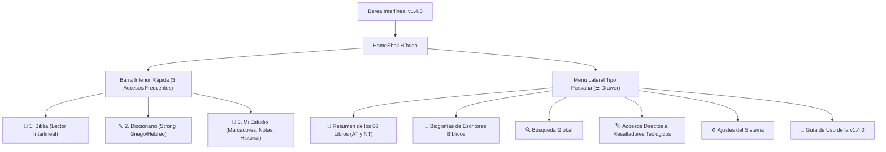

# 📜 Plan de Implementación v1.4.0: Módulo Especial de Resumen Bíblico, Biografías y Menú Lateral Híbrido

> **Documento de Especificación Técnica**: `PLAN_DESPLIEGUE_V1.4.0_MODULO_RESUMEN_Y_DRAWER.md`  
> **Versión Objetivo**: **v1.4.0 (Edición Enciclopedia Histórica y Persiana de Estudio)**  
> **Arquitectura de Navegación**: **Enfoque B (Modelo Híbrido)**: Barra Inferior Rápida (3 botones esenciales) + Menú Persiana Lateral (Navegación Profunda y Enciclopedia).  
> **Estilo Visual**: **Pergamino Alejandrino** (Vitela lisa marfil `#F5EEDB` / Códice espresso `#181412`, sin cuadrículas ni renglones).  
> **Regla de Publicación en GitHub**: **Release como BORRADOR (DRAFT)** estricto, para no disparar alertas OTA en la versión 1.3.1 en producción.  
> **Regla de Trabajo**: **No tocar código fuente (`lib/`) hasta aprobación formal.**

---

## 🧭 1. Resumen Ejecutivo del Salto a la Versión 1.4.0

La versión 1.4.0 transforma a **Berea Interlineal** de una herramienta puramente textual a una **plataforma completa de investigación bíblica, contextual e histórica**, optimizando la ergonomía de pantalla mediante el **Enfoque B (Híbrido)**.



### Objetivos Principales:
1. **Ergonomía de Estudio (Enfoque B)**: Mantener al alcance inmediato del pulgar la alternancia continua entre lectura bíblica, diccionario y notas personales (Barra Inferior), mientras se traslada la exploración histórica y herramientas profundas al menú lateral deslizante (Persiana).
2. **Enciclopedia Bíblica Integrada**: Incorporar fichas exhaustivas de los 66 libros de la Biblia con rigor histórico-gramatical y biografías completas de los escritores sagrados.
3. **Persistencia y Rendimiento Local (SQLite)**: Consulta instantánea (< 1 ms) y 100% offline desde `logos_k_logos.db`.
4. **Despliegue Seguro**: Publicación en GitHub Releases como **Borrador (Draft)**, impidiendo que los usuarios actuales en la v1.3.1 reciban notificaciones de actualización prematuras mientras la v1.4.0 se encuentra en fase de desarrollo y prueba.

---

## 🚪 2. Especificación del Menú Lateral Persiana (`BereaDrawer`)

**Archivo de implementación**: `lib/shell/widgets/berea_drawer.dart` integrado en `lib/shell/home_shell.dart`.

### 2.1. Comportamiento y Disparadores de Apertura
* **Botón Hamburguesa (☰)**: Ubicado en la esquina superior izquierda del `AppBar` en todas las pantallas principales.
* **Gesto Táctil (Edge Drag / Swipe)**: Deslizar el dedo desde el borde izquierdo de la pantalla hacia la derecha abre suavemente la persiana.
* **Animación de Apertura**: Desplazamiento lateral fluido con curva `Curves.easeOutCubic` (250 ms) y sombreado de penumbra cálida sobre el fondo (`Color(0x66000000)`).

### 2.2. Diseño Visual del Drawer (Estilo Pergamino Alejandrino)
* **Fondo del Drawer**:
  * Modo Claro: `Color(0xFFF7F1E1)` con borde sutil derecho en bronce `Color(0xFFDFCFAF)`.
  * Modo Oscuro: `Color(0xFF1B1613)` con borde sutil derecho en cuero tostado `Color(0xFF3D3025)`.
* **Cabecera Solemne (DrawerHeader)**:
  ```dart
  Container(
    padding: const EdgeInsets.fromLTRB(20, 48, 20, 20),
    decoration: BoxDecoration(
      color: isDark ? const Color(0xFF14110E) : const Color(0xFFEDE4CE),
      border: Border(
        bottom: BorderSide(
          color: isDark ? const Color(0xFF33271E) : const Color(0xFFDCCDB3),
          width: 1.0,
        ),
      ),
    ),
    child: Column(
      crossAxisAlignment: CrossAxisAlignment.start,
      children: [
        Row(
          children: [
            Container(
              width: 48,
              height: 48,
              decoration: BoxDecoration(
                borderRadius: BorderRadius.circular(12),
                border: Border.all(color: const Color(0xFFFBBF24), width: 1.2),
              ),
              child: ClipRRect(
                borderRadius: BorderRadius.circular(11),
                child: Image.asset('assets/images/berea_interlineal_icon.jpg', fit: BoxFit.cover),
              ),
            ),
            const SizedBox(width: 14),
            Column(
              crossAxisAlignment: CrossAxisAlignment.start,
              children: [
                Text(
                  'BEREA INTERLINEAL',
                  style: TextStyle(
                    fontSize: 16,
                    fontWeight: FontWeight.w900,
                    letterSpacing: 1.2,
                    color: isDark ? const Color(0xFFFDFBF7) : const Color(0xFF261D17),
                  ),
                ),
                Text(
                  'Versión 1.4.0 • Edición Estudio',
                  style: TextStyle(
                    fontSize: 12,
                    color: isDark ? const Color(0xFFF59E0B) : const Color(0xFFB45309),
                    fontWeight: FontWeight.w600,
                  ),
                ),
              ],
            ),
          ],
        ),
        const SizedBox(height: 12),
        Text(
          '«...escudriñando cada día las Escrituras» (Hechos 17:11)',
          style: TextStyle(
            fontSize: 11.5,
            fontStyle: FontStyle.italic,
            color: isDark ? const Color(0xFFE2C48E) : const Color(0xFF6B5A4B),
          ),
        ),
      ],
    ),
  )
  ```

### 2.3. Estructura de Opciones en el Menú Lateral
1. **SECCIÓN FONDO HISTÓRICO Y ENCICLOPEDIA**:
   * 📜 **Resumen de los 66 Libros**: Abre la enciclopedia canónica por testamentos y libros.
   * 👤 **Biografías de Escritores**: Galería biográfica cronológica de los autores inspirados.
2. **SECCIÓN INVESTIGACIÓN**:
   * 🔍 **Búsqueda Global**: Búsqueda coordinada en Biblia, Diccionarios y Notas.
3. **SECCIÓN RESALTADOS TEOLÓGICOS (Acceso Rápido a Mi Estudio)**:
   * 🟡 *Promesas de Dios*
   * 🟢 *Mandamientos y Exhortaciones*
   * 🔵 *Atributos de Dios*
   * 🔴 *Advertencias*
   * 🟣 *Profecía Bíblica*
   *(Al pulsar cualquiera, abre Mi Estudio pre-filtrado por esa etiqueta teológica).*
4. **SECCIÓN SISTEMA Y AYUDA**:
   * ⚙️ **Ajustes**: Preferencias de fuentes, respaldo SQLite y tema.
   * 🧭 **Guía de Uso v1.4.0**: Recorrido explicativo de las nuevas funciones.

---

## 📱 3. Especificación de la Barra Inferior Rápida (3 Botones Esenciales)

La barra inferior (`BottomNavigationBar`) se simplifica a los tres pilares de lectura diaria:

```text
┌────────────────────────────────────────────────────────┐
│     📖 Biblia     │    🔤 Diccionario    │   📑 Mi Estudio   │
└────────────────────────────────────────────────────────┘
```

1. **📖 Biblia**: Acceso al Lector Bíblico Interlineal (Capítulo continuo, hebreo/griego interactivo).
2. **🔤 Diccionario**: Léxico Strong Griego y Hebreo con buscador alfanumérico.
3. **📑 Mi Estudio**: Panel unificado con pestañas para **Marcadores** (con sus 5 colores teológicos), **Notas Personales** (en versículos y palabras Strong) e **Historial de Visitas**.

* **Beneficio directo**: Reduce la sobrecarga visual, elimina iconos apretados y permite usar la app de forma fluida con una sola mano.

---

## 📜 4. Módulo Especial: Resumen Bíblico de los 66 Libros

### 4.1. Fuentes Académicas y Bíblicas Utilizadas
* **Fuentes Primarias**: Texto Masorético Hebreo (BHS), Texto Crítico Griego (NA28 / Tischendorf) y Reina-Valera 1960.
* **Fuentes Históricas**: *International Standard Bible Encyclopedia (ISBE)*, *Easton's Bible Dictionary*, *Comentario Jamieson-Fausset-Brown (JFB)*, cronología de reyes hebreos de *Edwin R. Thiele* y obras históricas de *Flavio Josefo*.

### 4.2. Estructura Canónica de cada Ficha Técnica (6 Campos Obligatorios)
Cada libro (Génesis a Apocalipsis) dispondrá de los 6 bloques canónicos:
1. **👤 Autor / Escritor**: Identidad respaldada bíblica e históricamente, vocación, oficio original y evidencias internas/externas.
2. **🎯 Destinatarios Originales**: Comunidad o persona receptora inicial (Israel en el desierto, remanente en Babilonia, iglesias de Galacia, Teófilo, etc.).
3. **📅 Fecha y Rango de Redacción**: Estimación cronológica precisa (a.C. o d.C.).
4. **🏛️ Contexto Histórico, Político y Cultural**: Situación del pueblo de Dios, imperios dominantes (Egipto, Asiria, Babilonia, Persia, Grecia, Roma) y herejías combatidas.
5. **⭐ Temas Centrales y Versículo Clave**: Ejes doctrinales, palabras clave en idioma original y versículo lema con hipervínculo que salta directamente al interlineal.
6. **🌱 Aplicación Práctica para Hoy**: 3 lecciones espirituales concretas para la vida devocional contemporánea.

### 4.3. Acceso Dual en la Interfaz
1. **Desde el Menú Lateral (Persiana)**: Explora la lista de los 66 libros agrupados por género (Pentateuco, Históricos, Poéticos, Profetas, Evangelios, Epístolas, etc.).
2. **Directo desde el Lector Bíblico (Ficha en AppBar)**:
   * Mientras el usuario lee cualquier capítulo (ej. Génesis 1), un botón en forma de pergamino en el AppBar abre un **Modal Deslizable (BottomSheet)** con la ficha histórica de ese libro sin perder el versículo actual.

---

## 👤 5. Módulo de Biografías de Escritores Sagrados

Galardón biográfico de los hombres inspirados por Dios para redactar las Escrituras:
* **Antiguo Testamento**: Moisés, Josué, Samuel, David, Salomón, Isaías, Jeremías, Ezequiel, Daniel, los 12 profetas menores, Esdras, Nehemías, Mardoqueo.
* **Nuevo Testamento**: Mateo, Marcos, Lucas, Juan, Pablo, Pedro, Santiago, Judas, autor de Hebreos.

### Ficha Biográfica:
* Nombre en español y grafía original (Hebreo/Griego con su código Strong interactivo).
* Época y cronología vital.
* Ocupación terrenal y contexto de llamamiento.
* Libros bíblicos redactados.
* Versículo bíblico de llamamiento / testimonio personal.
* Síntesis de vida, ministerio y legado teológico.

---

## 💾 6. Modelo de Datos SQLite Local (`logos_k_logos.db`)

Para garantizar respuesta inmediata (< 1 ms) y disponibilidad 100% offline, se añaden las siguientes tablas a la base de datos principal:

```sql
-- 1. Tabla de Fichas de Resumen Bíblico
CREATE TABLE IF NOT EXISTS book_summaries (
    book_id INTEGER PRIMARY KEY,            -- ID del libro (1 = Génesis, 66 = Apocalipsis)
    testament TEXT NOT NULL,                -- 'OT' o 'NT'
    category TEXT NOT NULL,                 -- 'Pentateuco', 'Evangelios', 'Epístolas Paulinas', etc.
    author_id INTEGER NOT NULL,             -- Clave foránea hacia biblical_authors
    recipients TEXT NOT NULL,               -- Destinatarios originales
    date_written TEXT NOT NULL,             -- Ej: 'c. 1446-1406 a.C.' o 'c. 60-62 d.C.'
    historical_context TEXT NOT NULL,       -- Reseña del entorno histórico-político
    key_themes TEXT NOT NULL,               -- Puntos doctrinales y teológicos
    key_verse_ref TEXT NOT NULL,            -- Ej: 'Génesis 1:1' o 'Romanos 1:16-17'
    practical_application TEXT NOT NULL,    -- Aplicación a la vida diaria
    FOREIGN KEY (author_id) REFERENCES biblical_authors(author_id)
);

-- 2. Tabla de Biografías de Escritores Bíblicos
CREATE TABLE IF NOT EXISTS biblical_authors (
    author_id INTEGER PRIMARY KEY AUTOINCREMENT,
    name_es TEXT NOT NULL,                  -- 'Moisés', 'Pablo', 'David'
    name_original TEXT NOT NULL,            -- 'מֹשֶׁה' o 'Παῦλος'
    strong_code TEXT,                       -- 'H4872' o 'G3972'
    era TEXT NOT NULL,                      -- 'Época Patriarcal', 'Reino Unido', 'Siglo I d.C.'
    occupation TEXT NOT NULL,               -- 'Príncipe, pastor y libertador', 'Médico', 'Fariseo'
    calling_verse TEXT NOT NULL,            -- 'Éxodo 3:4-10' o 'Hechos 9:3-6'
    biography TEXT NOT NULL                 -- Biografía completa estructurada
);

-- Índices de aceleración
CREATE INDEX IF NOT EXISTS idx_summaries_testament ON book_summaries(testament);
CREATE INDEX IF NOT EXISTS idx_summaries_category ON book_summaries(category);
CREATE INDEX IF NOT EXISTS idx_authors_name ON biblical_authors(name_es);
```

---

## 🧭 7. Especificación de la Guía de Uso Interactiva Integral (v1.4.0)

> [!IMPORTANT]
> **REQUISITO MANDATORIO DE FAMILIARIZACIÓN COMPLETA**:
> La versión 1.4.0 introduce un cambio de paradigma en la navegación (menú persiana lateral + barra inferior simplificada de 3 botones) y nuevos módulos enciclopédicos.  
> Por ello, la Guía de Uso Interactiva de esta versión **NO debe limitarse únicamente a lo nuevo**, sino que debe realizar un **recorrido integral coordinado** que abarque tanto las **funciones consolidadas existentes** (lector interlineal, diccionario Strong, notas y marcadores teológicos) como las **nuevas integraciones de la v1.4.0** (la persiana lateral ☰, las fichas de los 66 libros, las biografías de escritores y el filtrado rápido de resaltados).

### 7.1. Comportamiento y Disparadores del Recorrido
1. **Disparo Automático en Primer Arranque**: Al abrir por primera vez la v1.4.0 (o tras actualizar desde v1.3.1 o v1.3.0), la guía se inicia automáticamente para presentar el nuevo entorno.
2. **Reactivación Bajo Demanda**:
   * Desde **Ajustes ➔ Ver guía de uso** (`ListTile` interactivo permanente).
   * Desde el **Menú Lateral Persiana ➔ 🧭 Guía de Uso v1.4.0**.

### 7.2. Secuencia Maestra del Recorrido Guiado (8 Pasos)

| Paso | Badge / Categoría | Icono | Título del Paso | Explicación Didáctica al Usuario | Elemento UI Resaltado |
| :--- | :--- | :--- | :--- | :--- | :--- |
| **1** | `BIENVENIDA & LECTURA` | `auto_stories_rounded` | **Lector Bíblico Interlineal Continuo** | Lee fluidamente las Escrituras en español con su texto original en Hebreo y Griego. Toca cualquier palabra interlineal para ver su análisis gramatical y raíz. *(Función consolidada)* | Versículos y palabras interlineales en `BibleScreen` |
| **2** | `NUEVA NAVEGACIÓN` | `menu_rounded` | **Nuevo Menú Lateral: Persiana de Estudio (☰)** | ¡Gran novedad de la v1.4.0! Toca el icono ☰ o desliza tu dedo desde el borde izquierdo hacia la derecha para desplegar la persiana con todas las herramientas avanzadas. | Botón hamburguesa (☰) del AppBar |
| **3** | `NUEVO MÓDULO` | `history_edu_rounded` | **Resumen Bíblico de los 66 Libros** | Descubre el autor, fecha de redacción, contexto histórico, puntos clave y lecciones prácticas de cada libro. ¡Disponible en la persiana y también con el botón de pergamino en el lector! | Opción *«Resumen de los 66 Libros»* en el Drawer |
| **4** | `NUEVO MÓDULO` | `person_search_rounded` | **Biografías de Escritores Sagrados** | Conoce la vida, vocación y legado de los hombres inspirados por Dios (Moisés, David, Lucas, Pablo...), con enlaces interactivos a sus nombres en los idiomas originales. | Opción *«Biografías de Escritores»* en el Drawer |
| **5** | `LÉXICO Y RAÍCES` | `translate_rounded` | **Diccionario Strong Griego y Hebreo** | Accesible al instante en la barra inferior. Busca definiciones exhaustivas, concordancia y palabras derivadas con hipervínculos directos. *(Función consolidada)* | Pestaña *«Diccionario»* en la Barra Inferior |
| **6** | `ESTUDIO PERSONAL` | `bookmark_added_rounded` | **Mi Estudio: Notas, Marcadores e Historial** | Todo tu trabajo personal guardado de forma permanente en SQLite: notas devocionales, historial de versículos y marcadores ordenados. *(Función consolidada)* | Pestaña *«Mi Estudio»* en la Barra Inferior |
| **7** | `TEOLOGÍA VISUAL` | `palette_rounded` | **5 Resaltadores Teológicos con Filtro Rápido** | Clasifica versículos por colores doctrinales: 🟡 *Promesas*, 🟢 *Mandamientos*, 🔵 *Atributos de Dios*, 🔴 *Advertencias* y 🟣 *Profecía*. ¡Ahora puedes filtrarlos directamente desde el menú lateral! | Accesos directos teológicos en el Drawer |
| **8** | `AYUDA PERMANENTE` | `explore_rounded` | **Tu Guía Siempre a Mano** | Puedes volver a repasar este recorrido interactivo cuando lo desees desde el menú lateral o desde *Ajustes ➔ Ver guía de uso*. | Opción *«Guía de uso»* en Ajustes / Drawer |

### 7.3. Especificación Técnica de Implementación (`interactive_tour_service.dart`)
* La guía se implementa utilizando un overlay interactivo enfocado (`CustomPainter` con foco recortado suave `Color(0xBB000000)` y tarjeta flotante en estilo Pergamino Alejandrino con bordes ámbar).
* Las claves de control (`GlobalKey`) a registrar en el shell son:
  ```dart
  final GlobalKey tourDrawerButtonKey = GlobalKey();
  final GlobalKey tourBibleInterlinearKey = GlobalKey();
  final GlobalKey tourBottomNavDictionaryKey = GlobalKey();
  final GlobalKey tourBottomNavStudyKey = GlobalKey();
  final GlobalKey tourBookSummaryButtonKey = GlobalKey();
  final GlobalKey tourDrawerTheologicalKey = GlobalKey();
  ```
* Cada paso incluye:
  - Botón «Siguiente» estilizado en ámbar cálido.
  - Indicador numérico de paso (ej. `3 de 8`).
  - Botón «Saltar recorrido» en tinta sepia suave.

---

## 🔒 8. Protocolo de Despliegue v1.4.0: Release como BORRADOR (DRAFT)

> [!IMPORTANT]
> **PROTECCIÓN DE LA VERSIÓN 1.3.1 EN PRODUCCIÓN**:
> Actualmente los usuarios tienen instalada la v1.3.1 (o v1.3.0). El actualizador integrado en la app consulta GitHub Releases públicas para avisar al usuario.  
> **Para evitar que a los usuarios reales les aparezca un aviso de actualización anticipada a la v1.4.0 mientras aún se está desarrollando y puliendo, la Release en GitHub DEBE crearse obligatoriamente con el atributo `draft: true` (Borrador)**.

### 8.1. Comportamiento Técnico del Borrador en GitHub
* Una release en estado **Draft**:
  1. Es completamente invisible para usuarios no autenticados y para el endpoint público de actualización OTA de la app.
  2. Permite almacenar los APKs compilados de la v1.4.0 (`arm64-v8a`, `armeabi-v7a`, `x86_64`, `universal`) de forma segura en la nube de GitHub.
  3. Puede ser descargada e instalada manualmente por el equipo de desarrollo para pruebas en emuladores y dispositivos físicos.
  4. Cuando la versión esté 100% validada y lista para el público, simplemente se desmarca la casilla de borrador ("Publish release"), haciéndola oficial sin necesidad de recompilar.

### 8.2. Script Automatizado para Subida como Borrador (`tools/upload_v140_draft_release.py`)
El script de subida debe enviar el payload a la API de GitHub con:
```python
payload = {
    "tag_name": "v1.4.0",
    "name": "📜 Berea Interlineal v1.4.0 [BORRADOR EN DESARROLLO]",
    "body": release_notes_v140,
    "draft": True,       # <-- CRÍTICO: Mantiene la release oculta al actualizador OTA
    "prerelease": False,
}
```

---

## 🧪 9. Plan de Pruebas en Emulador Android

Antes de dar por concluida la fase técnica de la v1.4.0, el desarrollador debe ejecutar las pruebas en el emulador Android (`HONOR X6c API 35` o `emulator-5554`):

1. **Instalación limpia de la versión 1.4.0**:
   ```powershell
   adb -s emulator-5554 install -r "release_builds\v1.4.0\berea_interlineal_1.4.0_x86_64.apk"
   ```
2. **Pruebas de la Persiana (Navigation Drawer)**:
   * Tocar el icono ☰ y verificar que abra suavemente sin saltos ni congelamientos.
   * Probar el deslizamiento con el dedo (swipe) desde el borde izquierdo.
   * Verificar que la cabecera muestre el logo Berea, el lema de Hechos 17:11 y la versión 1.4.0.
   * Comprobar que al tocar "Búsqueda Global" o "Ajustes", navegue a la pantalla correspondiente y cierre el menú de forma natural.
3. **Pruebas de la Barra Inferior de 3 Botones**:
   * Alternar con rapidez entre **Biblia**, **Diccionario** y **Mi Estudio**.
   * Verificar que la posición de lectura (libro, capítulo y versículo) en la Biblia se mantenga intacta al volver de Diccionario o Mi Estudio.
4. **Pruebas de la Guía de Uso Integral (8 Pasos)**:
   * Verificar que en el primer inicio se reproduzca automáticamente el recorrido guiado de los 8 pasos (explicando tanto las funciones consolidadas como las nuevas).
   * Confirmar que se pueda repetir en cualquier momento desde *Ajustes ➔ Ver guía de uso* o desde la persiana lateral.
5. **Pruebas del Módulo de Resumen Bíblico**:
   * Abrir la ficha de Génesis, Salmos, Mateo y Romanos.
   * Tocar el versículo clave de la ficha y comprobar que salta inmediatamente al texto bíblico interlineal.
   * En el lector bíblico, tocar el icono de pergamino en el AppBar y verificar que se abra la ficha en un modal deslizable (BottomSheet) sobre el texto.
6. **Pruebas del Módulo de Biografías**:
   * Abrir el perfil de Moisés y de Pablo.
   * Tocar el código Strong de su nombre original (H4872 / G3972) y verificar que abre la definición léxica.
7. **Verificación Estética de Pergamino Alejandrino**:
   * Comprobar que el fondo sea liso (`#F5EEDB` en Claro / `#181412` en Oscuro), sin líneas de cuaderno ni cuadrículas ni manchas de bordes.
8. **Verificación del Estado de Borrador en GitHub**:
   * Constatar en la web de GitHub Releases que la release v1.4.0 tenga la etiqueta amarilla **Draft** y que la app v1.3.1 instalada en un dispositivo no marque aviso de nueva versión.

---

## 📋 10. Checklist de Implementación para el Desarrollador

* [ ] Crear las tablas `book_summaries` y `biblical_authors` en la base de datos SQLite `logos_k_logos.db`.
* [ ] Poblar los datos curados de los 66 libros y de los escritores bíblicos con rigor histórico y doctrinal.
* [ ] Diseñar el widget `BereaDrawer` en `lib/shell/widgets/berea_drawer.dart` con la estética de Pergamino Alejandrino.
* [ ] Reconfigurar `lib/shell/home_shell.dart` para implementar el **Enfoque B**: Barra inferior de 3 botones (`Biblia`, `Diccionario`, `Mi Estudio`) y Drawer lateral (☰).
* [ ] Crear la pantalla `BookSummariesScreen` y el modal `BookSummarySheet`.
* [ ] Crear la pantalla `BiblicalAuthorsScreen` con perfiles y enlaces Strong interactivos.
* [ ] Implementar la **Guía de Uso Interactiva Integral de 8 Pasos** cubriendo funciones consolidadas y las nuevas de la v1.4.0.
* [ ] Diseñar la tarjeta de novedades de la versión 1.4.0 en Ajustes y el botón para repetir la guía.
* [ ] Compilar los APKs de la v1.4.0 (`arm64-v8a`, `armeabi-v7a`, `x86_64`, `universal`) firmados con la clave de producción `berea-release.jks`.
* [ ] Almacenar los binarios en `release_builds/v1.4.0/` con su archivo `checksums.txt`.
* [ ] Probar la instalación y navegación fluida en el emulador Android.
* [ ] Ejecutar el script de despliegue a GitHub Releases configurado estrictamente como **Borrador (Draft: true)**.
* [ ] Confirmar que los usuarios de la versión 1.3.1 en producción no reciban alertas prematuras de actualización.
