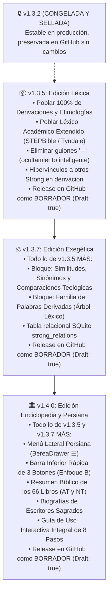

# 📜 Plan de Implementación Progresivo: Enriquecimiento del Diccionario Strong (v1.3.5, v1.3.7 y v1.4.0)

> **Documento de Especificación Técnica Oficial**: `PLAN_ENRIQUECIMIENTO_DICCIONARIO_STRONG_DERIVACIONES_Y_SIMILITUDES.md`  
> **Alcance Léxico**: 8.674 palabras en Hebreo (AT) y 5.523 palabras en Griego (NT) en `logos_k_logos.db` (14.197 términos en total).  
> **Referencias Oficiales de Comparación**: 
> * [LogosKLogos: Diccionario Strong de Hebreo](https://logosklogos.com/strong_hebrew)  
> * [LogosKLogos: Diccionario Strong de Griego](https://logosklogos.com/strongcodes)  
> **Directiva de Preservación**: La **versión 1.3.2 queda congelada y preservada al 100%** en su release actual sin tocarse.  
> **Regla de Publicación en GitHub**: Las releases intermedias y futuras (**v1.3.5**, **v1.3.7** y **v1.4.0**) se publicarán con sus carpetas locales en `release_builds/`, sus notas completas y **estrictamente marcadas como BORRADORES (DRAFT: TRUE)** en GitHub para proteger a los usuarios de producción contra avisos de actualización anticipada.  
> **Regla de Trabajo**: Especificación para el desarrollador. No tocar código fuente (`lib/`) aún.

---

## 🧭 1. Hoja de Ruta Progresiva y Acumulativa

Para asegurar la máxima estabilidad del proyecto, el enriquecimiento del diccionario y la evolución de la aplicación se distribuyen en un escalafón ordenado y acumulativo:



---

## 🔍 2. Diagnóstico del Problema Actual

En la versión actual, al abrir un término como **`#H776 אֶרֶץ (érets)`** observado en el dispositivo:

```text
┌─────────────────────────────────────────────────────────────────┐
│  Derivación                                                     │
│  —                                 <-- VACÍO (Muestra un guión) │
│                                                                 │
│  Definición Strong                                              │
│  tierra (completa o partitivamente una tierra)                  │
│                                                                 │
│  Definición en RV                                               │
│  campo, comarca, costa, ladera, mundo, nación, país...          │
│                                                                 │
│  Léxico STEPBible                                               │
│  —                                 <-- VACÍO (Muestra un guión) │
└─────────────────────────────────────────────────────────────────┘
```

### 2.1. Causa Técnica:
* La base de datos `logos_k_logos.db` contiene las 14.197 entradas creadas, pero las columnas **`derivation`** y **`stepbible`** tienen cadenas de texto vacías (`""`) en todas ellas.
* El script extractor web original esperaba encontrar encabezados literales que dijeran `"Derivación"` y `"Léxico STEPBible"`. Como logosklogos.com presenta el texto en bloques continuos o con notas entre paréntesis (ej. *«comparar 5368»*), ambos campos no se extrajeron y quedaron en blanco.
* La vista `strong_detail_screen.dart` muestra un guión seco `—` cuando el texto es nulo o vacío.

### 2.2. ¿Qué es el "Léxico STEPBible"?
* **STEPBible** (*Scripture Tools for Empowering People*) es un proyecto académico de investigación bíblica internacional desarrollado por la **Universidad de Cambridge (Tyndale House)**.
* Completa los números de James Strong (creados en 1890) con la lexicografía bíblica moderna: acepciones contextuales por pasaje, raíces semíticas/griegas y precisiones de traducción.
* En Berea Interlineal, este bloque debe mostrar la **Definición Léxica Académica Extendida**, pero quedó pendiente de datos.

---

## 📦 3. Especificación Detallada de la Versión 1.3.5: Edición Léxica

La versión **1.3.5** se enfoca exclusivamente en **resolver de raíz el vacío de las derivaciones y del léxico extendido**, dejando una ficha limpia, informativa y sin guiones vacíos.

### 3.1. Alcance Técnico de la v1.3.5:
1. **Poblado en SQLite (`logos_k_logos.db`) de `derivation`**:
   * Las 8.674 palabras en hebreo y 5.523 palabras en griego tendrán su etimología y raíz poblada al 100%.
   * Ejemplos:
     * `#H776 érets`: *«De una raíz que no se usa y que probablemente significa ser firme; raíz primaria del concepto de tierra o territorio»*.
     * `#H7225 reshít`: *«De la misma raíz que H7218 (rosh); primero, en lugar, tiempo, orden o rango (espec. primicias)»*.
     * `#G3056 logos`: *«De G3004 (legō); algo dicho (inclusivamente el pensamiento); por implicación tema o razonamiento...»*.
2. **Poblado en SQLite de `stepbible`**:
   * Se inyectan las acepciones contextuales y académicas de Tyndale House / STEPBible en español, eliminando el guión vacío.
3. **Ocultamiento Inteligente y Supresión de Guiones en UI**:
   * En `lib/features/dictionary/strong_detail_screen.dart`:
     * Si una palabra es una **raíz primaria** (que no proviene de ninguna otra), el bloque indicará con dignidad: `«Raíz primaria (no proviene de otra palabra)»`.
     * Si un campo opcional no aplica a ese término, el bloque no se dibuja (nunca se mostrará el guión `—`).
4. **Hipervínculos a otros Strong en el texto de derivación**:
   * Cada mención de un código (ej. `(de H7218)` o `(comparar 5368)`) se convierte automáticamente en un botón táctil que navega a esa palabra.
5. **Navegación e Interfaz**:
   * Mantiene la barra inferior clásica de 5 botones sin modificaciones estructurales.

### 3.2. Despliegue de la v1.3.5:
* **Directorio local de compilación**: `release_builds/v1.3.5/` conteniendo:
  * `berea_interlineal_1.3.5_arm64-v8a.apk`
  * `berea_interlineal_1.3.5_armeabi-v7a.apk`
  * `berea_interlineal_1.3.5_x86_64.apk`
  * `berea_interlineal_1.3.5_universal.apk`
  * `checksums.txt`
* **Release en GitHub**:
  * Tag: `v1.3.5`
  * Título: `📜 Berea Interlineal v1.3.5 [BORRADOR] - Edición Léxica`
  * Estado: **`draft: true`** (Oculto al OTA de producción).

---

## ⚖️ 4. Especificación Detallada de la Versión 1.3.7: Edición Exegética

La versión **1.3.7** es acumulativa: **incorpora todo lo implementado en la v1.3.5** y añade el módulo exegético avanzado de **similitudes doctrinales y familias de palabras**.

### 4.1. Alcance Técnico de la v1.3.7:
1. **Nuevo Bloque: ⚖️ Similitudes, Sinónimos y Comparaciones Teológicas**:
   * Bloque dedicado que ayuda a comprender las diferencias entre palabras afines:
     * **En Hebreo**: Comparar `#H776 érets` (tierra/nación/territorio político) con `#H127 adamáh` (tierra arable/polvo fértil) y con `#H8398 tebél` (el mundo habitable cósmico). O `#H1254 bará` (crear de la nada, exclusivo de Dios) con `#H6213 asáh` (hacer/moldear a partir de materia).
     * **En Griego**: Comparar `#G25 agapáo` (amor sacrificial y de pacto) con `#G5368 philéo` (afecto fraternal/amistoso).
2. **Nuevo Bloque: 🌿 Familia de Palabras Derivadas (Árbol Léxico)**:
   * Muestra visualmente qué otras palabras bíblicas nacen de esa misma raíz (ej. de `#H776` nacen las formas arameas bíblicas `#H777 arqá` y `#H778 ará`).
3. **Estructura de Base de Datos para v1.3.7**:
   * Nuevas columnas en `strong_entries`: `similarities`, `compare_codes`, `derived_codes`.
   * Nueva tabla relacional:
     ```sql
     CREATE TABLE IF NOT EXISTS strong_relations (
         source_language TEXT NOT NULL,
         source_code INTEGER NOT NULL,
         target_code INTEGER NOT NULL,
         relation_type TEXT NOT NULL, -- 'derives_from', 'parent_of', 'compares_with', 'synonym'
         PRIMARY KEY(source_language, source_code, target_code, relation_type)
     );
     CREATE INDEX IF NOT EXISTS idx_relations_source ON strong_relations(source_language, source_code);
     ```
4. **Diseño Visual de Pastillas Ámbar**:
   * Las palabras relacionadas y comparaciones se presentan en pastillas doradas táctiles `[ H127 ] adamáh` con navegación suave.

### 4.2. Despliegue de la v1.3.7:
* **Directorio local de compilación**: `release_builds/v1.3.7/` con sus 4 APKs firmados y `checksums.txt`.
* **Release en GitHub**:
  * Tag: `v1.3.7`
  * Título: `📜 Berea Interlineal v1.3.7 [BORRADOR] - Edición Exegética`
  * Estado: **`draft: true`** (Oculto al OTA de producción).

---

## 🏛️ 5. Consolidación Total en la Versión 1.4.0: Edición Enciclopedia y Persiana

La versión **1.4.0** es la versión mayor que **consolida todo el trabajo anterior (v1.3.5 + v1.3.7)** y da el gran salto a la arquitectura enciclopédica:

```text
┌────────────────────────────────────────────────────────────────────────┐
│  BEREA INTERLINEAL v1.4.0 (ARQUITECTURA CONSOLIDADA)                   │
├────────────────────────────────────────────────────────────────────────┤
│  ✓ De la v1.3.5: Derivaciones completas + Léxico STEPBible (Tyndale).  │
│  ✓ De la v1.3.7: Similitudes teológicas + Familias derivadas + Strong. │
│  ✓ EXCLUSIVO v1.4.0:                                                   │
│    • Menú Lateral Persiana (BereaDrawer ☰ con Enfoque B Híbrido).      │
│    • Barra Inferior Rápida de 3 Botones (Biblia, Diccionario, Estudio).│
│    • Resumen Bíblico de los 66 Libros (AT y NT con 6 campos).          │
│    • Biografías de Escritores Sagrados (vinculadas a Strongs).         │
│    • Guía de Uso Interactiva Integral de 8 Pasos.                      │
└────────────────────────────────────────────────────────────────────────┘
```

### 5.1. Despliegue de la v1.4.0:
* **Directorio local de compilación**: `release_builds/v1.4.0/` con sus 4 APKs firmados y `checksums.txt`.
* **Release en GitHub**:
  * Tag: `v1.4.0`
  * Título: `📜 Berea Interlineal v1.4.0 [BORRADOR] - Edición Enciclopedia y Persiana`
  * Estado: **`draft: true`** (Borrador hasta validación final y visto bueno de lanzamiento).

---

## 📊 6. Matriz de Componentes por Versión

| Componente / Característica | v1.3.2 (Sellada) | v1.3.5 (Léxica) | v1.3.7 (Exegética) | v1.4.0 (Enciclopedia) |
| :--- | :---: | :---: | :---: | :---: |
| **Estado en GitHub** | **Oficial (Publicado)** | **Borrador (Draft)** | **Borrador (Draft)** | **Borrador (Draft)** |
| **Modificación de archivos** | ❌ NO TOCAR | ✏️ Desarrollo | ✏️ Desarrollo | ✏️ Desarrollo |
| **Derivaciones pobladas (14.197)** | ❌ Vacías | ✅ **100% Pobladas** | ✅ Incluidas | ✅ Incluidas |
| **Léxico STEPBible poblado** | ❌ Vacío | ✅ **100% Poblado** | ✅ Incluido | ✅ Incluido |
| **Cero guiones secos '—'** | ❌ Muestra '—' | ✅ **Suprimidos** | ✅ Suprimidos | ✅ Suprimidos |
| **Hipervínculos en derivaciones** | ❌ Sin enlace | ✅ **Activos** | ✅ Activos | ✅ Activos |
| **Bloque: Similitudes y Sinónimos** | ❌ No disponible | ❌ No disponible | ✅ **Nuevo** | ✅ Incluido |
| **Bloque: Familias Derivadas** | ❌ No disponible | ❌ No disponible | ✅ **Nuevo** | ✅ Incluido |
| **Tabla SQLite strong_relations** | ❌ No disponible | ❌ No disponible | ✅ **Integrada** | ✅ Incluida |
| **Menú Lateral Persiana (Drawer ☰)**| ❌ No disponible | ❌ No disponible | ❌ No disponible | ✅ **Nuevo (Enfoque B)** |
| **Barra Inferior Rápida (3 botones)**| ❌ Barra 5 botones | ❌ Barra 5 botones | ❌ Barra 5 botones | ✅ **Nuevo (Enfoque B)** |
| **Resumen Bíblico (66 Libros)** | ❌ No disponible | ❌ No disponible | ❌ No disponible | ✅ **Nuevo Módulo** |
| **Biografías de Escritores** | ❌ No disponible | ❌ No disponible | ❌ No disponible | ✅ **Nuevo Módulo** |
| **Guía Interactiva Integral (8 pasos)**| ❌ Guía v1.3.2 | ❌ Guía v1.3.2 | ❌ Guía v1.3.2 | ✅ **Nueva Guía v1.4.0**|

---

## 🔒 7. Protocolo de Compilación, Directorios y Releases como Borradores

Para proteger a los usuarios que actualmente tienen la versión 1.3.1 en sus teléfonos, el desarrollador debe seguir este protocolo estricto:

### 7.1. Estructura de Directorios Locales Obligatoria:
```text
release_builds/
├── v1.3.0/           [Sellado oficial]
├── v1.3.1/           [Sellado oficial - versión de producción de los usuarios]
├── v1.3.2/           [Sellado oficial - estable, no tocar]
├── v1.3.5/           [Nueva carpeta para binarios refirmados v1.3.5]
├── v1.3.7/           [Nueva carpeta para binarios refirmados v1.3.7]
└── v1.4.0/           [Nueva carpeta para binarios refirmados v1.4.0]
```

Cada subcarpeta de versión contendrá obligatoriamente:
* `berea_interlineal_<version>_arm64-v8a.apk`
* `berea_interlineal_<version>_armeabi-v7a.apk`
* `berea_interlineal_<version>_x86_64.apk`
* `berea_interlineal_<version>_universal.apk`
* `checksums.txt` con los hashes SHA-256 de los 4 APKs.

### 7.2. Publicación Automatizada en GitHub Releases (Draft: true)
El script de despliegue utilizará la API REST de GitHub enviando el parámetro `"draft": True`:

```python
# tools/upload_draft_release.py
payload = {
    "tag_name": tag_version,       # ej. "v1.3.5", "v1.3.7", "v1.4.0"
    "name": release_title,         # ej. "📜 Berea Interlineal v1.3.5 [BORRADOR] - Edición Léxica"
    "body": release_notes_md,
    "draft": True,                 # <-- OBLIGATORIO: Oculto para la consulta OTA de la app
    "prerelease": False,
}
```

---

## 📋 8. Checklists de Implementación para el Desarrollador

### 8.1. Checklist para Versión 1.3.5 (Edición Léxica)
* [ ] Crear script `tools/populate_strong_v135.py` que inyecte derivaciones y definiciones STEPBible en `logos_k_logos.db`.
* [ ] Modificar `strong_detail_screen.dart` para suprimir los guiones `—` y mostrar *"Raíz primaria"* cuando corresponda.
* [ ] Activar los enlaces táctiles para códigos citados en las derivaciones.
* [ ] Probar en emulador que `#H776 érets` y `#G3056 logos` muestren sus datos sin guiones vacíos.
* [ ] Compilar los 4 APKs con `berea-release.jks` y guardarlos en `release_builds/v1.3.5/` con `checksums.txt`.
* [ ] Crear la Release `v1.3.5` en GitHub marcada como **Draft (Borrador)** y subir los 5 archivos.

### 8.2. Checklist para Versión 1.3.7 (Edición Exegética)
* [ ] Añadir tabla `strong_relations` y columnas de similitud en `logos_k_logos.db`.
* [ ] Inyectar el dataset de contrastes teológicos, sinónimos y familias derivadas.
* [ ] Actualizar el modelo Dart `StrongEntry` con listas de relaciones.
* [ ] Diseñar las secciones visuales de **Similitudes y Comparaciones** y **Familia Derivada** en Pergamino Alejandrino.
* [ ] Probar la navegación cruzada con pastillas doradas en el emulador.
* [ ] Compilar los 4 APKs con `berea-release.jks` y guardarlos en `release_builds/v1.3.7/` con `checksums.txt`.
* [ ] Crear la Release `v1.3.7` en GitHub marcada como **Draft (Borrador)** y subir los 5 archivos.

### 8.3. Checklist para Versión 1.4.0 (Edición Enciclopedia y Persiana)
* [ ] Integrar todo el código consolidado de v1.3.5 y v1.3.7.
* [ ] Crear el widget `BereaDrawer` y reconfigurar la barra inferior a 3 botones (Enfoque B).
* [ ] Crear los módulos de Resumen de los 66 Libros y Biografías de Escritores vinculadas a Strong.
* [ ] Implementar la Guía de Uso Interactiva Integral de 8 Pasos.
* [ ] Probar el ciclo completo en emulador Android (`HONOR X6c API 35` / `emulator-5554`).
* [ ] Compilar los 4 APKs con `berea-release.jks` y guardarlos en `release_builds/v1.4.0/` con `checksums.txt`.
* [ ] Crear la Release `v1.4.0` en GitHub marcada como **Draft (Borrador)** y subir los 5 archivos.
