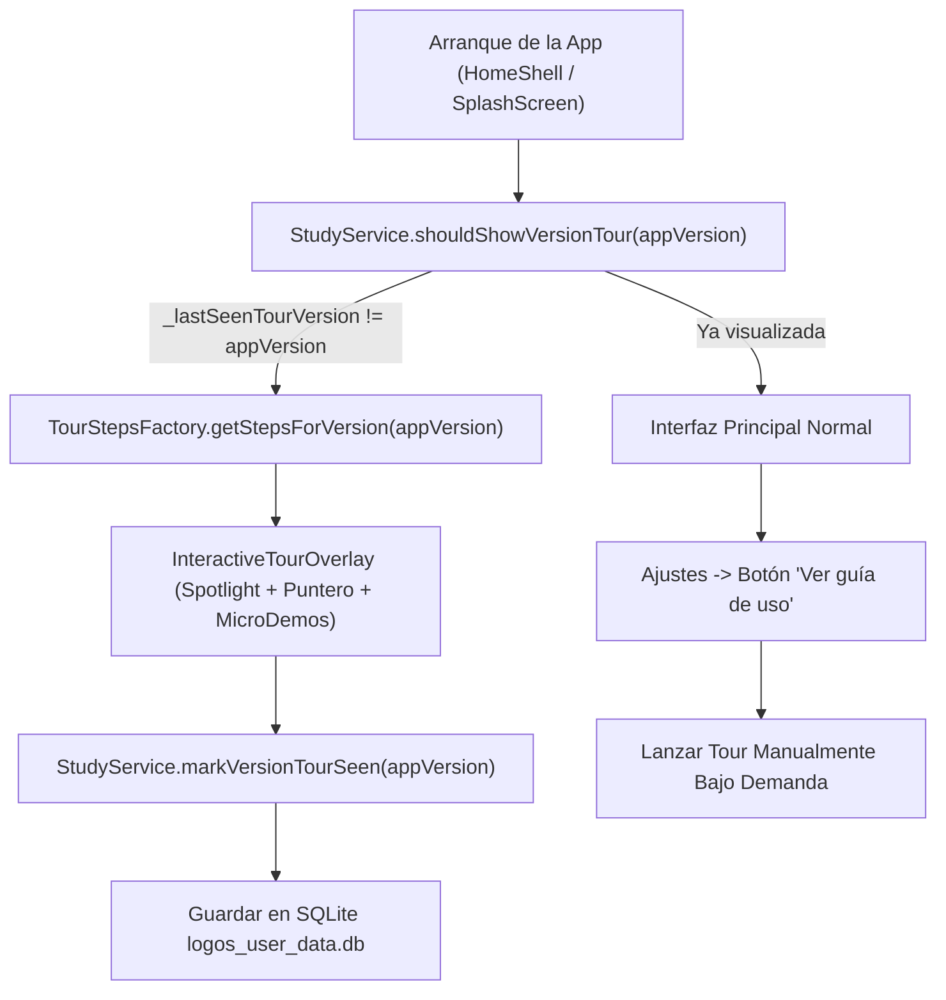

# 📘 Plan de Implementación: Estandarización Universal de Guías de Uso, Limpieza de Ajustes, Firmado Oficial y Despliegue Multi-Versión

> **Documento de Especificación para Desarrollador**: `PLAN_ESTANDARIZACION_GUIAS_Y_RELEASES.md`  
> **Ámbito de Aplicación**: Versiones Retroactivas (**v1.3.0**, **v1.3.1**), Versión Actual (**v1.3.2**) y Versiones Futuras (**v1.4.0+**)  
> **Nombre Oficial del Producto**: **Berea Interlineal**  
> **Repositorio Oficial**: `https://github.com/NetOpsSolutions/Berea_Interlineal.git`  
> **Clave Criptográfica Oficial**: `android/berea-release.jks` (Alias: `berea_key`)  

---

## 🎯 1. Objetivo y Alcance Técnico

> [!IMPORTANT]
> **ACLARACIÓN CRÍTICA DE ALCANCE: TRABAJO SOBRE LAS MISMAS VERSIONES EXISTENTES (NO ES v1.4)**
> Este trabajo **NO consiste en crear una nueva versión 1.4.0 ni avanzar el versionado a un número superior**.
> El objetivo exacto es **actualizar, estandarizar y reempaquetar las 3 versiones que YA EXISTEN en el proyecto y en GitHub**:
> * 📌 **Versión 1.3.0**
> * 📌 **Versión 1.3.1**
> * 📌 **Versión 1.3.2**
> 
> A cada una de estas **tres mismas versiones** se les aplicará:
> 1. **Identidad Visual y Marca 100% Unificada**: Las tres versiones compartirán obligatoriamente el **mismo nombre oficial ("Berea Interlineal")**, el **mismo nuevo logotipo oficial**, la **misma pantalla y animación de bienvenida (Splash Screen)**, y el **mismo sistema de notificaciones**.
> 2. **Su Guía de Uso Interactiva específica**: Adaptada fielmente a las funcionalidades que correspondían a esa versión.
> 3. **Depuración y Limpieza de Ajustes**: Retirando el *"Simulador de diseño / Demo OTA"*, opciones de depuración y listas kilométricas acumuladas, dejándola limpia tal como se definió en v1.3.2.
> 4. **Firmado Oficial de Producción**: Recompilando o refirmando con la nueva clave oficial permanente (`android/berea-release.jks`).
> 5. **Actualización de Artefactos**: Sustituyendo los archivos en `release_builds/v1.3.0`, `v1.3.1`, `v1.3.2` y actualizando sus respectivos Releases existentes en GitHub (sin crear releases nuevos).
> *(Cualquier versión posterior, como una futura v1.4.0, adoptará este estándar en su momento, pero el encargo actual es exclusivo sobre v1.3.0, v1.3.1 y v1.3.2).*

Este documento contiene la **guía paso a paso y la arquitectura completa** para que el desarrollador estandarice, compile y publique **estas versiones existentes de la aplicación** garantizando una experiencia de usuario consistente, profesional y libre de elementos residuales de depuración.

---

### 🏛️ 1.1. Matriz de Identidad Unificada vs. Diferenciación Funcional

Para evitar cualquier divergencia entre las tres versiones, el desarrollador debe aplicar estrictamente la siguiente regla:

| Componente | v1.3.0 | v1.3.1 | v1.3.2 | Regla de Estandarización |
| :--- | :---: | :---: | :---: | :--- |
| **Nombre de la Aplicación** | `Berea Interlineal` | `Berea Interlineal` | `Berea Interlineal` | **100% Idéntico** en Android (`android:label`), iOS y Flutter |
| **Logotipo e Iconos** | Nuevo Logo Oficial | Nuevo Logo Oficial | Nuevo Logo Oficial | **100% Idéntico** (Biblia abierta + lupa Hechos 17:11 en todos los `mipmap` y assets) |
| **Splash Screen (Animación de Entrada)** | Misma animación | Misma animación | Misma animación | **100% Idéntica** con barra de progreso ágil y logo iluminado |
| **Firma Criptográfica** | `berea-release.jks` | `berea-release.jks` | `berea-release.jks` | **100% Idéntica** (misma clave oficial de producción para todas) |
| **Soporte de Notificaciones** | Integrado | Integrado | Integrado | **100% Idéntico** en la barra de Android |
| **Pantalla de Ajustes Depurada** | Limpia (Sin demos) | Limpia (Sin demos) | Limpia (Sin demos) | **100% Idéntica** en diseño base y sin simuladores |
| **Diferenciador: Guía de Uso (*Tour*)** | *Guía v1.3.0* | *Guía v1.3.1* | *Guía v1.3.2* | **Específica**: Explica exactamente lo que esa versión ofrece |
| **Diferenciador: Novedades en Ajustes** | *Novedades v1.3.0* | *Novedades v1.3.1* | *Novedades v1.3.2* | **Específica**: Tarjeta con los hitos propios de la versión |
| **Diferenciador: Funcionalidades** | Base Interlineal | SQLite + OTA Base | Capítulo Continuo + SIL + Resaltadores | **Específica**: El conjunto de herramientas activas en el código |

---

### Requisitos Mandatarios:
1. **Guía de Uso Interactiva Contextual por Versión**:
   * Cada versión instalada o actualizada debe ejecutar automáticamente (en su primer inicio) un recorrido interactivo (*Tour*) con **las novedades exactas introducidas en dicha versión**.
   * Debe existir siempre el botón permanente **«Ver guía de uso»** en Ajustes para volver a reproducirla bajo demanda.
2. **Depuración y Limpieza Radical de Ajustes (Settings Screen)**:
   * **Eliminación total** de herramientas de prueba o depuración (como *"Simulador de diseño / Demo OTA"* o interruptores de prueba).
   * **Tarjetas de novedades limpias y concisas**: Cada versión solo debe mostrar sus propios puntos destacados en un `Card` visualmente atractivo, evitando listas acumulativas excesivas o textos cortados.
3. **Firma Oficial de Producción en el 100% de los Paquetes**:
   * Todos los APKs de **v1.3.0**, **v1.3.1**, **v1.3.2** y versiones posteriores deben compilarse o refirmarse con el **Keystore Oficial Permanente** (`berea-release.jks`), alineados con `zipalign` y firmados en esquemas **v1, v2 y v3** con `apksigner`.
4. **Almacenamiento Local Estandarizado**:
   * Todos los binarios generados deben quedar resguardados en `release_builds/v<version>/` con sus cuatro variantes de procesador (`arm64-v8a`, `armeabi-v7a`, `x86_64`, `universal`) y su archivo `checksums.txt` (SHA-256).
5. **Despliegue y Sustitución Autónoma en GitHub Releases**:
   * Mediante scripts de automatización (vía GitHub REST API o GitHub CLI), el desarrollador/agente sustituirá los binarios obsoletos con firma debug en cada Release de GitHub (`1.3.0`, `1.3.1`, `1.3.2`) por los nuevos paquetes firmados oficialmente.

---

## 🧭 2. Arquitectura del Sistema de Guía Interactiva Dinámica



### 2.1. Patrón Factory: `TourStepsFactory`
Para que la aplicación adapte automáticamente los pasos según la versión en ejecución sin duplicar código, el desarrollador implementará o estructurará el generador de pasos en `lib/core/tour/tour_steps_factory.dart`:

```dart
class TourStepsFactory {
  static List<TourStepConfig> getStepsForVersion({
    required String version,
    required GlobalKey bibleKey,
    required GlobalKey searchBarKey,
    required GlobalKey dictionaryControlsKey,
    required GlobalKey studyTabsKey,
    required GlobalKey settingsKey,
  }) {
    switch (version) {
      case '1.3.0':
        return _buildV130Steps(bibleKey, searchBarKey, dictionaryControlsKey, studyTabsKey, settingsKey);
      case '1.3.1':
        return _buildV131Steps(bibleKey, searchBarKey, dictionaryControlsKey, studyTabsKey, settingsKey);
      case '1.3.2':
        return _buildV132Steps(bibleKey, searchBarKey, dictionaryControlsKey, studyTabsKey, settingsKey);
      case '1.4.0':
      default:
        return _buildV140Steps(bibleKey, searchBarKey, dictionaryControlsKey, studyTabsKey, settingsKey);
    }
  }
}
```

---

## 📜 3. Contenido Específico de la Guía de Uso por Versión

### 🔹 Versión 1.3.0: *Génesis de la Interfaz & Navegación Bíblica*
En esta versión, la guía orienta al usuario que instala la app por primera vez:
1. **Paso 1: Animación de Bienvenida y Presentación Oficial (Splash)**:
   * *Badge*: `INICIO OFICIAL` | *Icono*: `play_circle_outline`
   * *Título*: Animación y Reverencia al Texto Sagrado
   * *Descripción*: Cada inicio presenta la animación oficial con manuscritos bíblicos, caracteres en griego y hebreo, y carga ágil en segundo plano.
2. **Paso 2: Navegación Bíblica Interlineal (Biblia)**:
   * *Badge*: `LECTURA BÍBLICA` | *Icono*: `menu_book_rounded`
   * *Título*: Hebreo, Griego y Español en Armonía
   * *Descripción*: Visualiza el texto bíblico palabra por palabra con su traducción literal en español, pronunciación fonética y códigos léxicos.
3. **Paso 3: Búsqueda Global Inmediata**:
   * *Badge*: `BÚSQUEDA` | *Icono*: `search_rounded`
   * *Título*: Encuentra Pasajes y Números Strong
   * *Descripción*: Escribe cualquier cita bíblica (ej. *Juan 3:16*) o una palabra clave para consultar todos los versículos al instante.
4. **Paso 4: Diccionario Léxico Strong**:
   * *Badge*: `DICCIONARIO` | *Icono*: `translate_rounded`
   * *Título*: Léxicos Griego y Hebreo Completos
   * *Descripción*: Explora las raíces morfológicas de cada término original del Antiguo y Nuevo Testamento.
5. **Paso 5: Mi Estudio Personal**:
   * *Badge*: `MI ESTUDIO` | *Icono*: `bookmarks_rounded`
   * *Título*: Marcadores, Notas y Registro de Historial
   * *Descripción*: Guarda versículos predilectos y consulta tus reflexiones organizadas con accesos directos e interactivos.
6. **Paso 6: Modo Oscuro y Apariencia**:
   * *Badge*: `AJUSTES` | *Icono*: `dark_mode_rounded`
   * *Título*: Modo Oscuro Predeterminado y Cómodo
   * *Descripción*: Diseñado para la lectura nocturna y prolongada sin fatiga visual.
7. **Paso 7: Repetir la Guía cuando Desees**:
   * *Badge*: `AYUDA SIEMPRE ACTIVA` | *Icono*: `explore_rounded`
   * *Título*: Vuelve a Ver esta Guía de Uso
   * *Descripción*: Puedes repasar este recorrido en cualquier momento desde *Ajustes → Ver guía de uso*.

---

### 🔹 Versión 1.3.1: *Persistencia SQLite Real & Motor OTA*
La guía destaca la seguridad de los datos y el nuevo actualizador:
1. **Paso 1: Persistencia Permanente en SQLite (`logos_user_data.db`)**:
   * *Badge*: `NOVEDAD v1.3.1` | *Icono*: `storage_rounded`
   * *Título*: Tus Notas y Marcadores Nunca se Borran
   * *Descripción*: Se incorpora una base de datos SQLite independiente con transacciones ACID. Aunque cierres forzosamente o reinicies tu teléfono, tus notas, marcadores e historial se conservan para siempre.
2. **Paso 2: Migrador Automático sin Pérdida de Datos**:
   * *Badge*: `MIGRACIÓN AUTOMÁTICA` | *Icono*: `sync_rounded`
   * *Título*: Datos Previos Importados al Instante
   * *Descripción*: Si tenías favoritos en versiones anteriores, el sistema los migra automáticamente a SQLite en el primer segundo de arranque.
3. **Paso 3: Hipervínculos Interactivos entre Códigos Strong**:
   * *Badge*: `ESTUDIO PROFUNDO` | *Icono*: `link_rounded`
   * *Título*: Referencias Cruzadas en las Definiciones
   * *Descripción*: Las palabras derivadas entre paréntesis dentro del diccionario ahora son enlaces táctiles: pulsa cualquier código para saltar a su raíz sin salir del estudio.
4. **Paso 4: Acordeón "Dónde Aparece" por Libro Bíblico**:
   * *Badge*: `CONCORDANCIA` | *Icono*: `format_list_bulleted_rounded`
   * *Título*: Ocurrencias Organizadas y Resaltadas
   * *Descripción*: Consulta en qué libros aparece cada palabra Strong, con carga perezosa rápida y resaltado nítido que no altera el color original del texto.
5. **Paso 5: Centro de Actualizaciones In-App OTA Multi-Procesador**:
   * *Badge*: `ACTUALIZACIONES` | *Icono*: `system_update_rounded`
   * *Título*: Descarga Automática según tu Procesador
   * *Descripción*: Detecta si tu dispositivo es de 64 bits (`arm64-v8a`), 32 bits (`armeabi-v7a`) o emulador, descargando el paquete óptimo con barra de progreso.
6. **Paso 6: Repetición de la Guía**:
   * *Badge*: `AYUDA` | *Icono*: `explore_rounded`
   * *Título*: Repite el Recorrido desde Ajustes.

---

### 🔹 Versión 1.3.2: *Identidad Berea Interlineal, Capítulo Continuo & Tipografías SIL*
La guía destaca la renovación visual y exegética:
1. **Paso 1: Nueva Identidad Oficial "Berea Interlineal"**:
   * *Badge*: `NUEVA IDENTIDAD` | *Icono*: `verified_rounded`
   * *Título*: Inspirados en Hechos 17:11
   * *Descripción*: Nuevo logotipo oficial: la Biblia abierta iluminada y la lupa de aumento exegético sobre Hechos 17:11 (*«escudriñando cada día las Escrituras»*).
2. **Paso 2: Lectura por Capítulo Completo y Gestos Laterales**:
   * *Badge*: `EXPERIENCIA BÍBLICA` | *Icono*: `menu_book_rounded`
   * *Título*: Lectura Continua y Expansión al Toque
   * *Descripción*: Lee los capítulos corridos con scroll vertical; pulsa cualquier versículo para desplegar su análisis interlineal en línea sin perder la lectura. Desliza a los lados para cambiar de capítulo.
3. **Paso 3: Tipografías Académicas SIL OFL Offline**:
   * *Badge*: `TIPOGRAFÍA ACADÉMICA` | *Icono*: `text_fields_rounded`
   * *Título*: Fuentes Ezra SIL, Cardo y Frank Ruhl Libre
   * *Descripción*: Soporte completo de diacríticos griegos politónicos y cantilaciones hebreas (*nikud*), con selector de tamaño y fuentes «TT».
4. **Paso 4: 5 Resaltadores Teológicos**:
   * *Badge*: `HERRAMIENTA TEOLÓGICA` | *Icono*: `palette_rounded`
   * *Título*: Resalta Versículos o Frases Seleccionadas
   * *Descripción*: Clasifica tus pasajes en Promesas (🟡), Mandamientos (🟢), Atributos de Dios (🔵), Advertencias (🌸) o Profecía (🟣).
5. **Paso 5: Notificaciones Nativas en la Bandeja de Android**:
   * *Badge*: `ACTUALIZACIONES` | *Icono*: `notifications_active_outlined`
   * *Título*: Avisos Nativos con Confirmación Explícita
   * *Descripción*: Android te notifica en la barra del sistema cuando hay una nueva versión, mostrando las novedades y pidiendo confirmación antes de descargar.
6. **Paso 6: Contraste Visual Accesible WCAG AAA**:
   * *Badge*: `ACCESIBILIDAD` | *Icono*: `contrast_rounded`
   * *Título*: Legibilidad Óptima en Temas Claro y Oscuro.
7. **Paso 7: Repetir Guía de Uso**:
   * Acceso permanente en Ajustes.

---

### 🔹 Versión 1.4.0+ (Referencia de Diseño para el Futuro — NO incluida en este lote de trabajo)
> *Nota para el desarrollador: Esta especificación se deja documentada como estándar de diseño para cuando se desarrolle dicha versión en el futuro. El trabajo inmediato actual es exclusivamente sobre v1.3.0, v1.3.1 y v1.3.2.*

La futura guía presentará en su momento los nuevos módulos de estudio y devocional:
1. **Paso 1: Módulo Resumen Bíblico (66 Libros)**:
   * *Badge*: `NUEVO MÓDULO` | *Icono*: `auto_stories_rounded`
   * *Título*: Autor, Destinatarios, Contexto y Aplicación
   * *Descripción*: Ficha técnica detallada de cada libro antes de leerlo, con contexto histórico, puntos más resaltantes y cómo aplica a tu vida diaria.
2. **Paso 2: Galería de Escritores y Personajes Bíblicos**:
   * *Badge*: `BIOGRAFÍAS` | *Icono*: `person_search_rounded`
   * *Título*: Vida, Ministerio y Llamamiento de los Escritores
   * *Descripción*: Conoce el trasfondo histórico de Moisés, David, Isaías, los Apóstoles y profetas con hipervínculos a sus escritos.
3. **Paso 3: Creador de Tarjetas Gráficas para WhatsApp**:
   * *Badge*: `DIFUSIÓN` | *Icono*: `share_rounded`
   * *Título*: Comparte Versículos en Estados y Chats
   * *Descripción*: Genera imágenes elegantes de pasajes bíblicos con fondos devocionales en alta resolución para WhatsApp e Instagram con un solo toque.
4. **Paso 4: Versículo del Día Devocional**:
   * *Badge*: `DEVOCIONAL DIARIO` | *Icono*: `wb_sunny_rounded`
   * *Título*: Palabra Diaria con Acceso al Interlineal
   * *Descripción*: Notificación matutina inspiradora y botón directo para estudiar los términos originales del pasaje diario.
5. **Paso 5: Referencias Cruzadas TSK en Línea**:
   * *Badge*: `ESTUDIO COMPARATIVO` | *Icono*: `alt_route_rounded`
   * *Título*: Treasury of Scripture Knowledge Integrado.

---

## 🧹 4. Guía de Depuración y Limpieza de la Pantalla de Ajustes

El desarrollador debe asegurarse de que la pantalla de Ajustes (`lib/features/settings/settings_screen.dart`) mantenga la **limpieza visual estrenada en la v1.3.2** en todas las versiones:

### 4.1. Elementos que DEBEN ELIMINARSE en todas las versiones:
* ❌ **Eliminar cualquier botón de simulación**: Retirar por completo el `ListTile` de *"Vista previa visual (Simulador de diseño)"* o *"Probar diálogo de novedades (Demo OTA)"*. La app en producción no debe mostrar herramientas de testing.
* ❌ **Eliminar listas acumuladas innecesarias**: No listar las 40 novedades de versiones anteriores. Cada versión debe contener **únicamente una tarjeta elegante con sus propias novedades clave** (entre 4 y 7 elementos).
* ❌ **Eliminar textos desbordados o cortados**: Todos los botones principales de actualización deben utilizar `SizedBox(width: double.infinity)` para garantizar que no se compriman en 3 líneas en pantallas angostas.

### 4.2. Estructura Limpia Estándar de `SettingsScreen`:
```dart
ListView(
  children: [
    // 1. Bloque: Lectura y Visualización
    _buildSectionHeader('Lectura y Visualización'),
    _buildThemeSwitchTile(),
    _buildChapterReadingModeSwitchTile(),
    _buildFluentReadingModeSwitchTile(),
    _buildFontScaleSlider(),

    // 2. Bloque: Mi Estudio Personal
    _buildSectionHeader('Mi Estudio Personal'),
    _buildStudyCounterTile(icon: Icons.bookmark, title: 'Marcadores guardados', count: bookmarksCount),
    _buildStudyCounterTile(icon: Icons.palette, title: 'Resaltados teológicos', count: highlightsCount),
    _buildStudyCounterTile(icon: Icons.edit_note, title: 'Notas en versículos', count: verseNotesCount),
    _buildStudyCounterTile(icon: Icons.history, title: 'Historial de visitas', count: historyCount),

    // 3. Bloque: Acerca de la Aplicación
    _buildSectionHeader('Acerca de la Aplicación'),
    ListTile(
      leading: const Icon(Icons.info_outline),
      title: const Text('Versión instalada'),
      subtitle: Text('Berea Interlineal v$currentVersion • Edición Oficial'),
    ),
    ListTile(
      leading: const Icon(Icons.play_circle_outline),
      title: const Text('Ver animación de bienvenida'),
      onTap: () => _openSplashScreen(),
    ),
    ListTile(
      key: tourReplayGuideKey,
      leading: const Icon(Icons.explore_outlined),
      title: const Text('Ver guía de uso'),
      subtitle: const Text('Iniciar recorrido interactivo animado de la versión'),
      onTap: onStartInteractiveGuide,
    ),

    // 4. Tarjeta de Novedades Limpia (Específica de la versión)
    _buildCleanVersionFeaturesCard(currentVersion),

    // 5. Bloque: Centro de Actualizaciones Oficial
    _buildSectionHeader('Actualizaciones del Sistema'),
    _buildCleanUpdaterCard(), // Solo botón ancho 'Comprobar actualizaciones' y fecha de verificación

    // 6. Enlaces y Créditos
    _buildSectionHeader('Recursos y Licencias'),
    _buildOfficialRepoTile(),
    _buildTypographyCreditsTile(),
    _buildLicenseTile(),
  ],
)
```

---

## 🔐 5. Procedimiento de Firmado Oficial de Producción

Todas las versiones empaquetadas deben ser firmadas con la **misma clave criptográfica de producción**:

### 5.1. Datos de la Clave
* **Ubicación del Keystore**: `android/berea-release.jks`
* **Tipo**: JKS / PKCS12 (RSA 2048 o 4096 bits, validez 10,000 días)
* **Alias**: `berea_key`
* **Configuración de Gradle**:
  En `android/key.properties`:
  ```properties
  storePassword=TU_PASSWORD_KEYSTORE
  keyPassword=TU_PASSWORD_ALIAS
  keyAlias=berea_key
  storeFile=berea-release.jks
  ```

### 5.2. Compilación de Paquetes Multi-Arquitectura
Para cada versión que se vaya a generar:
```bash
# 1. Compilación de APKs optimizados por arquitectura de procesador
flutter build apk --release --split-per-abi

# 2. Compilación del APK universal
flutter build apk --release
```

### 5.3. Alineación y Firmado con `apksigner`
Para cada APK resultante (`app-arm64-v8a-release.apk`, `app-armeabi-v7a-release.apk`, etc.):
```powershell
# Alinear archivo a 4 bytes
zipalign -v -p 4 input.apk input_aligned.apk

# Firmar con esquemas v1, v2 y v3
apksigner sign --ks android/berea-release.jks `
    --ks-key-alias berea_key `
    --v1-signing-enabled true `
    --v2-signing-enabled true `
    --v3-signing-enabled true `
    --v4-signing-enabled false `
    --out berea_interlineal_X.Y.Z_arm64-v8a.apk input_aligned.apk

# Verificar firma digital oficial
apksigner verify --verbose --print-certs berea_interlineal_X.Y.Z_arm64-v8a.apk
```

---

## 💾 6. Almacenamiento Local y Estructura en `release_builds/`

Los APKs compilados y firmados deben resguardarse en la estructura local del proyecto:

```
release_builds/
├── v1.3.0/
│   ├── berea_interlineal_1.3.0_arm64-v8a.apk
│   ├── berea_interlineal_1.3.0_armeabi-v7a.apk
│   ├── berea_interlineal_1.3.0_x86_64.apk
│   ├── berea_interlineal_1.3.0_universal.apk
│   └── checksums.txt
├── v1.3.1/
│   ├── berea_interlineal_1.3.1_arm64-v8a.apk
│   ├── berea_interlineal_1.3.1_armeabi-v7a.apk
│   ├── berea_interlineal_1.3.1_x86_64.apk
│   ├── berea_interlineal_1.3.1_universal.apk
│   └── checksums.txt
├── v1.3.2/
│   ├── berea_interlineal_1.3.2_arm64-v8a.apk
│   ├── berea_interlineal_1.3.2_armeabi-v7a.apk
│   ├── berea_interlineal_1.3.2_x86_64.apk
│   ├── berea_interlineal_1.3.2_universal.apk
│   ├── Berea_Interlineal_1.3.2.ipa (si se compila para iOS)
│   └── checksums.txt
└── v1.4.0/ (Próxima)
```

### Generación automática de `checksums.txt`:
```powershell
Get-ChildItem -Path "release_builds/vX.Y.Z" -Filter "*.apk" | ForEach-Object {
    $hash = (Get-FileHash -Path $_.FullName -Algorithm SHA256).Hash
    "$hash  $($_.Name)"
} | Out-File -FilePath "release_builds/vX.Y.Z/checksums.txt" -Encoding utf8
```

---

## 🚀 7. Script de Automatización de Despliegue en GitHub Releases

Para que el desarrollador o agente publique o sustituya los archivos en GitHub Releases sin que el usuario deba intervenir manualmente en la web:

```powershell
# Script: tools/deploy_release_to_github.ps1
param (
    [Parameter(Mandatory=$true)]
    [string]$VersionTag, # Ej: "1.3.0", "1.3.1", "1.3.2"
    [string]$Owner = "NetOpsSolutions",
    [string]$Repo = "Berea_Interlineal",
    [string]$GitHubToken = $env:GITHUB_TOKEN
)

$Headers = @{
    "Authorization" = "Bearer $GitHubToken"
    "Accept"        = "application/vnd.github+json"
}

$LocalFolder = "release_builds/v$VersionTag"
if (-not (Test-Path $LocalFolder)) {
    Write-Error "No se encontró la carpeta local: $LocalFolder"
    exit 1
}

Write-Host "Consultando Release en GitHub para el tag $VersionTag..." -ForegroundColor Cyan
$Release = Invoke-RestMethod -Uri "https://api.github.com/repos/$Owner/$Repo/releases/tags/$VersionTag" -Headers $Headers -Method Get
$ReleaseId = $Release.id
$UploadUrlBase = $Release.upload_url -replace '\{\?name,label\}', ''

# 1. Eliminar binarios obsoletos (con firma debug)
Write-Host "Eliminando assets antiguos..." -ForegroundColor Yellow
foreach ($Asset in $Release.assets) {
    Write-Host "  - Borrando $($Asset.name)..."
    Invoke-RestMethod -Uri "https://api.github.com/repos/$Owner/$Repo/releases/assets/$($Asset.id)" -Headers $Headers -Method Delete
}

# 2. Subir binarios oficiales con la nueva firma
$Files = Get-ChildItem -Path $LocalFolder -Include "*.apk", "*.ipa", "checksums.txt" -File
foreach ($File in $Files) {
    Write-Host "Subiendo: $($File.Name) ($([math]::Round($File.Length / 1MB, 2)) MB)..." -ForegroundColor Green
    $UploadUri = "$UploadUrlBase?name=$($File.Name)"
    $FileBytes = [System.IO.File]::ReadAllBytes($File.FullName)
    Invoke-RestMethod -Uri $UploadUri -Headers @{
        "Authorization" = "Bearer $GitHubToken"
        "Content-Type"  = "application/octet-stream"
    } -Method Post -Body $FileBytes
}

Write-Host "¡Release v$VersionTag actualizado exitosamente en GitHub!" -ForegroundColor Green
```

---

## 🗓️ 8. Checklist de Validación para el Desarrollador

Antes de dar por completada la tarea para cada versión, el desarrollador verificará:
- [x] La app compila en `--release` sin errores ni advertencias de deprecación.
- [x] La guía interactiva de uso aparece **automáticamente en el primer arranque** tras instalar la versión.
- [x] Los textos y badges de la guía reflejan con precisión **las novedades de esa versión concreta**.
- [x] El botón **«Ver guía de uso»** en Ajustes funciona y repite el recorrido cuando el usuario lo presiona.
- [x] La pantalla de Ajustes **no contiene simuladores de diseño ni botones de depuración**.
- [x] El APK está firmado con `berea-release.jks` (`apksigner verify` valida esquemas v1, v2 y v3).
- [x] Los archivos están almacenados localmente en `release_builds/v<version>/` con `checksums.txt`.
- [x] El Release de GitHub correspondiente tiene los nuevos archivos subidos y verificados con código HTTP 200.
