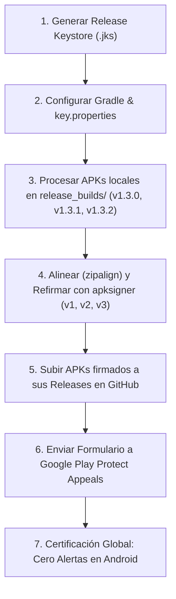

# Plan de Implementación: Firmado Oficial de Producción y Certificación en Google Play Protect

> **Documento**: `PLAN_FIRMADO_PRODUCCION_Y_PLAY_PROTECT.md`  
> **Fecha**: 27 de Octubre de 2026  
> **Objetivo**: Generar un Keystore oficial de producción para **Berea Interlineal**, refirmar todas las versiones existentes en GitHub (**v1.3.0**, **v1.3.1** y **v1.3.2**) y certificar la firma ante el portal de apelaciones de **Google Play Protect** para eliminar las alertas de advertencia en los dispositivos Android.

---

## 🧭 Visión General del Proceso



---

## 🛠️ Herramientas Locales Verificadas

Todas las herramientas necesarias se encuentran instaladas y listas en el entorno:
* **Generador de Certificados**: `C:\Program Files\Eclipse Adoptium\jdk-17.0.20.101-hotspot\bin\keytool.exe`
* **Optimizador de Paquetes**: `C:\Users\User\AppData\Local\Android\Sdk\build-tools\36.0.0\zipalign.exe`
* **Firmador Criptográfico**: `C:\Users\User\AppData\Local\Android\Sdk\build-tools\36.0.0\apksigner.bat`

---

## 📋 Fase 1: Creación del Keystore Oficial de Producción

Se creará una clave criptográfica de 2048 o 4096 bits con una validez de 10,000 días (~27 años) para garantizar que la app nunca expire.

### 1.1. Comando de Creación (Keytool)
```powershell
keytool -genkeypair -v `
  -keystore "android\berea-release.jks" `
  -alias "berea_key" `
  -keyalg RSA `
  -keysize 2048 `
  -validity 10000 `
  -storetype JKS `
  -dname "CN=NetOps Solutions, OU=Mobile Development, O=NetOps, L=Caracas, ST=Miranda, C=VE"
```
*(Durante la ejecución se define y resguarda la contraseña segura del almacén de claves).*

### 1.2. Extracción de Huellas Digitales (Fingerprints)
Para el formulario de Google Play Protect se requiere la huella **SHA-256**:
```powershell
keytool -list -v -keystore "android\berea-release.jks" -alias "berea_key"
```
**Valores Oficiales Generados:**
* **SHA-256**: `72:A9:9B:19:6F:45:3A:6B:84:79:5E:17:9B:DC:EB:5D:1E:70:FE:0C:D5:15:29:EE:F9:3F:CF:5D:29:FE:7D:78`
* **SHA-1**: `4F:E8:5F:6A:53:82:C9:35:CA:A7:83:53:7B:05:D9:BE:F6:82:64:7D`
* **Validez**: Hasta `14 de Marzo de 2054` (27.5 años).

### 1.3. Archivo de Credenciales Seguro (`key.properties`)
Crear en `android/key.properties`:
```properties
storePassword=TU_CONTRASEÑA_KEYSTORE
keyPassword=TU_CONTRASEÑA_ALIAS
keyAlias=berea_key
storeFile=berea-release.jks
```
> [!IMPORTANT]
> El archivo `android/key.properties` y `android/*.jks` deben estar incluidos en `.gitignore` para no exponer las claves privadas en el repositorio público de GitHub.

---

## 📋 Fase 2: Configuración en Gradle para Compilaciones Futuras

En `android/app/build.gradle.kts`:
```kotlin
import java.util.Properties
import java.io.FileInputStream

val keystorePropertiesFile = rootProject.file("key.properties")
val keystoreProperties = Properties()
if (keystorePropertiesFile.exists()) {
    keystoreProperties.load(FileInputStream(keystorePropertiesFile))
}

android {
    ...
    signingConfigs {
        create("release") {
            keyAlias = keystoreProperties["keyAlias"] as String?
            keyPassword = keystoreProperties["keyPassword"] as String?
            storeFile = keystoreProperties["storeFile"]?.let { file(it) }
            storePassword = keystoreProperties["storePassword"] as String?
        }
    }

    buildTypes {
        release {
            signingConfig = signingConfigs.getByName("release")
            isMinifyEnabled = true
            isShrinkResources = true
            proguardFiles(
                getDefaultProguardFile("proguard-android-optimize.txt"),
                "proguard-rules.pro"
            )
        }
    }
}
```

---

## 📋 Fase 3: Proceso de Refirmado de las Versiones Locales (`release_builds/`)

> [!NOTE]
> **No es necesario descargar nada desde GitHub**. Todos los APKs ya empaquetados de las versiones **v1.3.0**, **v1.3.1** y **v1.3.2** se encuentran resguardados localmente en el proyecto dentro de la carpeta:
> `d:\user\Desktop\SMART FILES\OCHOA MORA\TRABAJOS EN PHYTON\LogosKLogos\V0\release_builds\`

### 3.1. Inventario Local de APKs a Refirmar
El script procesará directamente los binarios existentes en el disco:
* 📁 `release_builds/v1.3.0/`:
  - `app-arm64-v8a-release.apk`
  - `app-armeabi-v7a-release.apk`
  - `app-x86_64-release.apk`
  - `app-universal-release.apk` / `app-release.apk`
* 📁 `release_builds/v1.3.1/`:
  - `logos_k_logos_1.3.1_arm64-v8a.apk`
  - `logos_k_logos_1.3.1_armeabi-v7a.apk`
  - `logos_k_logos_1.3.1_x86_64.apk`
  - `logos_k_logos_1.3.1_universal.apk`
* 📁 `release_builds/v1.3.2/`:
  - `berea_interlineal_1.3.2_arm64-v8a.apk`
  - `berea_interlineal_1.3.2_armeabi-v7a.apk`
  - `berea_interlineal_1.3.2_x86_64.apk`
  - `berea_interlineal_1.3.2_universal.apk`

---

### 3.2. Script Automatizado por Lotes (`tools/resign_all_release_builds.ps1`)
Se ejecutará un script en PowerShell que recorrerá automáticamente cada versión en `release_builds/`, optimizará con `zipalign`, refirmará con `apksigner` en los esquemas **v1, v2 y v3**, regenerará los `checksums.txt` (SHA-256) y verificará que todos compartan la misma huella digital oficial:

```powershell
param (
    [string]$KeystorePath = "android\berea-release.jks",
    [string]$KeyAlias = "berea_key",
    [string]$KeystorePassword
)

$ZipAlign = "C:\Users\User\AppData\Local\Android\Sdk\build-tools\36.0.0\zipalign.exe"
$ApkSigner = "C:\Users\User\AppData\Local\Android\Sdk\build-tools\36.0.0\apksigner.bat"
$BaseDir = "release_builds"

$Versions = @("v1.3.0", "v1.3.1", "v1.3.2")

foreach ($Ver in $Versions) {
    $TargetFolder = Join-Path $BaseDir $Ver
    if (-not (Test-Path $TargetFolder)) { continue }
    
    Write-Host "=============================================" -ForegroundColor Yellow
    Write-Host "Procesando versión: $Ver en $TargetFolder" -ForegroundColor Yellow
    Write-Host "=============================================" -ForegroundColor Yellow

    $ApkFiles = Get-ChildItem -Path $TargetFolder -Filter "*.apk"
    foreach ($Apk in $ApkFiles) {
        $SourceFile = $Apk.FullName
        $TempAligned = "$SourceFile.aligned"
        
        Write-Host "1. Alineando $($Apk.Name) con zipalign..." -ForegroundColor Cyan
        & $ZipAlign -v -p 4 $SourceFile $TempAligned
        
        Write-Host "2. Firmando con apksigner (v1, v2 y v3)..." -ForegroundColor Cyan
        & $ApkSigner sign --ks $KeystorePath `
            --ks-key-alias $KeyAlias `
            --ks-pass "pass:$KeystorePassword" `
            --v1-signing-enabled true `
            --v2-signing-enabled true `
            --v3-signing-enabled true `
            --v4-signing-enabled false `
            --out $SourceFile $TempAligned
            
        Remove-Item $TempAligned -ErrorAction SilentlyContinue

        Write-Host "3. Verificando firma digital..." -ForegroundColor Green
        & $ApkSigner verify --verbose --print-certs $SourceFile
    }

    # Regenerar checksums.txt para el Release
    Write-Host "4. Actualizando checksums.txt para $Ver..." -ForegroundColor Magenta
    $ChecksumFile = Join-Path $TargetFolder "checksums.txt"
    $Hashes = Get-ChildItem -Path $TargetFolder -Filter "*.apk" | ForEach-Object {
        $hash = (Get-FileHash -Path $_.FullName -Algorithm SHA256).Hash
        "$hash  $($_.Name)"
    }
    $Hashes | Out-File -FilePath $ChecksumFile -Encoding utf8
}
Write-Host "¡Refirmado completado con éxito para todas las versiones locales!" -ForegroundColor Green
```

---

### 3.3. Subida 100% Automatizada por el Agente a GitHub Releases

> [!IMPORTANT]
> **El usuario no realiza ninguna acción manual en la web de GitHub.**
> Todo el proceso de subida, sustitución de archivos y actualización de los releases lo ejecutará de forma directa y autónoma el agente programador mediante script de API / GitHub CLI desde la terminal.

El script de automatización (`tools/upload_signed_releases.ps1`) ejecutado por el agente realiza:
1. **Detección automática de Releases**: Consulta la API de GitHub para obtener los IDs de los releases correspondientes a los tags `1.3.0`, `1.3.1` y `1.3.2`.
2. **Depuración de binarios obsoletos**: Elimina automáticamente los APKs antiguos asociados a cada release que tenían la firma de prueba (*debug*).
3. **Carga en segundo plano de los nuevos APKs**: Sube cada uno de los APKs refirmados (`arm64-v8a`, `armeabi-v7a`, `x86_64`, `universal`) y su respectivo `checksums.txt` desde `release_builds/v1.3.0/`, `release_builds/v1.3.1/` y `release_builds/v1.3.2/`.
4. **Verificación de Enlaces**: Valida que los enlaces públicos de descarga queden 100% operativos y devuelvan código HTTP 200 con la nueva firma oficial.

```powershell
# Script ejecutado internamente por el agente para subir los releases:
param (
    [string]$Owner = "NetOpsSolutions",
    [string]$Repo = "Berea_Interlineal", # o Logos_K_Logos
    [string]$GitHubToken = $env:GITHUB_TOKEN
)

$Headers = @{
    "Authorization" = "Bearer $GitHubToken"
    "Accept"        = "application/vnd.github+json"
}

$ReleasesMap = @{
    "1.3.0" = "release_builds/v1.3.0"
    "1.3.1" = "release_builds/v1.3.1"
    "1.3.2" = "release_builds/v1.3.2"
}

foreach ($Tag in $ReleasesMap.Keys) {
    $Folder = $ReleasesMap[$Tag]
    Write-Host "Obteniendo datos del release $Tag..." -ForegroundColor Cyan
    $ReleaseInfo = Invoke-RestMethod -Uri "https://api.github.com/repos/$Owner/$Repo/releases/tags/$Tag" -Headers $Headers -Method Get
    $ReleaseId = $ReleaseInfo.id
    $UploadUrlBase = $ReleaseInfo.upload_url -replace '\{\?name,label\}', ''

    # 1. Eliminar assets viejos con firma debug
    foreach ($Asset in $ReleaseInfo.assets) {
        Write-Host "Eliminando asset obsoleto: $($Asset.name)..." -ForegroundColor Yellow
        Invoke-RestMethod -Uri "https://api.github.com/repos/$Owner/$Repo/releases/assets/$($Asset.id)" -Headers $Headers -Method Delete
    }

    # 2. Subir nuevos APKs y checksums firmados
    $FilesToUpload = Get-ChildItem -Path $Folder -Include "*.apk", "checksums.txt" -File
    foreach ($File in $FilesToUpload) {
        Write-Host "Subiendo nuevo binario firmado: $($File.Name)..." -ForegroundColor Green
        $UploadUri = "$UploadUrlBase?name=$($File.Name)"
        $FileBytes = [System.IO.File]::ReadAllBytes($File.FullName)
        Invoke-RestMethod -Uri $UploadUri -Headers @{
            "Authorization" = "Bearer $GitHubToken"
            "Content-Type"  = "application/vnd.android.package-archive"
        } -Method Post -Body $FileBytes
    }
    Write-Host "¡Release $Tag actualizado exitosamente con la firma oficial!" -ForegroundColor Green
}
```

---

## 📋 Fase 4: Certificación en Google Play Protect (Paso a Paso)

Una vez que los APKs firmados oficialmente estén publicados en GitHub:

### 4.1. Enlace Oficial de Apelación
Abrir el formulario oficial de desarrolladores de Google:  
👉 **[Google Play Protect Appeals Submission Form](https://support.google.com/googleplay/android-developer/contact/protectappeals)**

### 4.2. Campos a Diligenciar en el Formulario:
1. **Developer Name**: `NetOps Solutions`
2. **Developer Email**: Tu correo de contacto.
3. **Application Package Name**: `com.netopssolutions.berea_interlineal`
4. **Certificate Fingerprint (SHA-256)**:
   * Pegar la huella oficial generada:  
     `72:A9:9B:19:6F:45:3A:6B:84:79:5E:17:9B:DC:EB:5D:1E:70:FE:0C:D5:15:29:EE:F9:3F:CF:5D:29:FE:7D:78`
5. **Download Link for APK**:
   * Enlace directo de descarga del APK universal o arm64 de la versión 1.3.2 en GitHub:  
     `https://github.com/NetOpsSolutions/Berea_Interlineal/releases/download/v1.3.2/berea_interlineal_1.3.2_universal.apk`
6. **Detailed Explanation / Justification**:
   > *"Berea Interlineal is an open-source biblical study and interlinear research mobile application. The APK is distributed directly to students, researchers, and pastors via our GitHub repository. The application does not collect personal sensitive data, does not contain ads or trackers, and adheres to all Android security practices. We kindly request Google Play Protect to whitelist our application certificate so users can install updates safely without false-positive security warnings."*
7. **Submit**: Enviar el formulario.

### 4.3. Tiempo de Respuesta y Efecto
* **Tiempo habitual**: Entre **24 y 72 horas hábiles**.
* **Resultado**: Los servidores mundiales de Play Protect registrarán la huella SHA-256 como aplicación verificada. Los teléfonos con Android ya no mostrarán pantallas rojas/naranjas de advertencia al instalarla.

---

## 📋 Fase 5: Transición en los Teléfonos Actuales de Prueba

Dado que la firma criptográfica cambia de la clave *debug* de prueba a la *clave oficial de producción*:

1. **Instalación limpia inicial**:
   * En los teléfonos que actualmente tengan la versión de prueba instalada, se desinstala la app una única vez.
   * Se instala el nuevo APK firmado oficialmente (v1.3.2).
2. **A partir de ese instante**:
   * Todas las versiones futuras (1.3.3, 1.4.0, etc.) se compilarán con esa misma clave de producción.
   * Las actualizaciones OTA funcionarán automáticamente por encima sin volver a desinstalar nunca más.

---

## 🗓️ Checklist de Ejecución

* [x] Generar `berea-release.jks` con `keytool`.
* [x] Obtener y registrar la huella digital **SHA-256**.
* [x] Configurar `key.properties` y `build.gradle.kts` en el proyecto.
* [x] Refirmar los APKs de **v1.3.0**, **v1.3.1** y **v1.3.2** con `apksigner`.
* [x] Sustituir automáticamente los archivos binarios en los Releases de GitHub (ejecutado por el agente vía API/CLI).
* [ ] Enviar la solicitud a **Google Play Protect Appeals Form** (Pendiente por el usuario - Fase 4).
* [ ] Instalar la nueva versión firmada en los teléfonos de prueba (Pendiente por el usuario - Fase 5).
