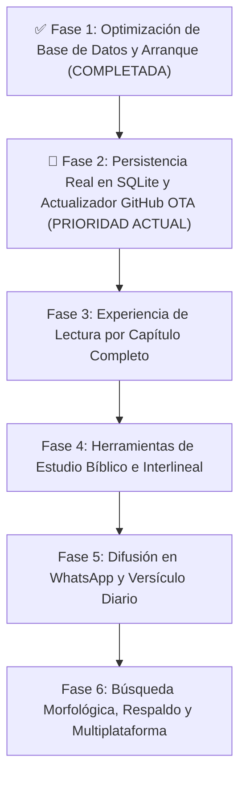
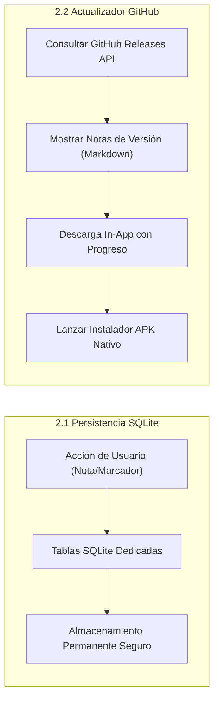
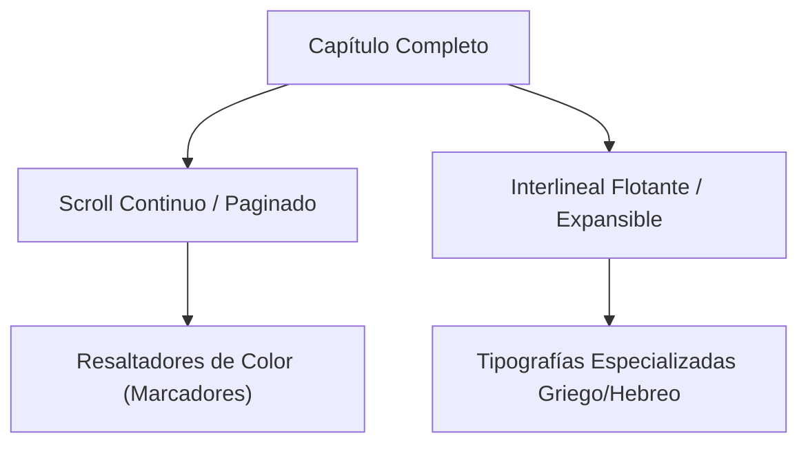
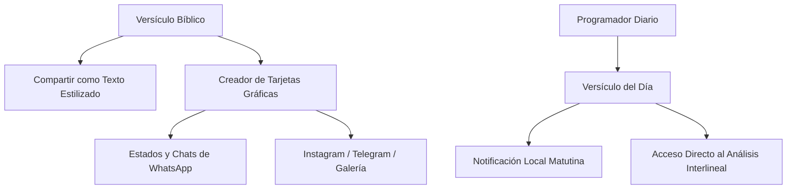

# 📋 Plan Estratégico de Mejoras e Integraciones: Logos K Logos

Este plan detalla la hoja de ruta técnica y funcional para consolidar **Logos K Logos** como una herramienta de referencia para el estudio bíblico interlineal (Hebreo BHS / Griego Tischendorf / RV1960).

---

## 🧭 Visión General de Fases y Prioridades



---

## ✅ Fase 1: Optimización de Base de Datos y Arranque (Completada)

- [x] Generación de base de datos SQLite preconstruida (`logos_k_logos.db` de 68.5 MB) con índices optimizados.
- [x] Copia directa de asset en primer arranque (arranque reducido de 10 minutos a pocos segundos).
- [x] Corrección de cachés de compilación en Windows (`kotlin.incremental=false`).
- [x] Corrección de bloqueo en Splash Screen con inicialización asíncrona y barra fluida.

---

## ✅ Fase 2: Persistencia Real de Datos Personales y Centro de Actualizaciones GitHub OTA (COMPLETADA)

> [!NOTE]
> Desplegada con éxito en la versión **1.3.1**:
> 1. **Persistencia SQLite de Usuario**: Implementada en `logos_user_data.db` (separada de la base bíblica de solo lectura), con tablas dedicadas (`user_bookmarks`, `user_verse_notes`, `user_strong_notes`, `user_history`), soporte de transacciones ACID, y migrador automático desde `SharedPreferences`.
> 2. **Centro de Actualizaciones GitHub OTA**: Integrado con soporte nativo de detección de arquitecturas (`arm64-v8a`, `armeabi-v7a`, `x86_64`, `universal`), cálculo de descargas con barra de progreso y auto-instalación mediante `FileProvider`.
> 3. **Release Builds v1.3.1**: Compilados y empaquetados en `release_builds/v1.3.1/` con cálculo de checksums SHA-256.



### 2.1. Migración de Persistencia a Tablas SQLite Dedicadas
- **Diagnóstico del problema**: Actualmente `StudyService` guardaba notas y marcadores serializados en cadenas de texto JSON dentro de `SharedPreferences`. En Android, este mecanismo es volátil ante cierres forzados, cambios de configuración o excepciones de deserialización, provocando la pérdida total de los datos del usuario al reiniciar.
- **Solución técnica en SQLite**:
  - Crear tablas nativas permanentes dentro de la base de datos local SQLite:
    - `user_bookmarks`: `(id, book_id, chapter, verse, preview, created_at)`
    - `user_verse_notes`: `(id, book_id, chapter, verse, note, updated_at)`
    - `user_strong_notes`: `(id, language, code, lemma, note, updated_at)`
    - `user_history`: `(id, book_id, chapter, verse, preview, visited_at)`
  - Transacciones atómicas ACID (nunca se corrompen ni se borran al cerrar el proceso).
  - Migrador automático: si existen datos antiguos en `SharedPreferences`, se importan a SQLite sin pérdida.

---

### 2.2. Sistema de Actualización In-App desde GitHub Releases (OTA Updater)
- **Repositorio Oficial del Proyecto**: [https://github.com/NetOpsSolutions/Logos_K_Logos.git](https://github.com/NetOpsSolutions/Logos_K_Logos.git)
  - **Owner**: `NetOpsSolutions`
  - **Repo**: `Logos_K_Logos`
  - **API Endpoint de Releases**: `https://api.github.com/repos/NetOpsSolutions/Logos_K_Logos/releases/latest`
- **Objetivo**: Distribución continua sin depender de Google Play Store. La app detecta, descarga e instala sus propias actualizaciones conectándose directamente al repositorio oficial en GitHub.
- **Flujo de Funcionamiento**:
  1. **Comprobación de Versión**:
     - Al iniciar la app (o manualmente desde *Ajustes > Buscar actualizaciones*), consulta el endpoint público de GitHub:
       ```http
       GET https://api.github.com/repos/NetOpsSolutions/Logos_K_Logos/releases/latest
       ```
     - Compara la versión instalada (`PackageInfo`, ej. `1.3.0`) contra el tag de la última release (ej. `v1.3.1`).
  2. **Ventana Informativa de Novedades**:
     - Si hay una versión nueva, se despliega una hoja modal elegante mostrando:
       - Número de versión y fecha de publicación.
       - **Notas de la versión** formateadas en Markdown (novedades, correcciones y mejoras).
       - Botón destacado: **«Descargar e Instalar Actualización»**.
  3. **Descargador Integrado con Progreso**:
     - Descarga el archivo `.apk` adjunto en la release de GitHub en segundo plano hacia la caché temporal del dispositivo.
     - Barra de progreso visual con porcentaje y peso (`XX MB / XX MB`).
  4. **Instalación Directa**:
     - Al completar la descarga, invoca el instalador nativo de paquetes de Android (`ACTION_INSTALL_PACKAGE` vía `FileProvider`).
     - El usuario simplemente pulsa "Actualizar" y el sistema operativo actualiza la aplicación conservando el 100% de los datos y notas existentes.

---

## 📖 Fase 3: Experiencia de Lectura e Interfaz (UI/UX)



### 1. Lectura por Capítulo Completo
- **Problema actual**: La lectura se realiza versículo a versículo mediante desplegables.
- **Mejora**:
  - Vista de lectura corrida del capítulo completo con scroll vertical fluido.
  - Al pulsar sobre cualquier versículo se expande o ilumina su bloque interlineal y detalles léxicos.
  - Botones y gestos de desplazamiento lateral (*swipe*) para pasar de capítulo rápidamente.

### 2. Tipografías Académicas para Lenguas Originales
- Incorporar fuentes open-source de alta fidelidad con soporte completo de marcas vocálicas y acentos (nikud y cantilaciones):
  - **Hebreo**: *Ezra SIL*, *SBL Hebrew* o *Frank Ruehl*.
  - **Griego**: *Cardo*, *Gentium Plus* o *SBL Greek*.

### 3. Marcado y Resaltado Visual (Highlighters)
- Permitir al usuario seleccionar texto y aplicar resaltador en 4 o 5 colores teológicos (ej. Amarillo para promesas, Verde para mandamientos, Azul para atributos de Dios, Rosa para advertencias).

---

## 🔍 Fase 4: Herramientas de Estudio Bíblico e Interlineal

### 1. Referencias Cruzadas (Cross-References)
- Integrar la base de datos de referencias cruzadas (*Treasury of Scripture Knowledge - TSK*).
- Al pie de cada versículo, mostrar las citas bíblicas correlacionadas con navegación en un toque sin perder la posición original.

### 2. Vista Paralela / Comparativa de Traducciones
- Permitir una vista dividida (*Split Screen* o toggle rápido) para contrastar:
  - Reina-Valera 1960
  - Traducción literal palabra por palabra
  - Texto hebreo/griego original
  - Posibilidad de incorporar versiones de dominio público adicionales (LBLA, KJV, Septuaginta LXX).

### 3. Pronunciación Fonética y Audio (TTS)
- Incorporar pronunciación aproximada o síntesis de voz (Text-to-Speech) para las raíces y palabras Strong en griego koiné y hebreo bíblico.
- Guía interactiva de transliteración fonética.

---

## 📲 Fase 5: Difusión en WhatsApp y Devocional Diario



### 1. Compartir por WhatsApp y Redes Sociales
- **Modo Texto Estilizado (WhatsApp / Portapapeles)**:
  - Formato estructurado con cita, versión, texto en español y opcionalmente el texto original en hebreo/griego.
- **Modo Creador de Tarjetas Visuales (Imágenes para Estados / Historias)**:
  - Generador visual integrado (`RepaintBoundary` exportado a PNG de alta resolución):
    - Selector de fondos: degradados sobrios, texturas de pergamino antiguo, amaneceres o fondos minimalistas oscuros.
    - Opciones tipográficas elegantes para la cita y el texto bíblico.
    - Botón directo de **«Compartir en WhatsApp»** (chat o Estado), **Instagram Stories** o guardar en galería.

### 2. Versículo del Día y Notificaciones Devocionales
- **Selección Curada de Pasajes**: Banco temático de versículos de bendición, consuelo y doctrina bíblica.
- **Notificaciones Locales Programadas**: Notificación matutina configurable (ej. 7:00 AM) que funciona **100% offline** o conectada sin consumir batería ni datos en segundo plano (`flutter_local_notifications`).
- **Banner Devocional en Inicio**: Tarjeta destacada al abrir la app con el pasaje del día y botón **«Estudiar interlineal»** para saltar directamente al análisis de sus palabras originales.

---

## 💾 Fase 6: Búsqueda Morfológica, Respaldo y Multiplataforma

### 1. Búsqueda Potenciada y Desglose Morfológico
- Búsqueda avanzada con filtros (por libro, testamento, rango, lema, código Strong exacto).
- Desglose legible de abreviaturas morfológicas (`V-AAI-3S` → *"Verbo Aoristo Activo Indicativo 3ª Sing"*).
- Gráficos de distribución de frecuencia por libro bíblico.

### 2. Respaldo y Multiplataforma
- Exportación e importación de notas, marcadores y configuraciones en formato estándar `.json` o archivo `.backup`.
- Soporte para compilaciones en **Windows Desktop** y **Web PWA**.

---

## 🗓️ Hoja de Ruta Actualizada (Milestones)

| Hito | Alcance | Prioridad |
|---|---|---|
| **M1: Persistencia SQLite de Usuario** | Mover notas, marcadores e historial a tablas nativas SQLite permanentes | ✅ Completada (v1.3.1) |
| **M2: Actualizador In-App GitHub OTA** | Conexión con GitHub Releases, visualización de notas de versión y descarga/instalación APK | ✅ Completada (v1.3.1) |
| **M3: Depuración final de Assets** | Excluir JSONs duplicados del bundle para dejar el APK en ~45 MB | ⭐⭐⭐ Alta |
| **M4: Difusión en WhatsApp y Redes** | Compartir texto estilizado y generador de imágenes de versículos para Estados | ⭐⭐⭐ Alta |
| **M5: Versículo del Día** | Notificación matutina, tarjeta devocional y salto al interlineal | ⭐⭐⭐ Alta |
| **M6: Modo Capítulo Continuo** | Lectura continua de capítulos bíblicos completos con scroll | ⭐⭐ Media |
| **M7: Tipografías y Colores** | Fuentes Ezra SIL / Cardo y sistema de resaltado en colores | ⭐⭐ Media |
| **M8: Referencias Cruzadas & Audio** | Dataset TSK de referencias cruzadas y pronunciación fonética | ⭐ Evolutiva |
