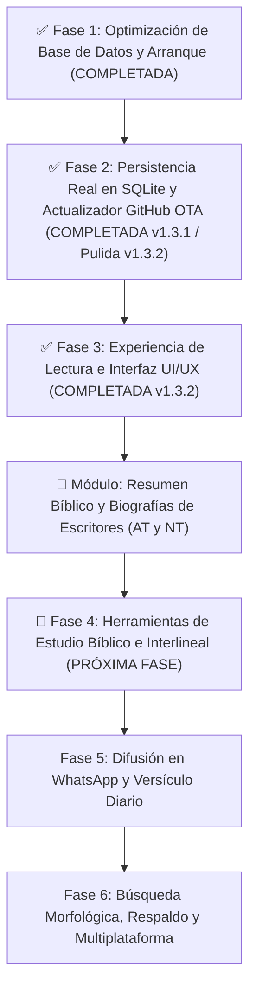
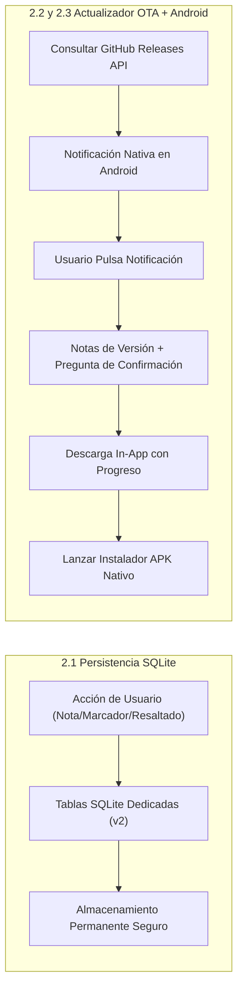
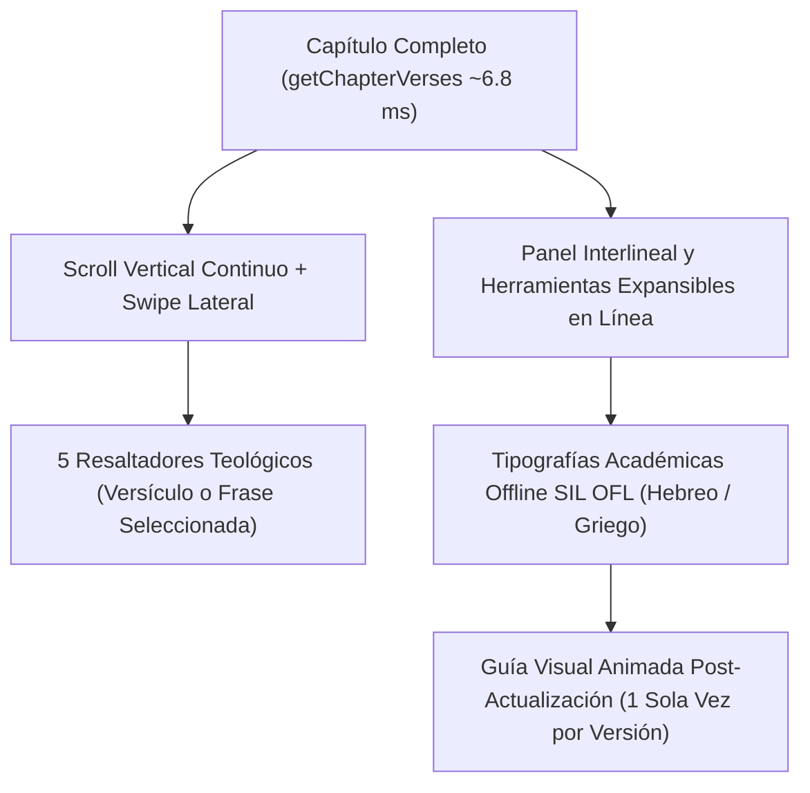
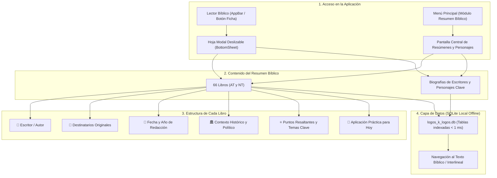
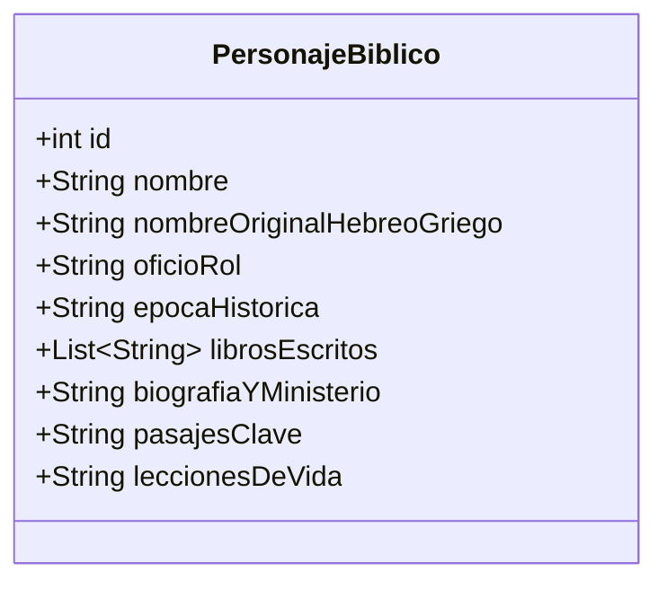
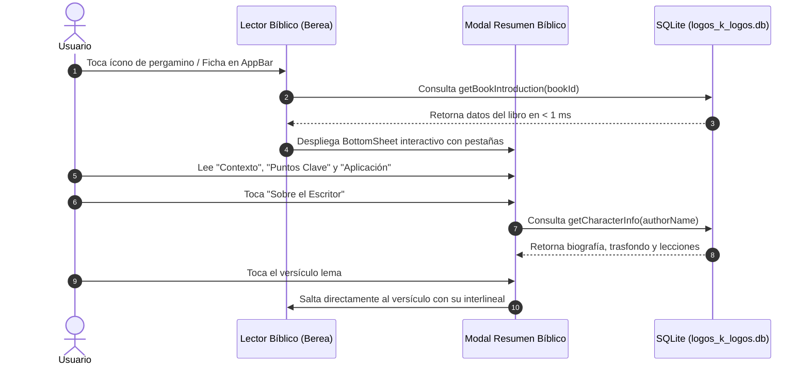
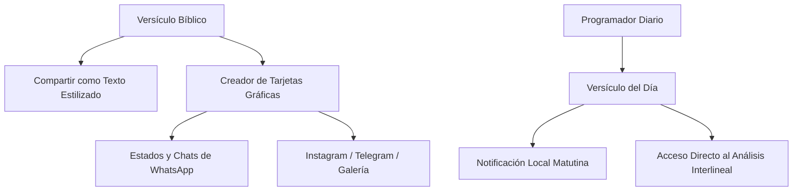

# 📋 Plan Estratégico de Mejoras e Integraciones: Berea Interlineal

Este plan detalla la hoja de ruta técnica y funcional para consolidar **Berea Interlineal** como una herramienta de referencia para el estudio bíblico interlineal (Hebreo BHS / Griego Tischendorf / RV1960).

> [!NOTE] Planes de Despliegue Específicos:
> * **Despliegue v1.3.2 y Rebranding**: Consultar [PLAN_DESPLIEGUE_V1.3.2_BEREA.md](file:///d:/user/Desktop/SMART%20FILES/OCHOA%20MORA/TRABAJOS%20EN%20PHYTON/LogosKLogos/V0/Archivos_md/PLAN_DESPLIEGUE_V1.3.2_BEREA.md) para los pasos de migración de repositorio, nuevo logo y actualización OTA.
> * **Empaquetado y Distribución iPhone**: Consultar [PLAN_IMPLEMENTACION_IPHONE.md](file:///d:/user/Desktop/SMART%20FILES/OCHOA%20MORA/TRABAJOS%20EN%20PHYTON/LogosKLogos/V0/Archivos_md/PLAN_IMPLEMENTACION_IPHONE.md) para el pipeline de iOS (.ipa).

---

## 🧭 Visión General de Fases y Prioridades



---

## ✅ Fase 1: Optimización de Base de Datos y Arranque (Completada)

- [x] Generación de base de datos SQLite preconstruida (`logos_k_logos.db` de 68.5 MB) con índices optimizados.
- [x] Copia directa de asset en primer arranque (arranque reducido de 10 minutos a pocos segundos).
- [x] Corrección de cachés de compilación en Windows (`kotlin.incremental=false`).
- [x] Corrección de bloqueo en Splash Screen con inicialización asíncrona y barra fluida.

---

## ✅ Fase 2: Persistencia Real de Datos Personales y Centro de Actualizaciones GitHub OTA (COMPLETADA y Pulida en v1.3.2)

> [!NOTE]
> Desplegada inicialmente en **v1.3.1** y perfeccionada en **v1.3.2**:
> 1. **Persistencia SQLite de Usuario**: Implementada en `logos_user_data.db` v2 (separada de la base bíblica de solo lectura), con tablas dedicadas (`user_bookmarks`, `user_highlights`, `user_verse_notes`, `user_strong_notes`, `user_history`, `user_settings`), soporte de transacciones ACID y migrador automático.
> 2. **Centro de Actualizaciones GitHub OTA + Centro de Notificaciones Android**: Integrado con detección nativa de arquitecturas (`arm64-v8a`, `armeabi-v7a`, `x86_64`, `universal`), notificación nativa en la barra de estado de Android (`POST_NOTIFICATIONS` + `NotificationCompat`), visualización de notas de versión, confirmación explícita de descarga, barra de progreso e instalación mediante `FileProvider`.
> 3. **Corrección de Contraste Visual WCAG AAA**: Solucionado el problema de contraste ilegible en avisos de actualización (`SnackBar` / botones) tanto en tema claro como en tema oscuro, y eliminada la opción de depuración *"Vista previa visual (Simulador de diseño)"*.



### 2.1. Migración de Persistencia a Tablas SQLite Dedicadas
- **Diagnóstico del problema**: Originalmente `StudyService` guardaba notas y marcadores serializados en cadenas JSON dentro de `SharedPreferences`, mecanismo volátil ante cierres forzados.
- **Solución técnica en SQLite (`logos_user_data.db` v2)**:
  - Tablas nativas permanentes con índices dedicados:
    - `user_bookmarks`: `(id, book_id, chapter, verse, preview, created_at)`
    - `user_highlights`: `(id, book_id, chapter, verse, color_key, preview, selected_text, updated_at)`
    - `user_verse_notes`: `(id, book_id, chapter, verse, note, updated_at)`
    - `user_strong_notes`: `(id, language, code, lemma, note, updated_at)`
    - `user_history`: `(id, book_id, chapter, verse, preview, visited_at)`
    - `user_settings`: `(key, value)`
  - Transacciones atómicas ACID y migración automática transparente entre versiones de esquema (`onUpgrade` v1 → v2).

---

### 2.2. Sistema de Actualización In-App desde GitHub Releases (OTA Updater)
- **Repositorio Oficial del Proyecto**: [https://github.com/NetOpsSolutions/Berea_Interlineal.git](https://github.com/NetOpsSolutions/Berea_Interlineal.git)
  - **Owner**: `NetOpsSolutions` | **Repo**: `Berea_Interlineal`
  - **API Endpoint de Releases**: `https://api.github.com/repos/NetOpsSolutions/Berea_Interlineal/releases/latest`
- **Flujo de Funcionamiento**:
  1. **Comprobación de Versión**: Consulta el endpoint de GitHub y compara semánticamente la versión instalada contra el último tag publicado, filtrando automáticamente el `.apk` compatible con el procesador del dispositivo (`arm64-v8a`, `armeabi-v7a`, `x86_64` o `universal`).
  2. **Notificación en el Centro de Notificaciones de Android** *(Nuevo en v1.3.2)*: Cuando existe una nueva actualización disponible, Android muestra una notificación expandible (`BigTextStyle`) en la bandeja del sistema con el número de versión y avance de novedades.
  3. **Apertura Directa, Notas y Confirmación de Descarga**: Al pulsar la notificación en Android, la app se abre directamente en la hoja modal de actualización mostrando las **notas completas de la versión**, el paquete detectado para la arquitectura del equipo y la **pregunta explícita de confirmación** (*«¿Deseas descargar e instalar la versión vX.Y.Z ahora?»*).
  4. **Descarga con Progreso e Instalación Nativa**: Al confirmar, cancela automáticamente la notificación de la bandeja, descarga el `.apk` con indicador de velocidad y porcentaje (`XX MB / XX MB`), y lanza `ACTION_INSTALL_PACKAGE` mediante `FileProvider` preservando el 100% de los datos del usuario.

---

### 2.3. Correcciones de Accesibilidad Visual y Limpieza de Interfaz OTA (Documentadas y Resueltas en v1.3.2)
- **Corrección de contraste ilegible en notificaciones de actualización**:
  - **Causa raíz detectada**: En Material 3 con **Modo Oscuro** activo, el `SnackBar` predeterminado renderizaba un fondo claro (`inverseSurface: #E6E1E5`) mientras los íconos y la acción *«VER NOVEDADES»* usaban `Colors.amberAccent` fijo (amarillo brillante sobre fondo casi blanco, resultando invisible). Adicionalmente, el botón *«Buscar actualizaciones»* en Ajustes se comprimía en 3 líneas cortadas en pantallas estrechas.
  - **Solución desplegada**: Se diseñó `AppSnackBar` y `SnackBarThemeData` adaptativos en `lib/core/theme.dart` con superficies oscuras/claras dedicadas, bordes definidos y acentos de contraste **WCAG AAA (> 9:1)** garantizados en ambos temas. Se reestructuró la tarjeta `_UpdaterCard` a ancho completo para evitar cortes de texto.
- **Eliminación del Simulador de Diseño**:
  - Se retiró por completo el bloque de depuración *«Vista previa visual (Simulador de diseño)»* en `SettingsScreen` para mantener una interfaz de producción limpia y profesional.

---

## ✅ 📖 Fase 3: Experiencia de Lectura e Interfaz (UI/UX) (COMPLETADA — v1.3.2)

> [!IMPORTANT]
> Desplegada en **v1.3.2** (`release_builds/v1.3.2/`, mantenida en entorno local de desarrollo sin publicar aún en GitHub hasta culminar el pulido integral de la fase).



### 1. Lectura por Capítulo Completo y Navegación Ágil
- **Consulta SQLite indexada de alto rendimiento**: Nuevo método `DatabaseService.getChapterVerses(bookId, chapter)` en 2 pasos sobre `idx_verses_book_ch_vs` e `idx_words_verse_pos` (carga los 176 versículos y 1,323 tokens de Salmos 119 en **~6.8 ms**).
- **Vista corrida con scroll vertical fluido**: Muestra todos los versículos del capítulo en lectura continua con selector instantáneo para alternar entre *Capítulo Completo* y *Versículo Individual*.
- **Interlineal y estudio expandible al toque**: Pulsar cualquier versículo ilumina suavemente el bloque y despliega en línea (`AnimatedSize`) su análisis interlineal palabra por palabra (RTL para Hebreo BHS, LTR para Griego Koiné), notas personales, marcadores y paleta de resaltado sin perder el contexto de lectura.
- **Gestos *Swipe* y Selector de Pasaje en 3 toques**: Deslizamiento horizontal (*swipe* izquierda/derecha) para avanzar o retroceder de capítulo (incluyendo transición automática entre libros consecutivos) y hoja modal rápida por pestañas (*1. Libro → 2. Capítulo → 3. Versículo*).

### 2. Tipografías Académicas Offline para Lenguas Originales (SIL Open Font License)
- Fuentes empaquetadas **100% offline** en `assets/fonts/` con soporte completo de vocalización tiberiana (*nikud*), cantilaciones hebreas y diacríticos griegos politónicos:
  - **Hebreo Bíblico (AT)**: *Ezra SIL* (`EzraSIL`) y *Frank Ruhl Libre* (`FrankRuhlLibre`).
  - **Griego Koiné (NT)**: *Cardo* (`Cardo` Regular/Bold) y *Gentium Plus* (`GentiumPlus` Regular/Bold).
- Selector tipográfico en vivo con vista previa inmediata y control deslizante de escala de lectura (`85%` a `145%`) accesible desde el lector (`Aa`) y desde *Ajustes*, aplicado transversalmente en Biblia, Diccionario Strong, Notas y Búsqueda Global.

### 3. Marcado y Resaltado Visual Teológico (Highlighters)
- **5 Categorías Teológicas con Paleta Adaptativa Claro/Oscuro**:
  1. 🟡 **Promesas** (Ámbar) — Pactos, bendiciones y fidelidad divina.
  2. 🟢 **Mandamientos** (Esmeralda) — Exhortaciones, obediencia y vida práctica.
  3. 🔵 **Atributos de Dios** (Azul) — Carácter divino, soberanía y doctrina.
  4. 🌸 **Advertencias** (Rosa) — Llamados al arrepentimiento, juicio y exhortación solemne.
  5. 🟣 **Profecía / Cristo** (Violeta) — Mesianismo, tipología y cumplimiento profético.
- **Doble modalidad de resaltado**:
  - **Versículo completo**: Un toque sobre la paleta del versículo expandido.
  - **Selección de palabras o frases**: Menú contextual personalizado (`_TheologicalSelectionToolbar`) al seleccionar cualquier fragmento de texto en el versículo.
- **Pestaña dedicada «Resaltados» en Mi Estudio**: Permite filtrar versículos resaltados por categoría teológica, saltar al pasaje en un toque o gestionar cada resaltado con persistencia permanente en SQLite (`user_highlights`).

### 4. Guía Visual Interactiva Post-Actualización (`InteractiveTourOverlay`)
- **Aparición única automática tras actualizar**: Al abrir la aplicación por primera vez en una versión nueva (ej. `v1.3.2`), `StudyService.shouldShowVersionTour` verifica la versión registrada en `logos_user_data.db` (`logos_last_seen_tour_version_v1`), despliega el recorrido interactivo animado **una única vez** y marca la versión como vista (`markVersionTourSeen`).
- **Recorrido animado paso a paso (*Spotlight* + puntero direccional + micro-demostraciones)**:
  1. **Biblia (Novedades v1.3.2)**: Despliega en vivo el versículo 1 con interlineal Hebreo/Griego, códigos Strong, paleta de 5 resaltadores teológicos y gestos *swipe* laterales.
  2. **Controles Superiores del Lector**: Alternancia *Capítulo Completo / Versículo Individual*, *Modo de Lectura Fluida* y selector tipográfico `TT` (*Ezra SIL*, *Cardo*, etc.).
  3. **Búsqueda Global**: Puntero animado y demostración tipo máquina de escribir con citas, palabras en español y códigos Strong (`G3056`).
  4. **Diccionario Strong**: Demostración animada para alternar entre Griego y Hebreo y consultar raíces o códigos (`H7225`, `λόγος`).
  5. **Mi Estudio**: Guía visual de *Marcadores*, *Resaltados Teológicos*, *Notas* e *Historial*.
  6. **Ajustes de Lectura y Apariencia**: Modo Claro / Modo Oscuro, Lectura por Capítulo Completo, Modo de Lectura Fluida y control deslizante de tamaño de letra.
  7. **Actualizaciones OTA**: Comprobación de versiones y notificaciones nativas en Android.
  8. **Repetición Manual Bajo Demanda**: Opción permanente **«Ver guía de uso»** ubicada en *Ajustes → Información de la aplicación*, justo debajo de *«Ver animación de bienvenida»*, para volver a iniciar la guía animada cuando el usuario lo desee.

---

## 📜 Módulo Especial: Resumen Bíblico y Biografías de Escritores (AT y NT)

> [!NOTE]
> Este módulo dota a **Berea Interlineal** de una base enciclopédica, histórica y pastoral profunda. Permite al usuario comprender el trasfondo exacto de cada libro antes o durante su lectura, así como profundizar en la vida, llamamiento y ministerio de los escritores inspirados por Dios.
> Aprovecha la totalidad de la base de datos de Antiguo y Nuevo Testamento (`logos_k_logos.db`) para vincular cada resumen directamente con el texto hebreo, griego e interlineal.



---

### 1. Estructura Obligatoria para los 66 Libros de la Biblia

Cada libro del Antiguo y Nuevo Testamento contará con una ficha técnica exhaustiva y redactada con rigor histórico-gramatical y calidez pastoral, compuesta por los 6 campos esenciales:

1. **👤 Escritor / Autor**: Identidad del escritor según la evidencia bíblica e histórica, su profesión, oficio original y antecedentes espirituales.
2. **🎯 Destinatarios Originales**: Audiencia inmediata a la que fue remitido el libro (el pueblo de Israel en el desierto, comunidades bajo el imperio babilónico, iglesias gentiles de Asia Menor, o individuos como Teófilo, Timoteo y Tito).
3. **📅 Fecha y Año de Redacción**: Cronología precisa o rango estimado de redacción (a.C. o d.C.).
4. **🏛️ Contexto Histórico, Político y Cultural**: Situación del pueblo de Dios, imperios dominantes de la época (Egipto, Asiria, Babilonia, Medo-Persia, Grecia ptolemaica/seléucida, Imperio Romano), y los desafíos espirituales o herejías que se enfrentaban.
5. **⭐ Puntos Más Resaltantes y Temas Clave**: Estructura temática condensada, eventos culminantes, palabras y doctrinas cardinales, junto con su **versículo lema / clave** con hipervínculo interactivo.
6. **🌱 Aplicación Práctica y Pastoral para Nuestra Vida**: Lecciones espirituales, éticas y devocionales aplicables al creyente contemporáneo, respondiendo a la pregunta: *«¿Cómo impacta este libro mi vida diaria hoy?»*.

---

### 2. Clasificación Canónica de los 66 Libros en el Sistema

#### Antiguo Testamento (39 Libros en Hebreo/Arameo BHS):
* **El Pentateuco / La Ley (Torá) [5 Libros]**:
  * *Génesis*: El libro de los orígenes (creación, caída, diluvio, pacto abrahámico y los patriarcas).
  * *Éxodo*: Redención de la esclavitud en Egipto, la pascua, travesía del mar y el pacto de la Ley en el Sinaí.
  * *Levítico*: La santidad de Dios, el sistema sacrificial, las fiestas solemnes y el sacerdocio aarónico.
  * *Números*: El censo y la peregrinación en el desierto de Sinaí a Moab; lealtad e incredulidad.
  * *Deuteronomio*: La repetición y renovación del pacto a la nueva generación antes de entrar a Canaán; el gran mandamiento (*Shemá*).
* **Libros Históricos [12 Libros]**:
  * *Josué*: Conquista y repartición de la Tierra Prometida; fidelidad de Dios.
  * *Jueces*: El ciclo continuo de apostasía, opresión, clamor y liberación.
  * *Rut*: La providencia divina, la redención del pariente cercano y el linaje de David.
  * *1 y 2 Samuel*: La transición de la teocracia a la monarquía; Saúl y el reinado de David.
  * *1 y 2 Reyes*: El reino unido bajo Salomón, la construcción del Templo, la división del reino (Israel y Judá) y el posterior cautiverio.
  * *1 y 2 Crónicas*: Perspectiva sacerdotal de la historia sagrada centrada en el pacto davídico y el culto.
  * *Esdras y Nehemías*: El retorno del remanente del exilio babilónico, la reconstrucción del altar, del Templo y de los muros de Jerusalén.
  * *Ester*: La providencia y soberanía oculta de Dios preservando a su pueblo en el Imperio Persa.
* **Libros Poéticos y Sapienciales [5 Libros]**:
  * *Job*: El misterio del sufrimiento del justo, la soberanía inescrutable de Dios y la fe inquebrantable.
  * *Salmos*: El himnario y devocional de Israel; oraciones, lamentos, alabanzas mesiánicas y adoración.
  * *Proverbios*: Sabiduría práctica inspirada para la vida diaria fundada en el temor de Jehová.
  * *Eclesiastés*: La vanidad de la vida terrenal separada de Dios («debajo del sol») y el deber supremo del hombre.
  * *Cantares*: La belleza, pureza y fidelidad del amor conyugal como reflejo del amor divino.
* **Profetas Mayores [5 Libros]**:
  * *Isaías*: Juicio a las naciones y gloriosa consolación; el profeta evangélico y los cantos del Siervo Sufriente.
  * *Jeremías*: El profeta de lágrimas advirtiendo la caída de Jerusalén y profetizando el Nuevo Pacto interior.
  * *Lamentaciones*: Cinco elegías acrósticas de dolor desgarrador sobre la ruina de Sion y la fidelidad matutina de Dios.
  * *Ezequiel*: Visiones sacerdotales y apocalípticas entre los exiliados junto al río Quebar; el valle de los huesos secos y el nuevo corazón.
  * *Daniel*: La soberanía universal de Dios sobre los imperios humanos, fidelidad bajo persecución y profecías del reino eterno del Mesías.
* **Profetas Menores [12 Libros]**:
  * *Oseas, Joel, Amós, Abdías, Jonás, Miqueas, Nahúm, Habacuc, Sofonías, Hageo, Zacarías y Malaquías*.

#### Nuevo Testamento (27 Libros en Griego Koiné Tischendorf):
* **Evangelios y Hechos [5 Libros]**:
  * *Mateo*: Presentación de Jesús como el Rey Mesiánico prometido, cumplimiento de las profecías del AT.
  * *Marcos*: Jesús como el Siervo de Dios obediente y lleno de poder en acción inmediata.
  * *Lucas*: Jesús como el Hijo del Hombre compasivo, salvador de los marginados y redentor de la humanidad.
  * *Juan*: Jesús como el Verbo eterno de Dios encarnado; señales milagrosas para creer y tener vida.
  * *Hechos de los Apóstoles*: El derramamiento del Espíritu Santo en Pentecostés y la expansión indetenible de la iglesia primitiva desde Jerusalén hasta Roma.
* **Epístolas Paulinas [14 Libros]**:
  * *Romanos*: La magna exposición doctrinal de la justificación por la fe, la gracia y la vida en el Espíritu.
  * *1 y 2 Corintios*: Solución a divisiones eclesiásticas, dones espirituales, la resurrección y el ministerio de consolación.
  * *Gálatas*: La carta magna de la libertad cristiana frente al legalismo de la ley.
  * *Efesios*: La iglesia como cuerpo de Cristo y las riquezas de la gracia en los lugares celestiales.
  * *Filipenses*: La epístola del gozo constante y la mente humilde de Cristo en medio de la adversidad.
  * *Colosenses*: La supremacía absoluta y suficiencia de Cristo sobre toda filosofía humana.
  * *1 y 2 Tesalonicenses*: La esperanza viva de la segunda venida de Cristo y la santificación diaria.
  * *1 y 2 Timoteo & Tito*: Epístolas pastorales sobre el orden eclesiástico, sana doctrina y liderazgo piadoso.
  * *Filemón*: La reconciliación cristiana y la hermandad en Cristo por encima de las barreras sociales.
  * *Hebreos*: La superioridad absoluta de Cristo como sumo sacerdote y mediador de un pacto mejor que el levítico.
* **Epístolas Generales [7 Libros]**:
  * *Santiago*: La fe viva demostrada por las obras prácticas y el control de la lengua.
  * *1 y 2 Pedro*: Esperanza viva en medio del sufrimiento y advertencia solemne contra falsos maestros.
  * *1, 2 y 3 Juan*: Comunión con Dios en luz y amor, discernimiento de espíritus y verdad encarnada.
  * *Judas*: Llamado urgente a contender ardientemente por la fe dada una vez a los santos.
* **Profecía Apocalíptica [1 Libro]**:
  * *Apocalipsis*: La revelación triunfal de Jesucristo, la victoria final del Cordero sobre el mal, el juicio universal y los cielos nuevos y tierra nueva.

---

### 3. Galería Biográfica: Escritores Bíblicos y Personajes Clave

Dentro de la misma sección se integrarán perfiles biográficos completos de los principales escritores y líderes del relato bíblico:



#### Perfiles Principales a Incluir:
1. **Moisés**:
   * *Trasfondo*: Nacido bajo decreto de muerte, criado en la corte real de Egipto, 40 años en Madián como pastor.
   * *Llamamiento*: La zarza ardiente en Horeb; libertador de Israel de la esclavitud faraónica.
   * *Obras escritas*: El Pentateuco (Génesis a Deuteronomio) y el Salmo 90.
   * *Lección de vida*: Mansedumbre, intercesión apasionada por el pueblo y dependencia de la presencia de Dios.
2. **David**:
   * *Trasfondo*: El menor de la casa de Isaí, pastor en Belén, arpista ante Saúl, vencedor de Goliat.
   * *Llamamiento*: Ungido por Samuel como rey sobre Israel; hombre conforme al corazón de Dios.
   * *Obras escritas*: Más de 73 Salmos inspirados.
   * *Lección de vida*: Arrepentimiento genuino ante el pecado (Salmo 51), adoración en la adversidad y confianza en el pacto eterno.
3. **Salomón**:
   * *Trasfondo*: Hijo de David y Betsabé; tercer rey de Israel en la era dorada de paz y esplendor.
   * *Llamamiento*: Petición de sabiduría para gobernar; edificador del Templo en Jerusalén.
   * *Obras escritas*: Proverbios, Eclesiastés y Cantares (y los Salmos 72 y 127).
   * *Lección de vida*: El peligro de las componendas mundanas y la conclusión suprema de que «temer a Dios y guardar sus mandamientos es el todo del hombre».
4. **Los Profetas Mayores**:
   * **Isaías**: De linaje noble en Jerusalén; vio la santidad de Dios en el Templo (Is 6); proclamó al Mesías sufriente y resucitado (Is 53).
   * **Jeremías**: Hijo del sacerdote Hilcías de Anatot; profeta desde su juventud; padeció calabozos y rechazo; proclamó el Nuevo Pacto (Jer 31:31).
   * **Ezequiel**: Sacerdote transportado al cautiverio en Babilonia; profeta de visiones celestiales portentosas y del renacimiento espiritual del pueblo (Ez 36-37).
   * **Daniel**: Príncipe de Judá llevado cautivo a Babilonia; mantuvo su fidelidad alimentaria y de oración; primer ministro en los imperios Babilónico y Persa; vidente del reino eterno de Dios.
5. **Los Evangelistas y Apóstoles**:
   * **Mateo (Leví)**: Publicano marginado llamado en su mesa de recaudación; testigo ocular que demostró a los judíos que Jesús es el Rey prometido.
   * **Marcos (Juan Marcos)**: Joven discípulo restaurado tras abandonar el primer viaje misionero; compañero de Pedro y Pablo; cronista dinámico del Siervo en acción.
   * **Lucas**: «El médico amado»; gentil e historiador meticuloso; compañero de viajes de Pablo; autor de Lucas y Hechos.
   * **Juan**: Pescador del mar de Galilea («hijo del trueno»); el discípulo a quien Jesús amaba; testigo al pie de la cruz; autor del Evangelio de Juan, 1, 2, 3 Juan y Apocalipsis en Patmos.
   * **Pedro (Simón Pedro)**: Pescador de Capernaúm; líder impetuoso de los doce; restaurado por Jesús junto al mar; pilar en Pentecostés y apóstol a los judíos; autor de 1 y 2 Pedro.
   * **Pablo (Saulo de Tarso)**: Fariseo instruido a los pies de Gamaliel; perseguidor de la iglesia transformado camino a Damasco; apóstol a los gentiles, plantador de iglesias y redactor de 13 o 14 epístolas.
   * **Santiago y Judas**: Hermanos del Señor Jesús; líderes de la iglesia primitiva en Jerusalén; redactores de cartas de profunda exigencia ética y celo doctrinal.

---

### 4. Modelo Técnico en Base de Datos SQLite (`logos_k_logos.db`)

Para garantizar que el módulo funcione **100% offline**, con carga inmediata (< 1 milisegundo) y sin consumo de red:

```sql
-- Tabla de Introducciones y Resúmenes de los 66 Libros
CREATE TABLE IF NOT EXISTS biblical_book_introductions (
    book_id INTEGER PRIMARY KEY,           -- 1 a 66 (Mapeado con la tabla 'books')
    book_name TEXT NOT NULL,               -- Nombre del libro (ej: 'Génesis', 'Romanos')
    testament TEXT NOT NULL,               -- 'AT' o 'NT'
    category TEXT NOT NULL,                -- 'Pentateuco', 'Evangelios', etc.
    author TEXT NOT NULL,                  -- 'Moisés', 'Pablo', etc.
    recipients TEXT NOT NULL,              -- Destinatarios originales
    date_written TEXT NOT NULL,            -- Año o rango cronológico
    historical_context TEXT NOT NULL,      -- Contexto histórico y político
    key_themes TEXT NOT NULL,              -- Temas cardinales y puntos resaltantes
    key_verse_ref TEXT NOT NULL,           -- Cita del versículo lema (ej: 'Hechos 17:11')
    key_verse_text TEXT NOT NULL,          -- Texto del versículo en RV1960
    practical_application TEXT NOT NULL    -- Aplicación para la vida actual
);

-- Tabla de Personajes y Escritores Bíblicos
CREATE TABLE IF NOT EXISTS biblical_characters (
    character_id INTEGER PRIMARY KEY AUTOINCREMENT,
    name TEXT NOT NULL,                    -- Nombre en español (ej: 'Moisés')
    original_name TEXT,                    -- Nombre en hebreo/griego original (ej: 'מֹשֶׁה')
    role_title TEXT NOT NULL,              -- 'Libertador y Legislador de Israel'
    era TEXT NOT NULL,                     -- Época (ej: 'c. 1526 – 1406 a.C.')
    authored_books TEXT,                   -- Lista de libros que escribió
    biography TEXT NOT NULL,               -- Reseña biográfica estructurada
    character_traits TEXT NOT NULL,        -- Virtudes y rasgos espirituales
    life_lessons TEXT NOT NULL,            -- Lecciones para el creyente
    icon_symbol TEXT                       -- Identificador de icono o arte temático
);

-- Índices de consulta ultrarrápida
CREATE INDEX IF NOT EXISTS idx_book_intro_testament ON biblical_book_introductions(testament);
CREATE INDEX IF NOT EXISTS idx_book_intro_category ON biblical_book_introductions(category);
CREATE INDEX IF NOT EXISTS idx_characters_name ON biblical_characters(name);
```

---

### 5. Experiencia de Usuario e Integración en la Interfaz (UI/UX)



* **Acceso Contextual en el Lector Bíblico**:
  * En la cabecera superior de cada capítulo aparecerá un icono elegante de pergamino sagrado.
  * Al pulsarlo, se despliega una hoja inferior fluida (*DraggableScrollableSheet*) con navegación por 4 pestañas:
    1. 🏷️ **Ficha Técnica**: Autor, destinatarios, fecha estimada y mapa/esquema del contexto político.
    2. ⭐ **Puntos Clave**: Bosquejo condensado, versículo lema resaltado con enlace interactivo.
    3. 🌱 **Aplicación para Hoy**: Tres lecciones devocionales y prácticas directamente aplicables a la vida diaria.
    4. 👤 **El Escritor**: Acceso directo a la biografía del autor del libro que se está leyendo.
* **Módulo Independiente en el Menú Principal**:
  * Entrada dedicada en la navegación: **«Resumen Bíblico»**.
  * Permite explorar los 66 libros clasificados por testamento y género literario, con buscador en tiempo real por nombre, autor o tema.
  * Pestaña complementaria **«Escritores Bíblicos»** para explorar las biografías completas con cronología visual.

---

## 🔍 Fase 4: Herramientas de Estudio Bíblico e Interlineal

### 1. Referencias Cruzadas (Cross-References)
- Integrar la base de datos de referencias cruzadas (*Treasury of Scripture Knowledge - TSK*).
- Al pie de cada versículo, mostrar las citas bíblicas correlacionadas con navegación en un toque sin perder la posición original.

### 2. Vista Paralela / Comparativa de Traducciones
- Permitir una vista dividida (*Split Screen* o toggle rápido) para contrastar:
  - Reina-Valera 1960
  - Traducción literal palabra por palabra
  - Texto hebreo/griego original
  - Posibilidad de incorporar versiones de dominio público adicionales (LBLA, KJV, Septuaginta LXX).

### 3. Pronunciación Fonética y Audio (TTS)
- Incorporar pronunciación aproximada o síntesis de voz (Text-to-Speech) para las raíces y palabras Strong en griego koiné y hebreo bíblico.
- Guía interactiva de transliteración fonética.

---

## 📲 Fase 5: Difusión en WhatsApp y Devocional Diario



### 1. Compartir por WhatsApp y Redes Sociales
- **Modo Texto Estilizado (WhatsApp / Portapapeles)**:
  - Formato estructurado con cita, versión, texto en español y opcionalmente el texto original en hebreo/griego.
- **Modo Creador de Tarjetas Visuales (Imágenes para Estados / Historias)**:
  - Generador visual integrado (`RepaintBoundary` exportado a PNG de alta resolución):
    - Selector de fondos: degradados sobrios, texturas de pergamino antiguo, amaneceres o fondos minimalistas oscuros.
    - Opciones tipográficas elegantes para la cita y el texto bíblico.
    - Botón directo de **«Compartir en WhatsApp»** (chat o Estado), **Instagram Stories** o guardar en galería.

### 2. Versículo del Día y Notificaciones Devocionales
- **Selección Curada de Pasajes**: Banco temático de versículos de bendición, consuelo y doctrina bíblica.
- **Notificaciones Locales Programadas**: Notificación matutina configurable (ej. 7:00 AM) que funciona **100% offline** o conectada sin consumir batería ni datos en segundo plano (`flutter_local_notifications`).
- **Banner Devocional en Inicio**: Tarjeta destacada al abrir la app con el pasaje del día y botón **«Estudiar interlineal»** para saltar directamente al análisis de sus palabras originales.

---

## 💾 Fase 6: Búsqueda Morfológica, Respaldo y Multiplataforma

### 1. Búsqueda Potenciada y Desglose Morfológico
- Búsqueda avanzada con filtros (por libro, testamento, rango, lema, código Strong exacto).
- Desglose legible de abreviaturas morfológicas (`V-AAI-3S` → *"Verbo Aoristo Activo Indicativo 3ª Sing"*).
- Gráficos de distribución de frecuencia por libro bíblico.

### 2. Respaldo y Multiplataforma
- Exportación e importación de notas, marcadores, resaltados y configuraciones en formato estándar `.json` o archivo `.backup`.
- Soporte para compilaciones en **Windows Desktop** y **Web PWA**.

### 3. Empaquetado y Distribución para iOS (iPhone / iPad)
- **Compatibilidad de Versiones de iOS y Modelos de iPhone**:
  - **Versión Mínima de Sistema Operativo**: **iOS 15.0 o superior** (`IPHONEOS_DEPLOYMENT_TARGET = 15.0`), compatible hasta **iOS 18+** y versiones futuras.
  - **Cobertura de Mercado**: Más del **98%** de los iPhones y iPads activos globalmente.
  - **Tabla de Dispositivos Soportados**:

| Generación | Modelos Compatibles | Versión Máxima Soportada |
|---|---|---|
| **iPhone 16 Series** (2024) | iPhone 16, 16 Plus, 16 Pro, 16 Pro Max | iOS 18+ |
| **iPhone 15 Series** (2023) | iPhone 15, 15 Plus, 15 Pro, 15 Pro Max | iOS 18+ |
| **iPhone 14 Series** (2022) | iPhone 14, 14 Plus, 14 Pro, 14 Pro Max | iOS 18+ |
| **iPhone 13 Series & SE 3** (2021-2022) | iPhone 13, 13 mini, 13 Pro, 13 Pro Max, iPhone SE (3ª gen) | iOS 18+ |
| **iPhone 12 Series** (2020) | iPhone 12, 12 mini, 12 Pro, 12 Pro Max | iOS 18+ |
| **iPhone 11 Series & SE 2** (2019-2020) | iPhone 11, 11 Pro, 11 Pro Max, iPhone SE (2ª gen) | iOS 18+ |
| **iPhone XR, XS & XS Max** (2018) | iPhone XR, iPhone XS, iPhone XS Max | iOS 18+ |
| **iPhone X & iPhone 8** (2017) | iPhone X, iPhone 8, iPhone 8 Plus | iOS 16.7.x (Soporte completo) |
| **iPhone 7 & 7 Plus** (2016) | iPhone 7, iPhone 7 Plus | iOS 15.8.x (Soporte completo) |
| **iPhone 6s & SE 1** (2015-2016) | iPhone 6s, iPhone 6s Plus, iPhone SE (1ª gen) | iOS 15.8.x (Soporte completo) |
| **Gama iPad** | Todos los iPad, iPad Air, iPad mini y iPad Pro compatibles con iPadOS 15.0+ | iPadOS 15 a 18+ |

- **Desafío técnico (Entorno de compilación)**:
  - iOS requiere **macOS** con **Xcode** y CocoaPods para compilar y generar archivos ejecutables `.ipa`. Dado que el desarrollo local se realiza en Windows, la compilación no se puede ejecutar directamente en local sin una Mac.
- **Solución: Pipeline Automatizado en la Nube (GitHub Actions CI/CD)**:
  - Configurar un workflow automatizado en el repositorio (`.github/workflows/build_releases.yml`) ejecutándose en runners de Apple (`macos-latest`).
  - Al crear una nueva versión (tag) en GitHub, el runner compila automáticamente:
    1. El instalador para Android (`app-release.apk`).
    2. El paquete para iOS (`Berea_Interlineal.ipa` / archivo Xcode Archive).
  - Ambos archivos se adjuntan automáticamente a la misma **GitHub Release**, quedando listos para descarga.
- **Mecanismos de Distribución para iPhone**:
  - **Distribución Externa / Sideloading (Sin App Store / Costo $0)**:
    - Publicar el `.ipa` en las releases de GitHub para usuarios con herramientas como *AltStore*, *Sideloadly*, *TrollStore* o *Scarlet*.
  - **Distribución Oficial (Apple Developer Program - $99/año)**:
    - Generación de certificados de distribución y perfiles de aprovisionamiento en GitHub Secrets para compilar con firma válida y subir a **TestFlight** (hasta 10,000 beta testers) o publicar en la **App Store**.
- **Adaptaciones requeridas en iOS**:
  - Configuración de `Info.plist` (permisos de red, guardado de imágenes en galería al compartir versículos, notificaciones locales).
  - Comportamiento del actualizador GitHub OTA en iPhone: Como iOS restringe la instalación directa de archivos `.ipa` desde dentro de una app, el actualizador en iOS detectará la nueva versión, mostrará el changelog en Markdown y proporcionará el enlace directo de actualización a la Release / TestFlight.

---

## 🗓️ Hoja de Ruta Actualizada (Milestones)

| Hito | Alcance | Estado / Prioridad |
|---|---|---|
| **M1: Persistencia SQLite de Usuario** | Mover notas, marcadores, resaltados e historial a tablas nativas SQLite permanentes | ✅ Completada (v1.3.1 / v1.3.2) |
| **M2: Actualizador GitHub OTA + Notificaciones Android** | GitHub Releases, notificación en bandeja Android, contraste WCAG AAA, confirmación de descarga e instalación APK | ✅ Completada (v1.3.1 / Pulida v1.3.2) |
| **M6: Modo Capítulo Continuo** | Lectura continua de capítulos bíblicos completos con scroll vertical, swipe lateral e interlineal en línea | ✅ Completada (v1.3.2) |
| **M7: Tipografías Académicas y Resaltadores** | Fuentes offline *Ezra SIL*, *Frank Ruhl Libre*, *Cardo* y *Gentium Plus* + 5 resaltadores teológicos | ✅ Completada (v1.3.2) |
| **M3: Depuración final de Assets** | Excluir JSONs duplicados del bundle para optimizar peso final del APK | ⭐⭐⭐ Alta |
| **M4: Difusión en WhatsApp y Redes** | Compartir texto estilizado y generador de imágenes de versículos para Estados | ⭐⭐⭐ Alta |
| **M5: Versículo del Día** | Notificación matutina, tarjeta devocional y salto al interlineal | ⭐⭐⭐ Alta |
| **M8: Referencias Cruzadas & Audio** | Dataset TSK de referencias cruzadas, vista paralela y pronunciación fonética | ⭐⭐ Media |
| **M9: Empaquetado y Pipeline iOS (iPhone)** | GitHub Actions con runner macOS para compilar y adjuntar `.ipa` en cada Release | ⭐⭐ Media |
| **M10: Resumen Bíblico y Biografías** | Fichas técnicas de los 66 libros (autor, fecha, destinatarios, contexto, puntos clave, aplicación) y perfiles biográficos de escritores | ⭐⭐⭐ Alta |
