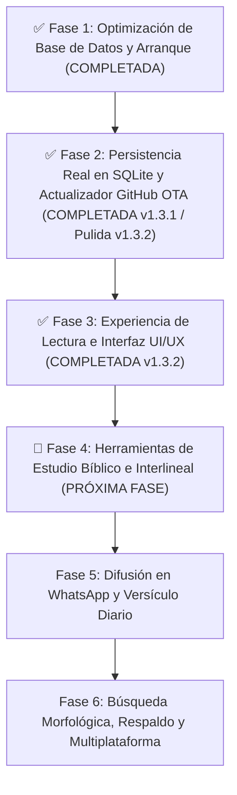
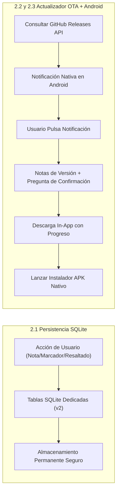
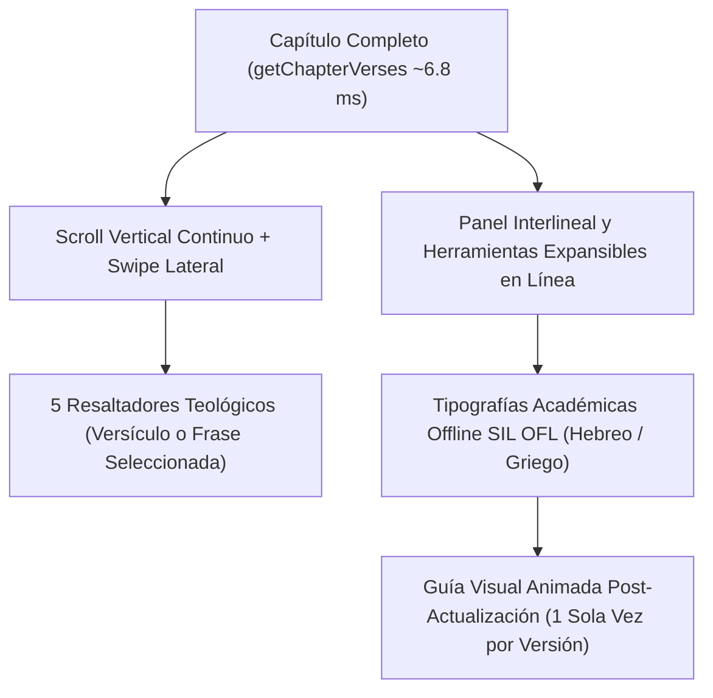
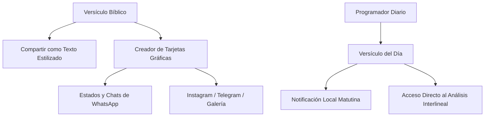

# 📋 Plan Estratégico de Mejoras e Integraciones: Logos K Logos

Este plan detalla la hoja de ruta técnica y funcional para consolidar **Logos K Logos** como una herramienta de referencia para el estudio bíblico interlineal (Hebreo BHS / Griego Tischendorf / RV1960).

---

## 🧭 Visión General de Fases y Prioridades

---

## ✅ Fase 1: Optimización de Base de Datos y Arranque (Completada)

- [x] Generación de base de datos SQLite preconstruida (`logos_k_logos.db` de 68.5 MB) con índices optimizados.
- [x] Copia directa de asset en primer arranque (arranque reducido de 10 minutos a pocos segundos).
- [x] Corrección de cachés de compilación en Windows (`kotlin.incremental=false`).
- [x] Corrección de bloqueo en Splash Screen con inicialización asíncrona y barra fluida.

---

## ✅ Fase 2: Persistencia Real de Datos Personales y Centro de Actualizaciones GitHub OTA (COMPLETADA y Pulida en v1.3.2)

> [!NOTE]
> Desplegada inicialmente en **v1.3.1** y perfeccionada en **v1.3.2**:
> 1. **Persistencia SQLite de Usuario**: Implementada en `logos_user_data.db` v2 (separada de la base bíblica de solo lectura), con tablas dedicadas (`user_bookmarks`, `user_highlights`, `user_verse_notes`, `user_strong_notes`, `user_history`, `user_settings`), soporte de transacciones ACID y migrador automático.
> 2. **Centro de Actualizaciones GitHub OTA + Centro de Notificaciones Android**: Integrado con detección nativa de arquitecturas (`arm64-v8a`, `armeabi-v7a`, `x86_64`, `universal`), notificación nativa en la barra de estado de Android (`POST_NOTIFICATIONS` + `NotificationCompat`), visualización de notas de versión, confirmación explícita de descarga, barra de progreso e instalación mediante `FileProvider`.
> 3. **Corrección de Contraste Visual WCAG AAA**: Solucionado el problema de contraste ilegible en avisos de actualización (`SnackBar` / botones) tanto en tema claro como en tema oscuro, y eliminada la opción de depuración *"Vista previa visual (Simulador de diseño)"*.

### 2.1. Migración de Persistencia a Tablas SQLite Dedicadas
- **Diagnóstico del problema**: Originalmente `StudyService` guardaba notas y marcadores serializados en cadenas JSON dentro de `SharedPreferences`, mecanismo volátil ante cierres forzados.
- **Solución técnica en SQLite (`logos_user_data.db` v2)**:
  - Tablas nativas permanentes con índices dedicados:
    - `user_bookmarks`: `(id, book_id, chapter, verse, preview, created_at)`
    - `user_highlights`: `(id, book_id, chapter, verse, color_key, preview, selected_text, updated_at)`
    - `user_verse_notes`: `(id, book_id, chapter, verse, note, updated_at)`
    - `user_strong_notes`: `(id, language, code, lemma, note, updated_at)`
    - `user_history`: `(id, book_id, chapter, verse, preview, visited_at)`
    - `user_settings`: `(key, value)`
  - Transacciones atómicas ACID y migración automática transparente entre versiones de esquema (`onUpgrade` v1 → v2).

---

### 2.2. Sistema de Actualización In-App desde GitHub Releases (OTA Updater)
- **Repositorio Oficial del Proyecto**: [https://github.com/NetOpsSolutions/Logos_K_Logos.git](https://github.com/NetOpsSolutions/Logos_K_Logos.git)
  - **Owner**: `NetOpsSolutions` | **Repo**: `Logos_K_Logos`
  - **API Endpoint de Releases**: `https://api.github.com/repos/NetOpsSolutions/Logos_K_Logos/releases/latest`
- **Flujo de Funcionamiento**:
  1. **Comprobación de Versión**: Consulta el endpoint de GitHub y compara semánticamente la versión instalada contra el último tag publicado, filtrando automáticamente el `.apk` compatible con el procesador del dispositivo (`arm64-v8a`, `armeabi-v7a`, `x86_64` o `universal`).
  2. **Notificación en el Centro de Notificaciones de Android** *(Nuevo en v1.3.2)*: Cuando existe una nueva actualización disponible, Android muestra una notificación expandible (`BigTextStyle`) en la bandeja del sistema con el número de versión y avance de novedades.
  3. **Apertura Directa, Notas y Confirmación de Descarga**: Al pulsar la notificación en Android, la app se abre directamente en la hoja modal de actualización mostrando las **notas completas de la versión**, el paquete detectado para la arquitectura del equipo y la **pregunta explícita de confirmación** (*«¿Deseas descargar e instalar la versión vX.Y.Z ahora?»*).
  4. **Descarga con Progreso e Instalación Nativa**: Al confirmar, cancela automáticamente la notificación de la bandeja, descarga el `.apk` con indicador de velocidad y porcentaje (`XX MB / XX MB`), y lanza `ACTION_INSTALL_PACKAGE` mediante `FileProvider` preservando el 100% de los datos del usuario.

---

### 2.3. Correcciones de Accesibilidad Visual y Limpieza de Interfaz OTA (Documentadas y Resueltas en v1.3.2)
- **Corrección de contraste ilegible en notificaciones de actualización**:
  - **Causa raíz detectada**: En Material 3 con **Modo Oscuro** activo, el `SnackBar` predeterminado renderizaba un fondo claro (`inverseSurface: #E6E1E5`) mientras los íconos y la acción *«VER NOVEDADES»* usaban `Colors.amberAccent` fijo (amarillo brillante sobre fondo casi blanco, resultando invisible). Adicionalmente, el botón *«Buscar actualizaciones»* en Ajustes se comprimía en 3 líneas cortadas en pantallas estrechas.
  - **Solución desplegada**: Se diseñó `AppSnackBar` y `SnackBarThemeData` adaptativos en `lib/core/theme.dart` con superficies oscuras/claras dedicadas, bordes definidos y acentos de contraste **WCAG AAA (> 9:1)** garantizados en ambos temas. Se reestructuró la tarjeta `_UpdaterCard` a ancho completo para evitar cortes de texto.
- **Eliminación del Simulador de Diseño**:
  - Se retiró por completo el bloque de depuración *«Vista previa visual (Simulador de diseño)»* en `SettingsScreen` para mantener una interfaz de producción limpia y profesional.

---

## ✅ 📖 Fase 3: Experiencia de Lectura e Interfaz (UI/UX) (COMPLETADA — v1.3.2)

> [!IMPORTANT]
> Desplegada en **v1.3.2** (`release_builds/v1.3.2/`, mantenida en entorno local de desarrollo sin publicar aún en GitHub hasta culminar el pulido integral de la fase).

### 1. Lectura por Capítulo Completo y Navegación Ágil
- **Consulta SQLite indexada de alto rendimiento**: Nuevo método `DatabaseService.getChapterVerses(bookId, chapter)` en 2 pasos sobre `idx_verses_book_ch_vs` e `idx_words_verse_pos` (carga los 176 versículos y 1,323 tokens de Salmos 119 en **~6.8 ms**).
- **Vista corrida con scroll vertical fluido**: Muestra todos los versículos del capítulo en lectura continua con selector instantáneo para alternar entre *Capítulo Completo* y *Versículo Individual*.
- **Interlineal y estudio expandible al toque**: Pulsar cualquier versículo ilumina suavemente el bloque y despliega en línea (`AnimatedSize`) su análisis interlineal palabra por palabra (RTL para Hebreo BHS, LTR para Griego Koiné), notas personales, marcadores y paleta de resaltado sin perder el contexto de lectura.
- **Gestos *Swipe* y Selector de Pasaje en 3 toques**: Deslizamiento horizontal (*swipe* izquierda/derecha) para avanzar o retroceder de capítulo (incluyendo transición automática entre libros consecutivos) y hoja modal rápida por pestañas (*1. Libro → 2. Capítulo → 3. Versículo*).

### 2. Tipografías Académicas Offline para Lenguas Originales (SIL Open Font License)
- Fuentes empaquetadas **100% offline** en `assets/fonts/` con soporte completo de vocalización tiberiana (*nikud*), cantilaciones hebreas y diacríticos griegos politónicos:
  - **Hebreo Bíblico (AT)**: *Ezra SIL* (`EzraSIL`) y *Frank Ruhl Libre* (`FrankRuhlLibre`).
  - **Griego Koiné (NT)**: *Cardo* (`Cardo` Regular/Bold) y *Gentium Plus* (`GentiumPlus` Regular/Bold).
- Selector tipográfico en vivo con vista previa inmediata y control deslizante de escala de lectura (`85%` a `145%`) accesible desde el lector (`Aa`) y desde *Ajustes*, aplicado transversalmente en Biblia, Diccionario Strong, Notas y Búsqueda Global.

### 3. Marcado y Resaltado Visual Teológico (Highlighters)
- **5 Categorías Teológicas con Paleta Adaptativa Claro/Oscuro**:
  1. 🟡 **Promesas** (Ámbar) — Pactos, bendiciones y fidelidad divina.
  2. 🟢 **Mandamientos** (Esmeralda) — Exhortaciones, obediencia y vida práctica.
  3. 🔵 **Atributos de Dios** (Azul) — Carácter divino, soberanía y doctrina.
  4. 🌸 **Advertencias** (Rosa) — Llamados al arrepentimiento, juicio y exhortación solemne.
  5. 🟣 **Profecía / Cristo** (Violeta) — Mesianismo, tipología y cumplimiento profético.
- **Doble modalidad de resaltado**:
  - **Versículo completo**: Un toque sobre la paleta del versículo expandido.
  - **Selección de palabras o frases**: Menú contextual personalizado (`_TheologicalSelectionToolbar`) al seleccionar cualquier fragmento de texto en el versículo.
- **Pestaña dedicada «Resaltados» en Mi Estudio**: Permite filtrar versículos resaltados por categoría teológica, saltar al pasaje en un toque o gestionar cada resaltado con persistencia permanente en SQLite (`user_highlights`).

### 4. Guía Visual Interactiva Post-Actualización (`InteractiveTourOverlay`)
- **Aparición única automática tras actualizar**: Al abrir la aplicación por primera vez en una versión nueva (ej. `v1.3.2`), `StudyService.shouldShowVersionTour` verifica la versión registrada en `logos_user_data.db` (`logos_last_seen_tour_version_v1`), despliega el recorrido interactivo animado **una única vez** y marca la versión como vista (`markVersionTourSeen`).
- **Recorrido animado paso a paso (*Spotlight* + puntero direccional + micro-demostraciones)**:
  1. **Biblia (Novedades v1.3.2)**: Despliega en vivo el versículo 1 con interlineal Hebreo/Griego, códigos Strong, paleta de 5 resaltadores teológicos y gestos *swipe* laterales.
  2. **Controles Superiores del Lector**: Alternancia *Capítulo Completo / Versículo Individual*, *Modo de Lectura Fluida* y selector tipográfico `TT` (*Ezra SIL*, *Cardo*, etc.).
  3. **Búsqueda Global**: Puntero animado y demostración tipo máquina de escribir con citas, palabras en español y códigos Strong (`G3056`).
  4. **Diccionario Strong**: Demostración animada para alternar entre Griego y Hebreo y consultar raíces o códigos (`H7225`, `λόγος`).
  5. **Mi Estudio**: Guía visual de *Marcadores*, *Resaltados Teológicos*, *Notas* e *Historial*.
  6. **Ajustes de Lectura y Apariencia**: Modo Claro / Modo Oscuro, Lectura por Capítulo Completo, Modo de Lectura Fluida y control deslizante de tamaño de letra.
  7. **Actualizaciones OTA**: Comprobación de versiones y notificaciones nativas en Android.
  8. **Repetición Manual Bajo Demanda**: Opción permanente **«Ver guía de uso»** ubicada en *Ajustes → Información de la aplicación*, justo debajo de *«Ver animación de bienvenida»*, para volver a iniciar la guía animada cuando el usuario lo desee.

---

## 🔍 Fase 4: Herramientas de Estudio Bíblico e Interlineal

### 1. Referencias Cruzadas (Cross-References)
- Integrar la base de datos de referencias cruzadas (*Treasury of Scripture Knowledge - TSK*).
- Al pie de cada versículo, mostrar las citas bíblicas correlacionadas con navegación en un toque sin perder la posición original.

### 2. Vista Paralela / Comparativa de Traducciones
- Permitir una vista dividida (*Split Screen* o toggle rápido) para contrastar:
  - Reina-Valera 1960
  - Traducción literal palabra por palabra
  - Texto hebreo/griego original
  - Posibilidad de incorporar versiones de dominio público adicionales (LBLA, KJV, Septuaginta LXX).

### 3. Pronunciación Fonética y Audio (TTS)
- Incorporar pronunciación aproximada o síntesis de voz (Text-to-Speech) para las raíces y palabras Strong en griego koiné y hebreo bíblico.
- Guía interactiva de transliteración fonética.

---

## 📲 Fase 5: Difusión en WhatsApp y Devocional Diario

### 1. Compartir por WhatsApp y Redes Sociales
- **Modo Texto Estilizado (WhatsApp / Portapapeles)**:
  - Formato estructurado con cita, versión, texto en español y opcionalmente el texto original en hebreo/griego.
- **Modo Creador de Tarjetas Visuales (Imágenes para Estados / Historias)**:
  - Generador visual integrado (`RepaintBoundary` exportado a PNG de alta resolución):
    - Selector de fondos: degradados sobrios, texturas de pergamino antiguo, amaneceres o fondos minimalistas oscuros.
    - Opciones tipográficas elegantes para la cita y el texto bíblico.
    - Botón directo de **«Compartir en WhatsApp»** (chat o Estado), **Instagram Stories** o guardar en galería.

### 2. Versículo del Día y Notificaciones Devocionales
- **Selección Curada de Pasajes**: Banco temático de versículos de bendición, consuelo y doctrina bíblica.
- **Notificaciones Locales Programadas**: Notificación matutina configurable (ej. 7:00 AM) que funciona **100% offline** o conectada sin consumir batería ni datos en segundo plano (`flutter_local_notifications`).
- **Banner Devocional en Inicio**: Tarjeta destacada al abrir la app con el pasaje del día y botón **«Estudiar interlineal»** para saltar directamente al análisis de sus palabras originales.

---

## 💾 Fase 6: Búsqueda Morfológica, Respaldo y Multiplataforma

### 1. Búsqueda Potenciada y Desglose Morfológico
- Búsqueda avanzada con filtros (por libro, testamento, rango, lema, código Strong exacto).
- Desglose legible de abreviaturas morfológicas (`V-AAI-3S` → *"Verbo Aoristo Activo Indicativo 3ª Sing"*).
- Gráficos de distribución de frecuencia por libro bíblico.

### 2. Respaldo y Multiplataforma
- Exportación e importación de notas, marcadores, resaltados y configuraciones en formato estándar `.json` o archivo `.backup`.
- Soporte para compilaciones en **Windows Desktop** y **Web PWA**.

### 3. Empaquetado y Distribución para iOS (iPhone / iPad)
- **Compatibilidad de Versiones de iOS y Modelos de iPhone**:
  - **Versión Mínima de Sistema Operativo**: **iOS 15.0 o superior** (`IPHONEOS_DEPLOYMENT_TARGET = 15.0`), compatible hasta **iOS 18+** y versiones futuras.
  - **Cobertura de Mercado**: Más del **98%** de los iPhones y iPads activos globalmente.
  - **Tabla de Dispositivos Soportados**:

| Generación | Modelos Compatibles | Versión Máxima Soportada |
|---|---|---|
| **iPhone 16 Series** (2024) | iPhone 16, 16 Plus, 16 Pro, 16 Pro Max | iOS 18+ |
| **iPhone 15 Series** (2023) | iPhone 15, 15 Plus, 15 Pro, 15 Pro Max | iOS 18+ |
| **iPhone 14 Series** (2022) | iPhone 14, 14 Plus, 14 Pro, 14 Pro Max | iOS 18+ |
| **iPhone 13 Series & SE 3** (2021-2022) | iPhone 13, 13 mini, 13 Pro, 13 Pro Max, iPhone SE (3ª gen) | iOS 18+ |
| **iPhone 12 Series** (2020) | iPhone 12, 12 mini, 12 Pro, 12 Pro Max | iOS 18+ |
| **iPhone 11 Series & SE 2** (2019-2020) | iPhone 11, 11 Pro, 11 Pro Max, iPhone SE (2ª gen) | iOS 18+ |
| **iPhone XR, XS & XS Max** (2018) | iPhone XR, iPhone XS, iPhone XS Max | iOS 18+ |
| **iPhone X & iPhone 8** (2017) | iPhone X, iPhone 8, iPhone 8 Plus | iOS 16.7.x (Soporte completo) |
| **iPhone 7 & 7 Plus** (2016) | iPhone 7, iPhone 7 Plus | iOS 15.8.x (Soporte completo) |
| **iPhone 6s & SE 1** (2015-2016) | iPhone 6s, iPhone 6s Plus, iPhone SE (1ª gen) | iOS 15.8.x (Soporte completo) |
| **Gama iPad** | Todos los iPad, iPad Air, iPad mini y iPad Pro compatibles con iPadOS 15.0+ | iPadOS 15 a 18+ |

- **Desafío técnico (Entorno de compilación)**:
  - iOS requiere **macOS** con **Xcode** y CocoaPods para compilar y generar archivos ejecutables `.ipa`. Dado que el desarrollo local se realiza en Windows, la compilación no se puede ejecutar directamente en local sin una Mac.
- **Solución: Pipeline Automatizado en la Nube (GitHub Actions CI/CD)**:
  - Configurar un workflow automatizado en el repositorio (`.github/workflows/build_releases.yml`) ejecutándose en runners de Apple (`macos-latest`).
  - Al crear una nueva versión (tag) en GitHub, el runner compila automáticamente:
    1. El instalador para Android (`app-release.apk`).
    2. El paquete para iOS (`Logos_K_Logos.ipa` / archivo Xcode Archive).
  - Ambos archivos se adjuntan automáticamente a la misma **GitHub Release**, quedando listos para descarga.
- **Mecanismos de Distribución para iPhone**:
  - **Distribución Externa / Sideloading (Sin App Store / Costo $0)**:
    - Publicar el `.ipa` en las releases de GitHub para usuarios con herramientas como *AltStore*, *Sideloadly*, *TrollStore* o *Scarlet*.
  - **Distribución Oficial (Apple Developer Program - $99/año)**:
    - Generación de certificados de distribución y perfiles de aprovisionamiento en GitHub Secrets para compilar con firma válida y subir a **TestFlight** (hasta 10,000 beta testers) o publicar en la **App Store**.
- **Adaptaciones requeridas en iOS**:
  - Configuración de `Info.plist` (permisos de red, guardado de imágenes en galería al compartir versículos, notificaciones locales).
  - Comportamiento del actualizador GitHub OTA en iPhone: Como iOS restringe la instalación directa de archivos `.ipa` desde dentro de una app, el actualizador en iOS detectará la nueva versión, mostrará el changelog en Markdown y proporcionará el enlace directo de actualización a la Release / TestFlight.

---

## 🗓️ Hoja de Ruta Actualizada (Milestones)

| Hito | Alcance | Estado / Prioridad |
|---|---|---|
| **M1: Persistencia SQLite de Usuario** | Mover notas, marcadores, resaltados e historial a tablas nativas SQLite permanentes | ✅ Completada (v1.3.1 / v1.3.2) |
| **M2: Actualizador GitHub OTA + Notificaciones Android** | GitHub Releases, notificación en bandeja Android, contraste WCAG AAA, confirmación de descarga e instalación APK | ✅ Completada (v1.3.1 / Pulida v1.3.2) |
| **M6: Modo Capítulo Continuo** | Lectura continua de capítulos bíblicos completos con scroll vertical, swipe lateral e interlineal en línea | ✅ Completada (v1.3.2) |
| **M7: Tipografías Académicas y Resaltadores** | Fuentes offline *Ezra SIL*, *Frank Ruhl Libre*, *Cardo* y *Gentium Plus* + 5 resaltadores teológicos | ✅ Completada (v1.3.2) |
| **M3: Depuración final de Assets** | Excluir JSONs duplicados del bundle para optimizar peso final del APK | ⭐⭐⭐ Alta |
| **M4: Difusión en WhatsApp y Redes** | Compartir texto estilizado y generador de imágenes de versículos para Estados | ⭐⭐⭐ Alta |
| **M5: Versículo del Día** | Notificación matutina, tarjeta devocional y salto al interlineal | ⭐⭐⭐ Alta |
| **M8: Referencias Cruzadas & Audio** | Dataset TSK de referencias cruzadas, vista paralela y pronunciación fonética | ⭐⭐ Media |
| **M9: Empaquetado y Pipeline iOS (iPhone)** | GitHub Actions con runner macOS para compilar y adjuntar `.ipa` en cada Release | ⭐⭐ Media |
