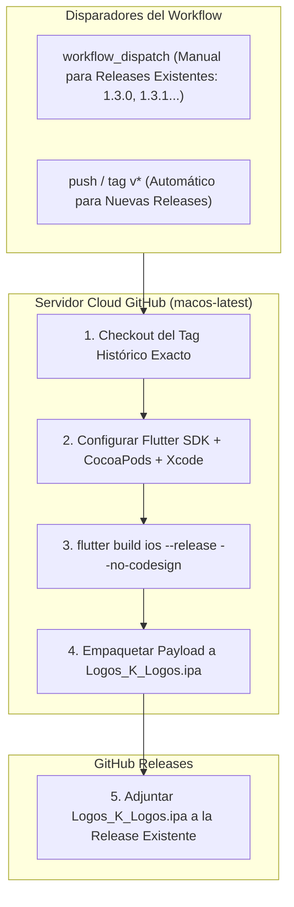
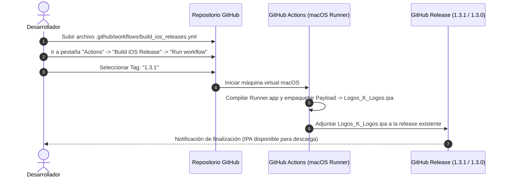

# 📱 Plan de Implementación: Empaquetado y Distribución para iPhone (iOS)
## Logos K Logos — Interlineal de Estudio Bíblico

Este documento establece la estrategia técnica, el procedimiento paso a paso y las consideraciones operativas para compilar, empaquetar y publicar **Logos K Logos** en formato `.ipa` para **iPhone y iPad**, cubriendo tanto las **releases existentes en GitHub** como todas las versiones futuras.

---

## 📌 1. Objetivo y Alcance

* **Repositorio oficial**: [https://github.com/NetOpsSolutions/Logos_K_Logos.git](https://github.com/NetOpsSolutions/Logos_K_Logos.git)
* **Objetivo principal**: Lograr que cada release de GitHub (`1.3.0`, `1.3.1`, `1.3.2`, etc.) disponga de su instalador para iPhone (`Logos_K_Logos.ipa`) adjunto junto a los archivos `.apk` de Android, sin necesidad de disponer de una computadora Mac física localmente.
* **Mecanismo técnico**: Automatización en la nube mediante **GitHub Actions** utilizando entornos oficiales de Apple (`macos-latest`).

---

## 🏗️ 2. Arquitectura de Compilación en la Nube (GitHub Actions CI/CD)

### 2.1. ¿Por qué se requiere un entorno macOS en la nube?
Apple restringe estrictamente la compilación de aplicaciones para iOS: únicamente el compilador de Apple (**Xcode** y sus SDKs asociados) puede transformar el código Dart/Flutter en binarios ARM64 nativos para iPhone. Dado que el entorno de desarrollo local funciona sobre Windows, **GitHub Actions resuelve este cuello de botella** ejecutando runners oficiales de Apple sin costo adicional de infraestructura.



---

## ⚙️ 3. El Archivo de Flujo en GitHub (`build_ios_releases.yml`)

El pipeline se ubicará en `.github/workflows/build_ios_releases.yml`. Contará con **doble modalidad de activación**:

1. **Modalidad Retroactiva (Manual)**: Permite elegir en un menú desplegable el tag de cualquier release ya existente (ej. `1.3.1` o `1.3.0`) para que el servidor Mac compile ese punto exacto del historial y le agregue el `.ipa`.
2. **Modalidad Automática**: Cada vez que se publique una nueva release o se cree un tag `v*`, compilará tanto Android como iOS en paralelo.

### Estructura técnica del proceso de empaquetado:
1. **Checkout específico**: `actions/checkout@v4` con `ref: ${{ github.event.inputs.release_tag }}`.
2. **Entorno**: macOS 14/15 con Xcode 15/16 y Flutter 3.47+.
3. **Compilación de dependencias nativas**: Ejecución de `pod install --repo-update` en `ios/`.
4. **Build del Runner**: `flutter build ios --release --no-codesign`.
5. **Generación del `.ipa` universal**:
   ```bash
   mkdir -p build/ios/iphoneos/Payload
   cp -r build/ios/iphoneos/Runner.app build/ios/iphoneos/Payload/
   cd build/ios/iphoneos
   zip -r -9 Logos_K_Logos_${TAG}.ipa Payload
   ```
6. **Inyección en la Release de GitHub**: Utilizando la acción oficial `softprops/action-gh-release` con el token automático `GITHUB_TOKEN`, se sube el `.ipa` a la release existente sin alterar ni eliminar los `.apk` que ya están publicados.

---

## 📲 4. Opciones de Distribución e Instalación en iPhone

Debido a que Apple no opera con un sistema de instalación abierta de APKs como Android, existen dos modalidades oficiales y reconocidas para que los usuarios instalen el `.ipa`:

### Modalidad A: Sideloading Gratuito ($0 — Recomendado para distribución GitHub)
* **Público objetivo**: Usuarios de iPhone que descargan la app directamente desde el repositorio de GitHub sin pasar por la App Store.
* **Herramientas de instalación soportadas**:
  * **AltStore** (Gratuito, recomendado): Permite instalar y sincronizar el `.ipa` en el iPhone vía Wi-Fi utilizando un Apple ID gratuito.
  * **Sideloadly** (Windows/Mac): Herramienta de escritorio con interfaz gráfica que permite conectar el iPhone por USB e instalar el archivo `.ipa` en 2 minutos.
  * **TrollStore** / **Scarlet** / **Esign**: Instaladores directos sobre el dispositivo.
* **Requisitos para el usuario**:
  * Solo requiere su propia cuenta gratuita de iCloud/Apple ID para firmar su copia personal en su dispositivo.

### Modalidad B: Distribución Oficial de Apple ($99 USD / año)
* **Público objetivo**: Distribución abierta masiva sin que los usuarios utilicen herramientas auxiliares.
* **Servicios de Apple**:
  * **Apple TestFlight**: Permite distribuir la aplicación mediante un simple enlace a hasta 10.000 usuarios beta con actualizaciones automáticas en segundo plano.
  * **Apple App Store**: Publicación global en la tienda oficial.
* **Configuración técnica**: Requiere configurar en los *GitHub Secrets* del repositorio el certificado de distribución (`BUILD_CERTIFICATE_BASE64`) y el perfil de aprovisionamiento (`PROVISION_PROFILE_BASE64`).

---

## 🔄 5. Comportamiento del Sistema de Actualizaciones en iPhone

El sistema de actualización que diseñamos en la **Fase 2** interactuará en iOS bajo las siguientes condiciones técnicas:

1. **Detección In-App Idéntica**:
   * Al abrir la app en el iPhone, el servicio `UpdateService` consultará `https://api.github.com/repos/NetOpsSolutions/Logos_K_Logos/releases/latest`.
   * Comparará la versión instalada contra el último tag publicado en GitHub.
2. **Visualización de Novedades**:
   * Mostrará la misma ventana modal elegante con las **Notas de la versión** formateadas en Markdown.
3. **Instalación de la Actualización**:
   * **Diferencia con Android**: iOS no permite por seguridad que una app ejecute un instalador sobre sí misma en segundo plano.
   * **Solución adaptada**: El botón de actualización en iPhone detecta que está en iOS y ofrece:
     * Si el usuario usa **AltStore / Sideloading**: Botón *«Descargar nueva versión (.ipa)»* para abrir la release y actualizar su instalación conservando notas y marcadores.
     * Si la app está enlazada a **TestFlight**: Botón *«Actualizar en TestFlight»* que abre la aplicación oficial de Apple con un solo toque.

---

## 📱 6. Matriz de Compatibilidad de Modelos de iPhone y Versiones de iOS

El proyecto está configurado con **`IPHONEOS_DEPLOYMENT_TARGET = 15.0`**, garantizando cobertura para más del **98% de los iPhones y iPads activos en el mundo**:

| Generación | Modelos de iPhone Soportados | Versión Máxima de iOS |
|---|---|---|
| **iPhone 16 Series** (2024) | iPhone 16, 16 Plus, 16 Pro, 16 Pro Max | iOS 18+ (Actual) |
| **iPhone 15 Series** (2023) | iPhone 15, 15 Plus, 15 Pro, 15 Pro Max | iOS 18+ |
| **iPhone 14 Series** (2022) | iPhone 14, 14 Plus, 14 Pro, 14 Pro Max | iOS 18+ |
| **iPhone 13 Series & SE 3** (2021-2022) | iPhone 13, 13 mini, 13 Pro, 13 Pro Max, iPhone SE (3ª gen) | iOS 18+ |
| **iPhone 12 Series** (2020) | iPhone 12, 12 mini, 12 Pro, 12 Pro Max | iOS 18+ |
| **iPhone 11 Series & SE 2** (2019-2020) | iPhone 11, 11 Pro, 11 Pro Max, iPhone SE (2ª gen) | iOS 18+ |
| **iPhone XR, XS & XS Max** (2018) | iPhone XR, iPhone XS, iPhone XS Max | iOS 18+ |
| **iPhone X & iPhone 8** (2017) | iPhone X, iPhone 8, iPhone 8 Plus | iOS 16.7.x (Soporte completo) |
| **iPhone 7 & 7 Plus** (2016) | iPhone 7, iPhone 7 Plus | iOS 15.8.x (Soporte completo) |
| **iPhone 6s & SE 1** (2015-2016) | iPhone 6s, iPhone 6s Plus, iPhone SE (1ª gen) | iOS 15.8.x (Soporte completo) |
| **Gama iPad** | Todos los iPad, iPad Air, iPad mini y iPad Pro con **iPadOS 15.0 o superior** | iPadOS 15 a 18+ |

---

## 🔍 7. Análisis de las Releases Existentes para su Empaquetado

Al ejecutar el pipeline sobre las releases ya publicadas en tu cuenta de GitHub, se deben tener en cuenta las siguientes características de cada una:

### Release `1.3.0`
* **Contenido histórico**: Primera versión publicada en GitHub. No contaba aún con la base de datos preconstruida SQLite ni con los resaltadores teológicos ni la lectura continua por capítulo.
* **Resultado del empaquetado**: Se generará `Logos_K_Logos_1.3.0.ipa`. Funcionará con la interfaz y lógica original de la versión 1.3.0.

### Release `1.3.1`
* **Contenido histórico**: Incorporó la base de datos preconstruida de inicio rápido (arranque en segundos), la persistencia nativa en SQLite y el actualizador OTA con soporte de notificaciones.
* **Resultado del empaquetado**: Se generará `Logos_K_Logos_1.3.1.ipa`. Excelente estabilidad y persistencia asegurada.

### Próxima Release `v1.3.2` (Estado Actual del Código)
* **Contenido completo**: Lectura continua de capítulos completos con scroll vertical, gestos swipe, tipografías académicas offline (*Ezra SIL*, *Cardo*, *Gentium Plus*), 5 resaltadores teológicos y corrección de contraste en notificaciones.
* **Resultado del empaquetado**: Será la versión definitiva y más completa para los usuarios de iPhone.

---

## 📋 8. Procedimiento Paso a Paso para su Puesta en Marcha



1. **Creación del workflow**: Crear el archivo `.github/workflows/build_ios_releases.yml` en el repositorio.
2. **Subida al repositorio**: Ejecutar `git push` hacia la rama principal de GitHub.
3. **Ejecución retroactiva**:
   * Ingresar a GitHub en el navegador: [https://github.com/NetOpsSolutions/Logos_K_Logos/actions](https://github.com/NetOpsSolutions/Logos_K_Logos/actions).
   * Seleccionar el flujo **«Build iOS Release»** en el panel izquierdo.
   * Hacer clic en el botón desplegable **«Run workflow»**.
   * Introducir el tag deseado (ej. `1.3.1`).
   * Pulsar el botón verde **«Run workflow»**.
4. **Verificación**: En aproximadamente 6 a 8 minutos, el runner de Apple terminará la compilación y el archivo `Logos_K_Logos_1.3.1.ipa` aparecerá automáticamente en la lista de descargas de la release `1.3.1`.
5. **Repetición**: El mismo procedimiento se puede repetir para el tag `1.3.0` o cualquier otro tag disponible.
